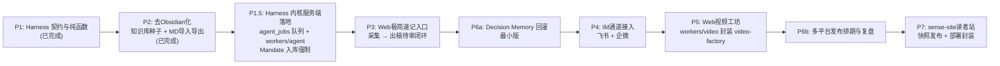

# 星火工厂（Signal to Story）V2.0 实施总计划（P1 ～ P7）与验证机制

> **更新日期**：2026-11-15  
> **状态**：已确认方向，按 P1 ～ P7（含 P1.5、P6a/P6b）阶段推进（每阶段完成必须通过自动化自测门禁后进入下一阶段）  
> **修订说明（2026-11-15）**：阶段编号以本文件为唯一准；新增 P1.5「Harness 内核服务端落地」；路线顺序调整为 P1 → P2 → P1.5 → P3 → P6a → P4 → P5 → P6b → P7；目录改为 `sense-console/workers/`；模型 ID 不再硬编码；CLI 驱动先只接通 Codex；验证门禁补第五道（数据库迁移 + RLS 测试）。P1、P2 已完成的是契约与纯函数，服务端落地见 P1.5。

---

## 一、 已敲定的四大核心架构前提

1. **双模 Agent 驱动中间层（Sense Agent Harness + Unified Runtime）**：
   - **通道 1（云端直连 API）**：统一 OpenAI 兼容协议直连国内主流模型厂家（通义千问 Qwen、月之暗面 Kimi、DeepSeek、智谱 GLM、MiniMax / 豆包 等）及海外模型。具体模型 ID 以控制台「模型配置」为准，本文出现的模型名仅为示例。
   - **通道 2（本地/容器 Agent CLI 桥接）**：通过统一的子进程协议调用 CLI。**当前只接通 Codex CLI（`codex`）一个**；Pi、OpenCode、Antigravity（`agy`）保留在驱动注册表中，标注「未验证」，实测通过后再启用。
   - **说明**：模型 ID 和各 CLI 的无交互参数必须以厂商文档 / `--help` 实测为准，不在代码或文档中凭记忆硬编码。
2. **去 Obsidian 化 + 项目内建知识库（Knowledge Base）**：
   - 彻底解耦 Obsidian 桌面端，云端数据库为唯一权威状态源。
   - 支持 **Markdown 标准导入/导出**。仓库根目录 `knowledge-base/` 定位为**默认种子**（导入到 `knowledge_entries` 表），运行时唯一权威是 Postgres；用于沉淀领域背景、写作 SOP、品牌语料，决定记忆（Decision Memory）存于 `decision_memories` 表。
3. **方向 B 多入口策略：先做「Web 极简速记入口」，再按难易度接入 1～2 个最简 IM 通道**。
4. **严格自测与自动化验证门禁**：每个阶段交付时，必须自带单元测试/集成测试并通过 `typecheck + lint + test + build` 四道门禁，涉及数据库时再加第五道「迁移 + RLS 测试」，并附一条行为级端到端验收（见第四节）。
5. **SaaS 范围收敛**：当前只保留 `organization_id` + RLS 隔离；计费、租户自助入驻推后到单条真实链路跑通之后。
6. **Mandate 门禁由数据库强制**：发布、高额视频生成、权限变更等放行规则下沉到数据库（触发器 / RPC），浏览器端检查只是 UX，不算门禁。

---

## 二、 IM 与外部采集通道「接入难易度」排序（由易到难）

为了让你用最小配置成本跑通手机/桌面随手发内容，我们将主流入口按**“无须繁琐企业资质备案、开发调试最快、支持双向回执/卡片”**从易到难排序如下：

| 排名 | 入口通道 | 接入难度 | 核心优势与适用场景 | 前置条件与限制 | 推荐策略 |
| :---: | :--- | :---: | :--- | :--- | :--- |
| **TOP 0** | **Web 极简速记框（Quick Capture Bar + 手机 PWA 快捷页）** | ⭐ 极易（0 外部依赖） | 打开网页或命令面板（`Cmd+K`）粘贴链接/一句话即刻入库并可勾选“立即自动出稿”；手机浏览器添加到主屏幕即可当 App 用 | 仅需登录现有控制台账号 | **【P3 必做首发】** 零第三方审核，100% 稳定兜底 |
| **TOP 1** | **飞书自建应用机器人（Feishu Bot - 长连接/Webhook 模式）** | ⭐⭐ 最容易（国内首选） | **个人免费创建企业即可开自建应用**；支持 WebSocket 长连接（甚至无需公网固定 IP 备案即可收消息）、原生支持**交互式审批卡片**（在飞书直接点「通过并发布」） | 飞书开放平台后台点选权限（约 10 分钟配置） | **【P4 首推第 1 个 IM】** 交互卡片能力最强、开发最顺畅 |
| **TOP 2** | **Telegram Bot / Discord Bot** | ⭐⭐ 极易（海外/极客首选） | `@BotFather` 1 分钟拿到 Token，天然支持 Inline Keyboard 审批按钮、链接预览与语音/文件直接转发 | 需网络环境支持 | **【P4 备选】** 若日常用 TG/Discord，半小时即可接通 |
| **TOP 3** | **企业微信智能机器人 / 自建应用（WeCom）** | ⭐⭐⭐ 中等 | 可在「个人微信 → 企业微信通知」或企微 App 中直接使用；官方提供 `aibot-node-sdk` 与回调接口 | 自建应用接收外部消息需配置可信域名/IP 白名单 | **【P4 首推第 2 个 IM】** 适合习惯微信生态的日常使用 |
| **TOP 4** | **iOS 快捷指令（Shortcuts） / 浏览器一键书签（Bookmarklet）** | ⭐⭐ 容易（单向极速） | 在手机微信/小红书/浏览器点「系统分享 → 发送到星火工厂」，直调 `intake-gateway` Bearer API 并弹窗显示回执 | 仅单向提交 + 弹窗回执，审批需跳网页或飞书 | **【P3 顺带交付】** 复用现有 `intake-gateway`，10 行配置搞定 |
| **TOP 5** | **个人微信 / 微信公众号客服消息** | ⭐⭐⭐⭐⭐ 难（限制多） | 公众号需认证服务号才有完整客服接口且有 48h 交互限制；个人微信号非官方 Hook 极易封号 | 资质与合规门槛高 | **【暂不直接做】** 建议通过「企微微信插件」或「iOS 快捷指令」平替 |

> **结论建议**：**P3** 先上线「Web 极简速记入口 + iOS 快捷指令/浏览器书签配置生成器」；**P4** 优先接入 **飞书机器人（TOP 1）** 和 **企业微信机器人（TOP 3）** 两个 IM 通道（Telegram/Discord 为 TOP 2 备选，按日常使用习惯决定是否替代企微）。

---

## 三、 P1 ～ P7 总体升级与施工计划

整个 V2.0 拆解为若干独立可验证的阶段，每个阶段聚焦一个清晰闭环。**执行顺序**：P1 → P2 → P1.5 → P3 → P6a → P4 → P5 → P6b → P7。编号只表示阶段身份，不表示顺序；P1、P2 已完成的是契约与纯函数，服务端落地由 P1.5 承担。



---

### 🔹 P1：Agent Harness 自循环内核 + 「国内大模型 API & 本地 CLI」双模中间层（方向 A 基座）
- **核心目标**：建立统一的 Agent 编排与模型调用底座，支持直连国内模型厂家 API（Qwen / Kimi / DeepSeek / GLM）和调用本地 Agent CLI（Pi / OpenCode / Codex / agy），并实现「指令数据分离 + 生成↔只读评估自循环」。
- **具体交付内容**：
  1. **契约与配置层（`src/contracts/agent-harness.ts`）**：定义统一的模型提供商枚举（`qwen`、`kimi`、`deepseek`、`zhipu`、`openai-compatible`）与本地 CLI 驱动枚举（`pi-cli`、`opencode-cli`、`codex-cli`、`agy-cli`）。
  2. **Harness 核心引擎（`src/services/agent-harness-service.ts`）**：
     - **Context Pack 安全组装器**：强制将外部信源正文包裹在 `<untrusted_source_data>` 沙箱标签内，注入租户 `DecisionMemory`（决定记忆）与知识库规则，防止提示词注入。
     - **Generator ↔ Evaluator 循环控制器**：支持配置 `maxEvaluationRounds`（默认 3 轮），由只读 Evaluator 按事实/风格/禁忌清单打分，通过后才流转为 `pending_review`。
     - **Mandate 人工门禁检查器**：明确区分 AI 可自动推进的操作与必须人工签名的操作（发布、高额视频生成、权限变更）。
  3. **服务端与本地 CLI 适配桥接器**：升级 `content-draft` 与本地 CLI 调用规格，支持在控制台「系统设置」可视化配置/切换国内 API 与本地 CLI 通道。
  4. **范围说明**：本阶段交付的是契约与纯函数（可单元测试的逻辑），不含服务端队列与常驻进程；服务端落地见 P1.5。CLI 驱动先只验证 Codex，prompt 走 stdin 而非 argv；其余 CLI 仅在注册表中标注「未验证」。
- **自测验收标准**：编写 `agent-harness.test.ts`，覆盖指令数据隔离防注入、3 轮评估熔断、国内模型路由构造、CLI 调用规格生成与 Mandate 门禁拦截测试。
- **状态**：已完成（契约与纯函数）。

---

### 🔹 P2：去 Obsidian 化 + 项目内建知识库（`knowledge-base/`）与 Markdown 导入导出
- **核心目标**：彻底剥离 Obsidian 本地耦合，建立云端与项目目录双支持的受控知识库，支持 Markdown 标准导入导出。
- **具体交付内容**：
  1. **默认种子目录（`knowledge-base/`）**：仓库根目录 `knowledge-base/` 作为默认种子（含 `brand-voice/` 品牌调性、`sops/` 创作规范，后续可增 `domain-facts/`），导入到 `knowledge_entries` 表后才参与运行；运行时唯一权威是 Postgres，目录内文件不被运行时直接读取。
  2. **知识库管理与 Markdown 导入导出服务（`src/services/knowledge-base-service.ts`）**：
     - 支持将任意 `.md` 文件解析 Frontmatter 与正文后直接导入为平台「信源 / 知识条目 / 稿件草稿」；
     - 支持将平台稿件、选题 Brief 与复盘记录导出为标准无损 Markdown 包；
     - 将知识库条目自动关联到 P1 的 Context Pack 中，供 Agent 创作与审查时按需检索引用。
- **自测验收标准**：编写 `knowledge-base.test.ts`，验证 Markdown 导入解析、XSS/恶意脚本清洗、知识条目向 Context Pack 注入及导出一致性。
- **状态**：已完成（解析与导入导出纯函数）；`knowledge_entries` 表与种子导入随 P1.5 落地。

---

### 🔹 P1.5：Harness 内核服务端落地（P2 之后、P3 之前）
- **核心目标**：把 P1/P2 的契约与纯函数变成可在服务端可靠运行的内核，使生成↔评估多轮循环不再受 Edge Function 单请求时限约束。
- **具体交付内容**：
  1. **任务表队列**：`agent_jobs` + `agent_job_steps`，以 `FOR UPDATE SKIP LOCKED` 的认领 RPC 实现（不使用 pgmq）；含幂等键、最大尝试次数、超时、取消与成本字段。
  2. **独立 Node worker**：位置 `sense-console/workers/agent/`，独立依赖、进程与部署。同一个 worker 部署在云端容器即 Agent Runtime，跑在个人电脑上即本地算力节点（原 `sense-node-agent`），二者是同一程序的两种部署；本地节点通过 outbound 反向认领任务，无需公网 IP。
  3. **新表与 RLS**：`decision_memories`、`knowledge_entries`（带 `trust_level`，未审核的导入知识不进入 system prompt）、`approval_requests` 的 migration + RLS，均绑定 `organization_id`。
  4. **Mandate 门禁下沉到数据库**：发布、高额视频生成、权限变更等由触发器 / RPC 强制校验 `approval_requests`；浏览器端检查只是 UX。
  5. **评估器两层**：确定性预检（长度、引用、禁忌词、结构）+ 独立模型的 LLM 评估器（输出结构化 JSON 清单）；硬上限 `MAX_ROUNDS = 3`。
  6. **`content-draft` Edge Function 改为入队**：函数只负责校验与写入 `agent_jobs`，循环在 worker 中执行。
  7. **数据库测试**：用进程内 PGlite 跑全量迁移 + RLS 测试。
  8. **本地桥说明**：Vite dev server 中的 `/__sense_bridge` 仅为开发期配置与连通性自测工具，带 loopback / Origin / Token 校验，生产不存在；正式的本地算力路径是 worker 反向认领。
  9. **CLI 与密钥**：先只接通 Codex；个人订阅的 CLI 只适用于 BYO-Node（自带节点）模式，不用于给多租户托管服务供能；prompt 走 stdin 不走 argv；「受限沙箱」只有在容器内才成立。provider 密钥统一为组织级 provider 配置（服务端加密存储）。
- **自测验收标准**：PGlite 迁移 + RLS 测试（跨组织隔离、Mandate 绕过尝试被拒、SKIP LOCKED 并发认领不重复）；worker 单元测试；**行为级验收**：入队一个 content-draft 任务 → worker 认领 → 完成 ≤3 轮生成与评估 → 写入带评估记录与成本的 `pending_review` 提案。

---

### 🔹 P3：Web 极简速记入口（Quick Capture）+ 一键「采集 ➔ 自动出稿待审」闭环（方向 B 第一步）
- **核心目标**：不用填写繁琐表单，在网页任意位置（顶部速记栏 / 快捷键 / 独立极简收集页）输入一条链接或一句话想法，即可选择「仅收藏进选题库」或「立即自动立项并生成母稿+平台稿到待审核」。
- **具体交付内容**：
  1. **全局极简速记组件（`QuickCaptureModal` / 顶栏极简输入框）**：支持粘贴 URL + 一句话角度 + 意图切换（`capture_only` 仅收录 vs `auto_draft` 自动出稿到待审）。
  2. **自动流水线编排**：当意图为 `auto_draft` 时，原子化完成「保存信源 → 创建选题 → 立项 Content Project → 调用 P1 Harness 生成母稿与指定平台稿 → 进入审核中心待审」。
  3. **以“待我处理”为中心的任务与审核提醒**：在工作台与任务中心优先高亮「等我审核的草案 / 等我拍板的选题 / 失败阻塞项」。
- **自测验收标准**：单元测试 + 组件测试验证极简输入解析、意图分流、防重复提交与状态流转。
- **行为级验收**：一条真实链接进入 → 原子建立信源/选题/项目并入队 → worker 产出带评估记录与成本的 `pending_review` 提案。

---

### 🔹 P4：最简 IM 通道接入（飞书机器人 TOP 1 + 企业微信机器人 TOP 3）（方向 B 第二步）
- **核心目标**：打通飞书自建机器人与企业微信机器人，实现手机随手转发链接/文字入库，并在 IM 内收到「待审核交互卡片」。
- **具体交付内容**：
  1. **多渠道 Webhook 统一适配器（`adapters/im/` & `intake-gateway` 扩展）**：
     - **飞书适配器（Feishu Adapter）**：支持飞书事件订阅验签、文本/富文本链接提取、以及飞书交互式消息卡片（含「查看预览」「通过暂存」「退回重改」按钮回传）。
     - **企业微信适配器（WeCom Adapter）**：支持企微智能机器人 Webhook 消息接收与 Markdown 审核通知卡片推送。
  2. **控制台「外部接入」页面升级**：内置飞书、企微、iOS 快捷指令的一键配置向导与连通性自检按钮。
- **自测验收标准**：编写 `im-adapters.test.ts`，用真实飞书/企微 Payload 样本测试签名校验、消息解析、幂等防重与卡片构建。
- **行为级验收**：在飞书发送一条链接 → 收到回执 → 稍后收到待审卡片 → 点击「退回」带理由后状态与 Decision Memory 候选正确落库。

---

### 🔹 P5：Web 视频工坊（Video Studio）实装落地（方向 C 核心模块）
- **核心目标**：将 `sense-console` 中的视频模块从演示页升级为真正可交互的 **Web 分镜工作台**，并与 `video-factory` 执行引擎打通。
- **具体交付内容**：
  1. **视频分镜数据契约与状态服务（`src/contracts/video-studio.ts` & `src/services/video-studio-service.ts`）**：标准化 `VideoPlan` 与 `VideoShot`（景别、运镜方式：`local_ken_burns` vs 云端视频生成模型（如万相，具体型号以控制台配置为准）、旁白台词、精确毫秒时长、SFX 音效描述、关键帧与视频资产 URI、单镜渲染状态）。
  2. **可视化分镜画布升级（`storyboards-page.tsx` & 分镜卡片组件）**：
     - **大纲智能拆解**：输入故事/解说大纲，调用国内大模型（如 Qwen / Kimi，以控制台配置为准）一键生成结构化分镜卡片流；
     - **单镜精细控制**：在线修改旁白台词、切换配音角色音色、试听单句 TTS、一键触发「云端视频模型单镜重抽」或「本地运镜毫秒级合成」；
     - **多轨时间线与成片预览**：展示旁白轨 + SFX 拟音轨 + BGM Ducking 混音状态，内嵌播放器预览成片并展示单次成本账本。
  3. **`sense-console/workers/video/`（Python）**：封装现有 `sense-console/video-factory/`，通过 `agent_jobs` 同一任务队列消费 Web 下发的单镜重抽与全片合成指令，产物上传对象存储并回写成本；高额生成受 Mandate 数据库门禁约束。
- **自测验收标准**：编写 `video-studio.test.ts`，验证大模型分镜 JSON Schema 校验、Audio-First 时长对齐计算、单镜头状态机局部更新与成本估算。
- **行为级验收**：一份大纲 → 分镜卡片 → 单镜试听与重抽 → 全片合成 → 资产库出现带成本账本的成片。

---

### 🔹 P6a：「决定记忆（Decision Memory）」回灌最小版（从原 P6 拆出，P3 之后提前）
- **核心目标**：尽早形成「退回理由 / 复盘结论 → 下一轮出稿自动遵守」的最小回路，避免早期人工纠正白白丢失。
- **具体交付内容**：审核中心「退回」填写理由、或复盘页填写「下次改进变量」时，可一键勾选「记入长期创作偏好」，写入 `decision_memories`；Context Pack 组装时按租户检索并注入（带条数与长度上限）。
- **自测验收标准**：记忆写入 RLS 隔离测试；注入上限与排序测试。**行为级验收**：退回一份稿件并记入偏好 → 下一份同类稿件的 Context Pack 含该偏好，评估清单据此检查。

---

### 🔹 P6b：图文+视频统一多平台发布排期与复盘
- **核心目标**：让图文稿件与 P5 产出的视频成片共用同一套多平台发布与复盘闭环。
- **具体交付内容**：视频资产一键转发布计划，可关联视频号、抖音、小红书、B站、YouTube、X，附自动生成的平台标题、话题标签与封面图；发布动作受 Mandate 数据库门禁约束，仍由人类批准具体版本和账号。
- **自测验收标准**：图文/视频混合发布排期校验、版本变更自动失效旧排期。**行为级验收**：审核通过的成片 → 生成各平台发布计划 → 人工批准 → 人工发布记录与指标快照回写。

---

### 🔹 P7：独立读者内容站 `sense-site` 建设与部署封装（方向 D = 独立读者站 `sense-site`）
- **核心目标**：落地独立 `sense-site`（获批的同级读者站工程，详见 [sense-site 建设计划](sense-site-plan.md)）面向外部读者展示已批准内容，并完成服务端部署封装。当前不做多租户自助入驻与计费。
- **具体交付内容**：
  1. **`sense-site` 独立前端与快照发布事务**：实现后台一键将已审核图文/视频发布到 `site_entries` 快照表，读者站支持公开阅读、注册读者阅读、专题浏览与资源鉴权下载。
  2. **部署封装**：服务端一键部署脚本（Web + worker 容器化）；provider 密钥沿用组织级 provider 配置（服务端加密存储）。计费与租户自助入驻推后到单条真实链路跑通之后再评估。
- **自测验收标准**：跨工程独立 `typecheck / lint / test / build` + 匿名/注册读者权限隔离测试（数据库 RLS 测试）。
- **行为级验收**：人工批准版本 → 站点发布快照 → 无痕游客可读 → 下线后不可读。

---

## 四、 自动化验证与自测机制（Verification Harness）

为确保**「做完自己测试，通过后才往下推进」**，采用**五道门禁**，每个阶段结束前必须执行并输出绿灯报告：

```bash
# Gate 1: TypeScript 严格类型检查
npm --prefix sense-console run typecheck

# Gate 2: ESLint 静态规范与安全边界检查
npm --prefix sense-console run lint

# Gate 3: Vitest 全量单元与集成测试（每个阶段必须新增对应 .test.ts）
npm --prefix sense-console run test

# Gate 4: 生产包编译构建验证
npm --prefix sense-console run build
```

**Gate 5：数据库迁移 + RLS 测试（涉及数据库时必做）**：使用进程内 PGlite 跑全量 `sense-console/supabase/migrations/*.sql`，并执行 RLS 测试（跨组织隔离、角色能力、Mandate 绕过尝试被拒、并发认领）。测试脚本随阶段提交，同时保留 `sense-console/supabase/tests/*.sql` 事务回滚验收脚本。

**行为级端到端验收**：每个阶段除自动化门禁外，必须有一条可演示的真实行为链路（各阶段「行为级验收」条目），例如 P3：一条真实链接进入 → 产出带评估记录与成本的 `pending_review` 提案。门禁全绿但行为链路不通，不算阶段完成。

此外：
- 涉及页面交互变更时，同步验证路由渲染与组件可访问性；
- 新增 worker 工程（`workers/agent/`、`workers/video/`）须有各自的类型检查与测试命令，并纳入同一交付报告。
