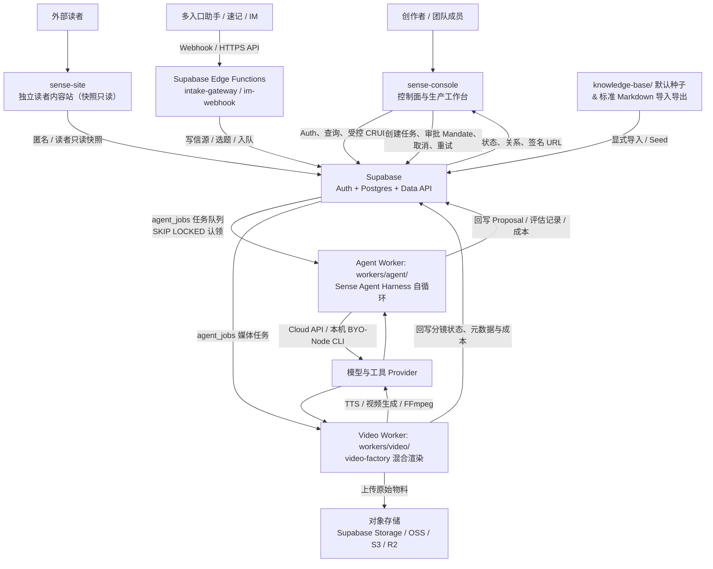

# Signal to Story 总体系统架构 SPEC

> **决策摘要（V2.0 对齐版）**
> `sense-console` 是内容生产系统的**控制面和资产关系可视化中心**；`sense-site` 是独立的**读者内容消费站**；Supabase 管理身份、运行状态、任务队列、决定记忆、知识库与审计；独立后台 Worker（`workers/agent/` 与 `workers/video/`）构成异步执行面；图片、音频、视频等原始二进制物料保存在独立对象存储中。系统以云端 Postgres 为唯一运行时权威源，支持标准 Markdown 导入导出。

相关文档：[内容创作与 AI-CMS 指导 SPEC](内容创作与AI-CMS指导-SPEC.md) · [内容站 SPEC](sense-site-SPEC.md) · [产品需求文档 PRD](../design/AI内容生产系统-PRD-v1.md) · [V2 统一架构规划](../plan/v2-unified-architecture-plan.md) · [V2.0 实施总计划](../plan/v2-master-execution-plan.md)

---

## 1. 目的与适用范围

本 SPEC 是 `signal-to-story` 的上位系统架构约束，用于统一以下问题：

- `sense-console` 与 `sense-site` 分别负责什么，不负责什么。
- 普通页面能否直接访问 Supabase。
- Supabase、对象存储、`knowledge-base/` 默认种子分别保存什么。
- Sense Agent Harness 与 Worker（Agent Worker / Video Worker）如何分工。
- 任务、内容、Mandate 门禁和媒体资产如何形成可追溯关系。
- 当前已交付基线与后续演进边界。

数据库表和字段明细由 `sense-console/docs/supabase-data-model.md`、`sense-console/docs/cloud-content-api.md` 与 `sense-console/docs/agent-harness.md` 维护，并通过 `sense-console/supabase/migrations/` 落地。

---

## 2. 系统定位

Signal to Story 是一个面向个人与小团队内容生产、AI 协作的 **Content Ops 控制系统**，不是单纯的内容后台，也不是把所有模型和工具塞进一个进程的“超级 Agent”。

系统目标：

1. **可见**：随时看到信源、选题、项目、任务、审核、资产和发布状态。
2. **可控**：能够创建、暂停、取消、重试后台任务，并通过数据库强制 Mandate 门禁控制高风险动作。
3. **可追溯**：任何结论、内容、提案和成片都能追溯到来源、版本、任务、模型、成本和人工决策。
4. **可复用**：知识条目、决定记忆、人物、场景、脚本、分镜和媒体文件形成结构化关系，而不是散落在本地目录和聊天记录中。

产品中文名统一为 **星火工厂**，英文名为 **Signal to Story**；中英文组合展示名为 **星火工厂 · Signal to Story**。`sense-console` 与 `sense-site` 仅作为工程目录或技术标识，不作为用户可见产品名。企业及版权标识暂用 `susesne.cn`。

---

## 3. 总体架构



系统分为四个主要平面：

| 平面 | 组成 | 职责 |
| --- | --- | --- |
| 控制面与消费面 | `sense-console` / `sense-site` | 控制面管驾驶舱、编辑、指令下达、审核与资产可视化；消费面只读已发布站点快照 |
| 网关与状态层 | Supabase（Auth / Postgres / Data API / Edge Functions） | 身份认证、组织隔离 RLS、状态机、任务表队列 `agent_jobs`、Mandate 门禁、审计与短请求网关 |
| 异步执行面 | `workers/agent/`（Node）与 `workers/video/`（Python） | Harness 生成↔评估多轮循环、Workspace 物化、Provider 调用与轮询、FFmpeg 多轨渲染与成本回写 |
| 媒体存储层 | 对象存储（R2 / OSS / S3 / Supabase Storage） | 原始图片、音频、视频、字幕和成片二进制存储，通过短期签名 URL 受控预览 |

---

## 4. Sense Console 与 Sense Site 的职责边界

`sense-console/` 是 Signal to Story 的 Web 控制中心，负责：

- 个人驾驶舱、以“待我处理”为核心的待办与状态汇总。
- 信息源、线索、选题、知识库（`knowledge_entries`）、决定记忆（`decision_memories`）和内容项目管理。
- 在线 Markdown 母稿、多平台版本编辑、不可变历史对比与并发冲突提示。
- 故事、脚本、分镜画布、角色资产与多平台发布计划管理。
- 任务中心状态、步骤追踪、耗时、错误、成本账本展示，以及任务的创建、取消、重试与恢复。
- 审核中心查看 Agent Proposal 与评估清单，执行批准、退回（可一键记入决定记忆）或 Mandate 签名放行。
- 通过受控签名 URL 预览图片、音频、视频、字幕和封面，以及执行显式 Markdown / 视频交接包导入导出。

`sense-site/` 是面向外部读者的独立展示站（规划中，P7 建设），只负责读取经人工批准并显式触发发布事务生成的不可变站点快照（`site_entries` / `site_entry_bodies`），与后台组织表完全隔离。

Console 与 Site 均不负责：

- 在浏览器中执行长时间 Agent 自循环或媒体生成任务。
- 直接运行 FFmpeg、Remotion 或 Provider 轮询。
- 保存生产媒体二进制文件。
- 持有 `service_role`、数据库密码或 Provider API Key。
- 代替 RLS 和数据库触发器承担数据授权或 Mandate 门禁。

---

## 5. Supabase 的职责与访问模式

### 5.1 使用的 Supabase 能力

- **Auth**：使用邮箱和密码登录、会话恢复与用户身份；读者站与控制台共用 Auth 但角色权限严格隔离。
- **Postgres**：保存业务对象、状态机、不可变版本、任务表队列（`agent_jobs` / `agent_job_steps`）、决定记忆、知识库、Mandate 审批（`approval_requests`）、成本和审计。
- **Data API**：向前端提供受 RLS 保护的普通 CRUD 与 RPC 调用。
- **Storage**：作为默认私有媒体对象存储或记录外部 OSS 资产索引。
- **Queues 选型决策**：任务队列采用 Postgres 原生任务表 `agent_jobs` 配合 `FOR UPDATE SKIP LOCKED` 认领 RPC（`claim_agent_job`），**不使用 `pgmq`**，以保证与业务对象、版本检查、Mandate 触发器处于同一数据库事务边界内。
- **Edge Functions**：处理需要服务端 Secret、外部 Webhook（`intake-gateway`、IM 回调）、账号管理或入队校验（`content-draft`）的短请求。

### 5.2 普通 CRUD 不建设传统后台 API

登录、列表、详情和普通编辑由前端通过 `@supabase/supabase-js` 直接访问 Supabase。项目不为这些操作单独开发 Node、Java 或 Spring API 服务。

直接访问必须同时满足：

1. 浏览器只使用 Project URL 和 publishable key。
2. 明确配置表是否暴露给 Data API，以及 `anon`/`authenticated` 的 GRANT。
3. 每张暴露业务表启用 RLS。
4. RLS 绑定真实 `organization_id` / membership 或显式读者快照可见性，不能只写 `TO authenticated`。
5. UPDATE 同时设计 SELECT、USING 和 WITH CHECK。
6. 授权不依赖用户可修改的 `user_metadata`。
7. 页面通过 `src/services/` 层组织查询，不在组件中散写复杂数据库访问。

### 5.3 必须使用可信服务端的场景

以下能力不能放在浏览器中：

- 使用 `service_role`、Provider Key 或其他服务端 Secret。
- 外部接入鉴权（`intake-gateway`）、第三方 IM Webhook 与签名验证。
- 长耗时 AI 生成↔评估循环（由 `workers/agent/` 消费 `agent_jobs` 执行，不在 Edge Function 单请求内死循环）。
- 媒体生成、轮询、转码与合成（由 `workers/video/` 消费 `agent_jobs` 执行）。
- 需要可信跨表事务、版本锁定检查或受控提权的数据库函数（例如 `decide_approval_request`、`publish_site_entry`）。

---

## 6. Agent Harness 与 Worker 的职责

### 6.1 AI Agent 与 Sense Agent Harness

Agent 负责认知、分析、结构化拆解和内容提案（Proposal）：

- 信息收集、去重、聚类和摘要。
- 选题分析、评分和研究计划。
- Brief、母稿、多平台原生稿件与视频分镜（`VideoPlan`）草案。
- 基于只读 Evaluator 的质量自检与基于 `decision_memories` 的偏好对齐。
- 内容适配和发布后复盘归因。

通过 **Sense Agent Harness** 治理内核实现安全可控的编排：

- **指令数据物理隔离**：外部信源与未审核知识统一包裹在 `<untrusted_source_data>` / `<untrusted_reference_knowledge>` 标签内，严禁提示注入越权。
- **Generator ↔ Evaluator 自循环**：确定性预检 + 独立模型 LLM 评估，硬上限 `MAX_ROUNDS = 3`，合格后写入 `content_ai_proposals` 并挂起为 `pending_review`（挂起零消耗），超限或异常停放为 `blocked_needs_human`。
- **双模驱动适配**：
  - **Cloud LLM API Driver**：统一 OpenAI 兼容协议直连组织级配置的模型（如 Qwen / Kimi / DeepSeek / GLM / 海外模型，不在代码中硬编码模型 ID）。
  - **Headless Agent CLI Driver**：通过工作区物化协议（`Checkout` 本地任务目录 → `stdin` 传参启动与 `--resume` 续接 → `Commit` 归档）调用 CLI（当前已接通并验证 `codex-cli`，其余 CLI 保持注册表未验证状态；个人订阅态仅适用于本机 BYO-Node 模式）。

Agent 及 Worker 绝对不得：

- 自行批准、发布或删除正式内容（`decide_approval_request` 拒绝 `service_role` 调用）。
- 绕过数据库触发器 `agent_job_mandate` 强行入队或执行受控任务。
- 未经人工审核将导入知识设为 `trusted` 或自动写入 `decision_memories`。
- 绕过预算、轮次、跳数上限与状态机。

### 6.2 Worker（独立后台进程）

Worker 位于 `sense-console/workers/`（独立进程、独立依赖与部署周期，不属于前端浏览器打包产物）：

- **`workers/agent/`（Node 22）**：认领 `agent_jobs` 执行 Harness 循环。同一份代码支持云端容器托管（Agent Runtime）与个人电脑通过出站连接反向认领（BYO-Node 本地算力节点）两种部署形态。
- **`workers/video/`（Python，P5 建设）**：封装 `sense-console/video-factory/`，消费单镜 TTS、图像/视频 Provider 调用与轮询、本地 Ken Burns 运镜、FFmpeg 多轨混音合成与对象存储归档。

---

## 7. 数据权威来源

| 内容类型 | 权威来源 | 规则 |
| --- | --- | --- |
| 在线母稿、平台版本、Brief、分镜 | Supabase Postgres | 在线编辑、不可变 `content_revisions`、人工审核 |
| 知识库与创作偏好 | Supabase Postgres（`knowledge_entries`、`decision_memories`） | 仓库 `knowledge-base/` 仅为默认种子，运行时权威是 Postgres；未审核知识不进入 system prompt |
| 任务、状态、Mandate 审批、成本与审计 | Supabase Postgres | Console、Edge Functions 和 Worker 共同依赖的运行事实库 |
| 图片、音频、视频、字幕和工程产物 | 对象存储（OSS / R2 / S3 / Supabase Storage） | 数据库只保存元数据、位置、Hash 和关系 |
| 读者站公开内容 | Supabase Postgres（`site_entries` / `site_entry_bodies`） | 仅保存人工批准后显式发布的不可变快照 |
| 外部文本交换 | 标准 Markdown 导入导出 | 支持显式导入与无损导出；本地文件不反向作为运行时真相源 |
| Web 与执行代码 | `signal-to-story/sense-console` & `sense-site` | 不混入生产媒体二进制文件或真实密钥 |

---

## 8. 资产存储与关系

### 8.1 原始媒体不进入前端工程或 Postgres 字段

图片、音频、人物与场景建模、视频、字幕和封面等原始二进制物料不提交到源码仓库，也不直接保存进普通 Postgres 字段。

资产元数据至少需要表达：

- 资产 ID、类型、状态和版本。
- Storage Provider、Bucket、Object Key 或受控外部地址。
- MIME、大小、Hash、尺寸和时长。
- 来源、作者类型、生成模型和 Prompt 版本。
- 授权、许可证和使用限制。
- 所属内容项目、故事、脚本、分镜或任务。
- 候选、选定、废弃和最终交付关系。

Web Console 与 Site 使用短期签名 URL 或显式公开展示路径预览资产。

### 8.2 本地热工作区与对象存储协同

Video Worker 在生成或渲染过程中可使用本机/容器临时工作区（Hot Cache）完成低延迟 FFmpeg 合成，或由 Agent Worker 创建临时任务目录（`/workspaces/job_<id>/`）供 CLI 读写；但所有正式交付产物（单镜成品、成片、关键参考图）必须上传至云端对象存储（Cold Lake），并在 `assets` 表登记标准索引。本机绝对路径不得作为跨设备资产地址或返回给普通 Web 用户。

### 8.3 核心对象关系

```text
Source
  → Signal
    → Selection (Topic)
      → Content Project
        → Brief & Content Document / Revisions
          → Video Plan / Shots
            → Agent Jobs (Harness / Media)
              → Candidate Proposals & Assets
                → Approval Request (Mandate)
                  → Publication / Site Snapshot
                    → Metrics / Retrospective → Decision Memory
```

任意最终图文或视频成片都必须能回溯到信源、选题、项目、版本、任务、模型、素材、成本和人工审批记录。

---

## 9. 标准任务执行闭环

1. 用户或外部通道在 Console / 网关提交输入，或针对已有项目触发异步任务。
2. 数据库通过受控 RPC（`enqueue_agent_job`）原子保存任务、幂等键、目标对象与版本、预算、最大轮次/跳数和初始状态（若为受 Mandate 约束任务，数据库触发器立即校验有效的 `approval_request_id`）。
3. `workers/agent/` 或 `workers/video/` 通过 `claim_agent_job`（`FOR UPDATE SKIP LOCKED`）认领任务并持有租约，持续发送心跳并检测取消请求。
4. 执行过程中逐轮落库 `agent_job_steps`，实现可断点恢复且不重复执行已计费调用；每轮记录消耗、模型和成本。
5. 生成的二进制产物进入对象存储并写入 `assets`；文本/分镜成果写入 `content_ai_proposals` 或对应草稿表。
6. 任务完成并置为 `pending_review`（挂起零消耗），或因超限/失效停放为 `blocked_needs_human`。
7. 人类在 Console 或 IM 审核卡片查看内容与评估报告，决定采纳、退回（可选沉淀到 `decision_memories`）或通过 `decide_approval_request` 签署 Mandate 放行发布。

---

## 10. 工程组织与演进边界

### 10.1 目录组织（无 Monorepo，无 `packages/`）

```text
signal-to-story/
├── sense-console/
│   ├── src/                    # React Web Console、契约、Harness 纯函数与服务层
│   ├── supabase/               # 配置、migrations、RLS、Edge Functions、seeds 与 SQL 测试
│   ├── video-factory/          # 既有 Python 视频引擎（待 P5 由 workers/video/ 封装）
│   ├── workers/                # 独立运行进程（不属于 Web 打包产物）
│   │   ├── agent/              # Node 22 Agent Harness Worker（P1.5）
│   │   └── video/              # Python Video Worker（P5 建设）
│   └── docs/                   # 数据模型、API 字典、Harness 协议与前端规范
├── sense-site/                 # 独立读者内容站（P7 建设，见 sense-site-plan.md）
├── knowledge-base/             # 默认知识库种子（通过 kb:seed 同步；运行时权威是 Postgres）
├── docs-site/                  # 架构 SPEC、PRD、演进计划与研究归档
└── README.md
```

当前仍**不建立 `packages/` 或 monorepo**。`sense-console/src/harness/` 通过纯 TypeScript 保持零浏览器/Node 专属依赖，供前端与 `workers/agent/` 复用；只有出现跨仓库多端共享版本化 Schema 的真实需求时，再评估提升为共享 package。

### 10.2 当前已确认边界与演进约束

已建立并强制执行：

- `sense-console` React + shadcn/ui Base UI 控制台基座、Supabase Auth、两层导航、云端内容创作闭环与外部接入网关。
- Agent Harness 契约、知识库导入导出、任务表队列（`agent_jobs` / `agent_job_steps`）、`workers/agent/`、`decision_memories`、`knowledge_entries`、`approval_requests` 与数据库 Mandate 门禁。
- PGlite 全量迁移 + RLS 测试及事务回滚验收脚本。

当前仍明确不建立：

- 独立传统业务 CRUD 后台 API 服务（普通 CRUD 始终直连 Supabase Data API + RLS）。
- 通用无边界 Agent 编排平台（`workers/agent/` 仅承载 Content Harness 有限轮次的生成/评估任务）。
- 未经人类审批的全自动外网发布（即使后续接入自动发布，仍必须受数据库 `approval_requests` Mandate 门禁控制）。
- 多租户计费与自助入驻（推后到单条真实内容生产与分发链路跑通之后，当前仅保留 `organization_id` + RLS 隔离）。
- 三级以上菜单、多标签企业工作台，以及任何对本地 Obsidian Vault 的静默覆盖或双向同步。

---

## 11. 架构原则

1. **Console 管控制，不承担长任务。**
2. **Supabase Postgres 管状态、队列和关系，不存大型二进制文件。**
3. **对象存储管原始物料，数据库保存可审计索引。**
4. **Agent 提交提案，人类保留最终决策权；Mandate 门禁由数据库强制，前端只是 UX。**
5. **Worker 负责可靠执行，任务必须幂等、可重试、可取消、有预算与轮次熔断。**
6. **彻底去 Obsidian 化，Postgres 为运行时唯一权威源，标准 Markdown 仅用于显式导入导出。**
7. **指令与数据物理隔离，外部信源与未审核知识绝不进入 system prompt。**
8. **前端可直连 Supabase，但必须由 RLS 与显式 GRANT 共同保证数据安全。**
9. **先验证单条真实链路，再增加抽象、模型和自动化。**
10. **用户可见品牌统一为星火工厂（Signal to Story）。**

> **完成定义**
> 任一正式内容或媒体产物，都能在 Console 中找到其状态、来源、任务、版本、资产关系、成本账本和人工审批；任何 Agent、Worker 或浏览器都不能绕过既定权限和数据库 Mandate 门禁。