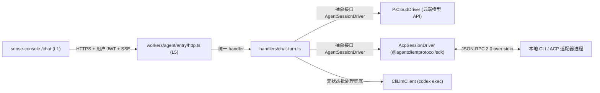

# ACP 协议与本地 Agent CLI 接入参考

> 第 1～3 节为项目侧整理的 T3 Code ACP 参考说明；第 4～7 节为面向 Signal to Story 接入的协议技术补充与架构落位（2026-11-24）。明确区分「外部技术事实」「代码现状」与「本项目落位建议」。

## 1. 核心架构与双轨定位（T3 Code 参考）

T3 Code 的 ACP（Agent Client Protocol）方案，本质上是一套标准化的“多 Agent 统一接入与编排协议”。T3 Code 自己不提供大模型，而是作为统一控制面板，通过「原生适配 + ACP 协议」双轨机制，把本机已安装的各类 Coding Agent 收拢到一个界面里调度。

- **原生内置 Provider**：针对 Codex、Claude Code、Cursor、Grok、OpenCode、Pi、Antigravity 等主流工具，T3 Code 提供深度内置适配，直接在 `Settings → Providers` 开启即可，不会出现在 ACP 列表中。
- **ACP 标准生态接入**：只要符合 ACP 协议的工具（如 Qwen Code、Qoder CLI、Amp、Cline、Copilot、goose 等），均可通过官方 ACP Registry 一键添加，或手动配置本地 ACP 命令行接入。

## 2. 协议兼容与功能支持（T3 Code 参考）

- **v1 / v2 协议协商**：优先使用 ACP v2 预览协议，支持更丰富的消息流、Token 用量统计、执行计划（Plans）、上下文压缩（Compaction）以及终端状态同步；对于尚未升级的旧工具，会自动向下兼容协商 ACP v1。
- **BYOS（自带订阅）模式**：ACP Agent 自带模型、工具链和登录态（走本机 OAuth 或 API Key），控制面板仅负责提供项目管理、线程控制、检查点（Checkpoints）和权限审批。

## 3. 底层运行与跨 Agent 编排机制（T3 Code 参考）

- **轻量级子进程调用**：不由前端做昂贵的 GUI 模拟点击，而是由本地核心引擎在后台拉起 CLI 子进程，通过标准输入输出（stdio）协议流交互，轻量且稳定。
- **内部 `/mcp` 跨模型委派**：向运行中的 Agent 暴露内部 MCP 端点，主线程可在执行复杂任务时通过工具调用委派其他 Agent 协同。
- **Git Worktree 物理隔离**：多个 Agent 子线程并发修改同一个代码库时，为每个线程分配独立的 Git Worktree 与分支，避免互相覆盖。

---

## 4. ACP 协议技术框架（外部技术事实）

Agent Client Protocol（ACP）最早由 Zed 发起并联合 JetBrains 等生态推进，定位类似「AI Agent 领域的 LSP」：把**控制端（Client / 控制台 / IDE）**与**Agent 运行时（Agent 子进程）**解耦。

### 4.1 传输与 SDK

- **传输层**：宿主（Client）拉起 Agent 子进程后，通过 **`stdin` / `stdout` 逐行 JSON-RPC 2.0** 双向通信（每行一条 JSON 消息；`stderr` 仅作诊断日志）。
- **官方 TypeScript SDK**：`@agentclientprotocol/sdk`（提供客户端/服务端连接封装、类型定义、请求处理与流式通知分发，无需手写 JSON-RPC 拆包）。
- **与 MCP 的边界**：
  - **ACP** 负责「控制面 ↔ Agent 运行时」：会话管理、提示词下发、流式思考/计划/工具过程回传、敏感操作授权；
  - **MCP** 负责「Agent ↔ 外部工具与数据源」：让 Agent 在执行中读取外部资源或调用受控工具。两者互补，不互相替代。

### 4.2 核心方法与生命周期

| 阶段 | 方法 | 方向 | 作用与关键语义 |
| --- | --- | --- | --- |
| 初始化 | `initialize` | Client → Agent | 协商协议版本与双方能力（如流式、加载旧会话、文件系统/终端能力开关） |
| 建会话 | `session/new` | Client → Agent | 传入受控工作目录 `cwd` 与允许的 MCP 配置，返回持久 `sessionId` |
| 恢复会话 | `session/load` | Client → Agent | 按已有 `sessionId` 恢复多轮上下文（需 Agent 声明支持） |
| 发送回合 | `session/prompt` | Client → Agent | 发送本轮用户输入，驱动 Agent 进入推理与工具执行 |
| 流式通知 | `session/update` | Agent → Client | 实时推送执行事件（Notification，不期待回复，详见下表） |
| 授权回调 | `session/request_permission` | Agent → Client | Agent 需要执行写文件、命令或高风险动作时请求宿主/人类放行或拒绝 |
| 取消执行 | `session/cancel` | Client → Agent | 用户中断生成时立即中止当前回合 |

`session/update` 中与前端渲染强相关的 `sessionUpdate` 事件类型：

- `agent_message_chunk`：正文输出增量；
- `agent_thought_chunk`：推理 / 思考过程增量；
- `plan`：多步计划更新；
- `tool_call` / `tool_call_update`：工具调用名称、入参、状态（运行中/成功/失败）与输出结果。

---

## 5. 主流 CLI 接入矩阵（面向本项目的选型参考）

> 现状事实：当前仓库仅在 `sense-console/src/harness/providers.ts` 与 `sense-console/dev/local-bridge-guard.ts` 登记了 `codex-cli`、`pi-cli`、`opencode-cli`、`agy-cli` 四种批处理命令；其中仅 `codex exec` 在 `--help` 层核对过参数，其余三个均为未验证占位，且没有任何 ACP 长连接实现。

| 工具 / 引擎 | 生态定位 | 接入方式与适配器（外部事实） | 在 Signal to Story 中的建议定位 |
| --- | --- | --- | --- |
| **OpenCode** (`opencode`) | 开源多模型终端 Agent | 原生支持 ACP / 结构化流式运行 | **建议作为首批 ACP 验证对象**（不需额外桥接包，便于跑通首个 `AcpSessionDriver`） |
| **Codex CLI** (`codex`) | OpenAI 终端 Agent | 社区/官方 `codex-acp` stdio 适配器；另有 `codex exec` 无交互模式 | **主对话走 `codex-acp`（待真机验证）**；现有 `workers/agent/drivers/cli-driver.ts` 的 `codex exec` 保留作后台无状态批处理兜底 |
| **Claude Code** (`claude`) | Anthropic 终端 Agent | `@agentclientprotocol/claude-agent-acp` 适配器 | 若本机安装且订阅 Claude，纳入第二批 ACP 适配器验证 |
| **Pi** (`@mariozechner/pi-coding-agent`) | 极简 TS Agent 框架与 CLI | 底层核心 `@mariozechner/pi-ai` + `@mariozechner/pi-agent-core`（MIT）可直接嵌入 Node 进程 | **云端 API 轨直接采用 Pi 精简内核**，无需再套 CLI 子进程；本机 `pi` CLI 如需走本地配置亦可后续按需接 |
| **Antigravity CLI** (`agy`) | Antigravity 桌面端 CLI | 是否暴露标准 ACP stdio 入口需本机 `--help` / 版本实测核验 | 暂标记为「待验证」，核实协议入口后再接入，不盲猜参数 |
| **Qwen Code / goose** | 原生 ACP 兼容 CLI | 原生 ACP（可通过命令白名单配置） | 由本地节点配置文件声明后统一经 `AcpSessionDriver` 接管 |

---

## 6. 在 Signal to Story（`workers/agent`）中的架构落位

### 6.1 关键边界：ACP 只存在于 `workers/agent` 与本地 CLI 之间

**Browser 绝不直接运行或直连 ACP stdio 子进程**（生产静态前端没有进程权限，也不符合 [architecture.md](architecture.md) 的 L1/L5 分层）。

### 6.2 与现有设计的对齐点

1. **执行接口预留**：[architecture.md](architecture.md) 已规划 `workers/agent/drivers/SessionDriver`，正好由 `PiCloudDriver` 与 `AcpSessionDriver` 共同实现，上层 `handlers/chat-turn` 只消费标准化 `ChatStreamEvent`，不感知底层是云端 API 还是本地 CLI。
2. **数据库会话句柄预留**：`supabase/migrations/20261126100200_chat.sql` 的 `chat_sessions.exec_session`（`jsonb`，限 16KB，仅节点可写）正好存放 ACP 会话状态（如 `{ driver: "acp", node_id, cli_key, acp_session_id, cwd, protocol_version }`），以便下次消息调用 `session/load` 续接上下文。这个句柄**只在写入它的那台节点上有效**（会话文件在那台机器上），因此必须带 `node_id`，换节点或换运行时即视为新上下文（见 [modules/chat.md](modules/chat.md) 3.4 第 5 点）。
3. **事件到 AI Elements UI 的 1:1 映射**：

| ACP `sessionUpdate` | 云端 Pi 内核事件 | 平台统一 SSE 事件 | 前端 AI Elements 对应组件 |
| --- | --- | --- | --- |
| `agent_thought_chunk` | `thinking_delta` | `reasoning_delta` | `Reasoning`（可折叠思考块） |
| `agent_message_chunk` | `text_delta` | `text_delta` | `Message` / `Bubble`（流式 Markdown） |
| `plan` | 工具/步骤规划输出 | `plan_update` | `Plan`（多步计划展示） |
| `tool_call` / `tool_call_update` | `tool_execution_start` / `end` | `tool_start` / `tool_end` | `Task` / `Tool`（失败时展开 `Stack Trace`） |
| `session/request_permission` | 高风险动作拦截 | `permission_request` | `Questionnaire` / 审批确认卡 |

---

## 7. 安全与权限边界（建议方案）

沿用 [architecture.md](architecture.md) 与 [research.md](research.md) 的既有安全红线，ACP 子进程必须遵守以下四项硬约束：

1. **环境变量白名单（继承 `CLI_ENV_ALLOWLIST`）**：子进程只透传 `PATH`、`HOME`、`LANG`、`LC_ALL`、`TMPDIR` 及显式声明的 CLI 自身配置目录与代理变量；**严禁透传 `SENSE_NODE_TOKEN`、Supabase URL/Key 以及服务端云端大模型 API Key**。
2. **工作目录（`cwd`）只是默认位置，不是沙箱（评审修订）**：`session/new` 传入的 `cwd` 默认指向隔离的会话临时目录，不默认把项目源码根目录交给外部 CLI。但 `cwd` 只决定 CLI 的起始目录，CLI 用自带工具照样能读写 `cwd` 以外的路径（`~/.ssh`、其他项目的 `.env`）。真正的隔离要靠：
   - **CLI 自身的沙箱 / 审批模式**：启动适配器时显式选择最严格档位（如 Codex 的只读沙箱 + 每步审批、Claude Code 的默认审批模式），具体参数在 R3-B 真机验证后写进节点配置，不盲猜；
   - **不向 Agent 声明宿主的 `fs` / `terminal` 能力**：MVP 的 `initialize` 中 `clientCapabilities.fs.readTextFile / writeTextFile` 与 `terminal` 全部置 `false`，避免 worker 替 Agent 代执行文件与终端操作而绕过 CLI 自身审批；
   - 需要更强隔离时（例如处理外部收录内容），在容器或系统级沙箱中运行该节点，这超出 MVP 范围。
3. **`session/request_permission` 默认从严策略**：
   - 只读、且路径位于会话 `cwd` 之内：可按白名单策略放行；**`cwd` 之外的读取同样需要确认**（读密钥文件本身就是外泄的第一步）；
   - 任何写文件、执行 Shell 命令、联网发送或修改配置：**禁止自动放行**，必须转成 `permission_request` 事件挂起等待前端人类显式确认（或直接拒绝），防范外部收录信源夹带 Prompt Injection 诱导本地 CLI 越权操作；
   - 用户无响应（超时，建议 5 分钟）或 SSE 连接丢失：一律按**拒绝**回复 Agent，回传通道见 [modules/chat.md](modules/chat.md) 2.5；
   - 若适配器在选项中提供「总是允许」（`allow_always`），MVP 不展示该选项，只提供单次允许 / 拒绝。
4. **节点归属隔离**：只有部署在本机且通过 `runner_nodes` 注册的节点才在 `capabilities.runtimes` 中声明可用本地 ACP CLI；云端无头节点不暴露本地 CLI 选项，请求直接发往目标节点的 HTTP 入口（详见 [modules/chat.md](modules/chat.md) 2.4）。
5. **子进程生命周期（评审补充）**：每个活跃会话最多一个 ACP 子进程；回合结束后保留一段空闲时间（如 10 分钟）便于下一轮直接 `session/prompt`，超时即关闭，下轮按 `exec_session` 走 `session/load`（Agent 未声明 `loadSession` 能力时，退化为新会话 + 文本历史）。节点级限制并发子进程数（如 3 个），超出时拒绝新回合并提示。worker 退出时必须清理全部子进程。
