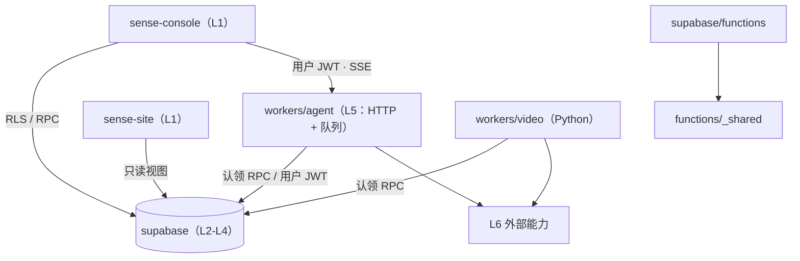

# Signal to Story 架构规划（0.5.0）

> 2026-11-17 · 2026-11-18 修订（取消 `core/`、执行面增加 HTTP 入口，见 6.2、6.5）· 分支 `0.5.0`（从 `codex/0.3` 切出），2026-11-25 合并进 `main` 并上线 · 状态：**R0～R3 已完成，R4 待做**。
>
> 这是 0.5.0 起的**唯一架构入口**。旧文档已精简并入 `docs/`（见 [README](README.md)）。0.4 的数据库设计稿 `sense-console/supabase/design/00～13` 只作为参考，不作为基准，而且只存在于 `codex/0.4` 分支（提交 `348e41c`），不在本分支。
>
> 第 1～5 节是 2026-11-17 的梳理结论，已经确认。第 3、4、5 节的路径已按第 6 节确认的「根目录按职责拆分」方案更新。

## 目录

1. 现状的主要问题
2. 目标分层
3. 目标目录图
4. 业务模块与调用关系
5. 调整顺序
6. 已确认的决定与分析
7. 下一步

---

## 1. 现状的主要问题

| # | 问题 | 依据 |
|---|---|---|
| 1 | `sense-console` 名不副实：里面同时放了前端、数据库、两个 worker、视频引擎和 IM 适配器 | 看目录结构就能看出来 |
| 2 | 共享代码靠 `../../src/...` 相对路径引用；worker 的 demo 甚至依赖测试代码 | `workers/agent` 有 40 多处 `../../src/harness`、`../../src/test/db/pglite-harness` |
| 3 | IM 适配器有两份完全相同的拷贝；`adapters/im` 还反过来引用 `workers` | `sense-console/adapters/im/` 和 `sense-console/supabase/functions/im-webhook/adapters/` 用 diff 比对完全一致 |
| 4 | **调用 CLI 的桥接代码有两套**：Chat 走 Vite 开发服务器里的 `spawn`，生产环境里根本没有；任务走 worker 的 `cli-driver` | `sense-console/dev/local-bridge-plugin.ts` 和 `sense-console/workers/agent/drivers/cli-driver.ts` |
| 5 | 视频代码分在两处：`video-factory/` 放引擎（另有约 98M 本地 demo 产物，未提交到仓库），`workers/video/` 靠修改 `sys.path` 去导入引擎 | `sense-console/workers/video/video_worker/engines.py:24` |
| 6 | 前端按技术类型平铺：37 个页面、21 个 service。其中 6 个页面还在用 mock 数据（角色、场景、画布、脚本、仪表盘），Chat 页有 856 行（0.4 版本） | `src/pages`、`src/data/mock-data.ts` |
| 7 | 文档分散在四处：`docs-site/{spec,design,plan,research}`、`sense-console/docs`、`supabase/design` 下的 14 篇（现只在 `codex/0.4`）、两份 HTML 评审 | — |
| 8 | 仓库根目录有一个空的 `supabase/.temp`，是之前运行 CLI 留下的 | — |

## 2. 目标分层

```text
L1 界面          sense-console（控制台，只是 Web）    sense-site（读者站）
                    │ 只经 RLS / RPC                       │ 只读 public 视图
L2 入口适配       supabase/functions（intake-gateway / im-webhook / content-draft）
                    │ 都写成 trigger
L3+L4 状态与门禁   supabase/migrations（表、RLS、RPC、Mandate 触发器）+ 对象存储
                    ▲ 认领 RPC（出站拉取）          ▲ 用户 JWT（RLS 生效）
L5 执行面        workers/agent（队列入口 + HTTP 入口，共用 handler；loop/ 内含 Agent 循环）
                 workers/video（Python：TTS / 渲染 / 合成）
                    │ 只经过 4 个适配接口
L6 外部能力      云端模型 · Codex/Claude CLI · TTS/视频模型 · 飞书/企微 · 存储
```

**没有独立的共享内核层**（2026-11-18 决定，见 6.2）：Agent 循环、上下文组装、预检、评估、记忆压缩和模型 Key 都在 `workers/agent` 内（`loop/` 子目录放纯逻辑）。浏览器只写数据库、调用 HTTP 入口、渲染流式输出，不运行 Agent 循环。

## 3. 目标目录图

```text
signal-to-story/
├── README.md · CLAUDE.md · AGENTS.md
├── docs/                          【R0 已完成】合并四处文档，精简后只保留一个入口
│   ├── README.md                  文档索引与维护规则
│   ├── architecture.md            唯一架构入口：分层、模块、调用规则（本文件）
│   ├── product.md                 ← PRD + 内容方法论 SPEC（精简）
│   ├── status.md                  ← V2 计划、验收清单中的现状与断层（精简）
│   ├── research.md                ← research/（只留结论）
│   ├── modules/                   每个模块一页：data-model / harness / intake / content / video / site
│   └── conventions/frontend.md    ← frontend-conventions + shadcn-foundation
│   （旧文档不归档、直接删除，原文在 codex/0.3 的 git 历史中）
├── knowledge-base/                保留：知识库默认种子
│
├── supabase/                      L2–L4 ← sense-console/supabase【R1 已完成】
│   ├── migrations/ seeds/
│   ├── tests/                     SQL 验收脚本；tests/db/ 为 vitest + PGlite 测试（← sense-console/src/test/db）
│   └── functions/
│       ├── _shared/im/            ← adapters/im，唯一一份（Supabase 官方约定的共享目录），协议测试在旁边
│       └── intake-gateway/ im-webhook/ content-draft/ admin-create-account/ *-upload-token/
│
├── workers/                       L5，独立进程 ← sense-console/workers【R1 已完成】
│   ├── agent/                     Agent 执行面，所有模型 Key 和 CLI 调用只在这里
│   │   ├── loop/                  【R2 已完成】← sense-console/src/{harness,contracts}：循环、预检、评估、Context Pack、
│   │   │                          预算；接口 LlmClient / SessionDriver / JobStore / ChannelSender；
│   │   │                          纯逻辑：不读 process.env、不联网、不引用 drivers/ entry/
│   │   ├── entry/                 【R3 已完成】http.ts（SSE 流式）与 queue.ts（认领 agent_jobs）两个入口适配器
│   │   ├── runner.ts main.ts      认领 / 心跳 / 分派（runner.ts 尚未并入 entry/queue.ts，留待打磨）
│   │   ├── handlers/              content-draft、video-storyboard、fetch-source、分镜、图片、想法完善、chat-turn（新）
│   │   ├── drivers/               LlmClient（cloud / cli）、SessionDriver（新），读 Key
│   │   ├── backends/              JobStore / 数据库访问实现
│   │   ├── delivery/              ← notify/，改成通知投递器（扫描 `notified_at` 为空的待办）+ ChannelSender（未做，仍为 notify/）
│   │   ├── demo/                  ← 根目录散放的 demo-*、*-scenario【R1 已完成】
│   │   └── Dockerfile             构建上下文为仓库根目录
│   └── video/
│       ├── video_worker/          队列消费
│       ├── engine/                ← video-factory（Python 包 `engine`，去掉 sys.path 注入）【R1 已完成】
│       └── Dockerfile             构建上下文为仓库根目录
│
├── sense-console/                 L1 控制台前端，只在浏览器运行
│   └── src/
│       ├── app/                   路由、Provider、布局壳 ← App.tsx、components/layout、features/*
│       ├── modules/               【新】按一级菜单分域，每个域自带 pages/components/services
│       │   ├── board/             任务看板（新建，替代 tasks / topics / projects 的入口）
│       │   ├── chat/              Chat 界面：会话列表、消息渲染、输入；不含循环逻辑
│       │   ├── content/           稿件、审核、发布与复盘
│       │   ├── intake/            速记、信源分类、外部接入配置
│       │   ├── video/             视频工坊；角色/场景/画布/脚本这些 mock 页标为演示或下线
│       │   ├── library/           知识库、决定记忆、资产、提示词示例
│       │   └── system/            账号、角色、模型、CLI、存储
│       ├── components/ui/         只放 shadcn
│       ├── components/shared/     跨域复用（category-select 等）
│       └── lib/                   supabase client、safe-markdown、query-client
│   （dev/ 已于 R3 删除（Vite spawn 桥退役，2026-11-25）；e2e/ scripts/ 保留；
│     e2e/support/intake-send.mjs ← adapters/intake/send.mjs，只剩 e2e 在用）
│
├── sense-site/                    保留：L1 读者站，与 console 零共享代码
├── testing/                       ← sense-console/src/test/db/{pglite-harness, supabase-shim.sql, video-studio-seed}【R1 已完成】
│                                  workers 与 supabase 测试共用
└── package.json · tsconfig.json · vitest.config.ts · eslint.config.js
                                   运行时一侧（workers、testing、supabase 测试）的依赖与门禁；不是 npm workspace
（已删除：sense-console/adapters/、sense-console/video-factory/、im-webhook/adapters 拷贝、
  video-factory 的 3 个一次性脚本 download_wanx_shots.py / test_dashscope*.py）
```

## 4. 业务模块与调用关系

| 模块 | 所在层 | 代码位置 | 可以调用 | 主要的表（下一步细化） |
|---|---|---|---|---|
| 资讯收集 | L1/L2 | `sense-console/src/modules/intake`、`supabase/functions/intake-gateway`、`im-webhook` | RPC `record_intake_event` | intake_events、source_categories |
| 看板 / 事项 | L1 | `sense-console/src/modules/board` | RLS + RPC | work_items（`status` 即看板列） |
| 内容生产 | L1 | `sense-console/src/modules/content` | RLS + RPC | content_documents / revisions / proposals |
| Chat | L1 → L5 | 界面 `modules/chat`；循环 `workers/agent/loop`；执行 `workers/agent/handlers/chat-turn`（HTTP 入口，SSE 流式） | 写消息 + 调 HTTP 入口 | chat_sessions / messages |
| Agent 循环 | L5 | `workers/agent/loop` | 什么都不依赖（接口在内，实现在 drivers/） | — |
| CLI 桥接 | L5 | `workers/agent/drivers` | 只被 handler 调用 | agent_jobs、steps |
| Harness | L5 | `workers/agent/loop` | 只依赖 loop 内的接口与契约 | — |
| 视频 | L1 + L5 | `modules/video`、`workers/video` | 与 agent 只通过 `agent_jobs` 交互 | video_plans / shots |
| 知识与记忆 | L1/L5 | `modules/library`、`workers/agent/loop/context-pack` | 读仓库 `knowledge-base/` 文件（MVP 不建表） | — |
| 发布 / 读者站 | L1 | `modules/content`、`sense-site` | 发布 RPC；读者站只读已发布列 | content_documents（`published_*`） |
| IM 通知 | L5 | `workers/agent/delivery` | ChannelSender | approval_requests / agent_jobs 的 `notified_at` |

**禁止的调用方向**（用 ESLint `no-restricted-imports` 和各自的 tsconfig 强制执行）：

- `sense-console` 不能引用 `workers`，也不能 `spawn` 子进程。
- `workers` 不能引用 `sense-console`（R2 于 2026-11-24 完成：worker 侧契约副本在 `workers/agent/loop/contracts/`，两边不共享代码；静态与动态 `import()`、`require()` 均由 ESLint 拦截）。
- `workers/agent/loop` 不得引用 `drivers/`、`entry/`，不得读 `process.env`，用 ESLint `no-restricted-imports` 强制，保证可用假模型单测。
- `workers` 可以引用 `supabase/functions/_shared`（纯 TS、Deno 兼容）：IM 协议在 Edge Function 收消息和 worker 发通知两处都要用，只能放在 Deno 能打包的位置。
- `supabase/functions` 只能引用 `supabase/functions/_shared`。
- `sense-site` 不能引用 `sense-console`，也不引用 `workers`。
- `sense-console/src/modules` 之间不互相引用页面；需要共用的组件先提到 `components/shared`。



## 5. 调整顺序

1. **R0 文档**（2026-11-17 完成）：写 `docs/architecture.md`；旧文档按 0.5 方向精简后并入 `docs/`，不需要的直接删除，不保留 archive。纯文档改动，零风险。
2. **R1 搬家**（2026-11-17 完成）：
   - `sense-console/supabase` 移到根目录 `supabase/`，`sense-console/workers` 移到根目录 `workers/`；
   - IM 适配器只保留一份，放在 `supabase/functions/_shared/im`；
   - 删除根目录残留的 `supabase/.temp`；
   - `video-factory` 移到 `workers/video/engine`；
   - 抽出 `testing/`，把 worker 的 demo 归位；
   - 同步修改 CLAUDE.md、README 与 docker-compose 中的路径和边界说明；
   - 实际做法：根目录新增 `package.json`（运行时一侧），Docker 镜像按进程拆开（`sense-console/Dockerfile` 只剩 Web，`workers/*/Dockerfile` 以仓库根为构建上下文），数据库与 migration 未改动。
3. ~~**R2 并入 `workers/agent`**~~（2026-11-24 完成，Gemini 交叉评审）：先做依赖盘点（`sense-console` 页面/服务是否用到 `src/contracts` 类型；如用到，类型改用数据库生成类型或接口返回字段，Mandate 界面提示改为接口返回「可执行动作」，仅 UX），再把 `sense-console/src/{harness,contracts}` 迁入 `workers/agent/loop`，消除 worker 对 console 的反向引用，并加 import 规则检查。
4. **R3 桥接统一并让 Chat 能在生产使用**（2026-11-25 完成并上线：回合内核、Pi / ACP 驱动、HTTP 入口、前端切换、第 6 批数据库；Vite `spawn` 已删除；实现记录见 [modules/chat.md](modules/chat.md) 第 6 节）：在 `workers/agent/loop` 新建统一 Agent 循环，加 `chat-turn` handler 和 HTTP 入口（SSE 流式；长任务仍走队列），删掉 Vite 里的 `spawn`。
5. **R4 前端按模块重组**：和看板一起做，不单独大挪动。
6. **R5 按模块确认表的归属**：已提前完成规划，见 [database.md](database.md)；实施按其中 DB0～DB7，与 R2～R4 交错推进。

每一步都跑一遍 typecheck / lint / test / build 再进入下一步。

---

## 6. 已确认的决定与分析

### 6.1 顶层按职责拆到根目录（已确认，2026-11-17）

选「最对的改动」，不选最小改动：`supabase`、`workers`、`sense-console`、`sense-site`、`testing` 在根目录平级（原计划的 `core/` 于 2026-11-18 取消，见 6.2）。Console 只是 Web 控制台。

需要同步修订 CLAUDE.md 中的两条约束（在 R1 时改）：

| 现条款 | 修订为 |
| --- | --- |
| All current application code belongs under `sense-console/` | 应用代码按职责分布在根目录的 `sense-console/`、`sense-site/`、`workers/`、`supabase/` 下 |
| Monorepo and shared packages remain forbidden | 不建 npm workspace / 发布包；共享代码是纯源码，按相对路径引用 |

### 6.2 取消独立的 `core/`，并入 `workers/agent`（已确认，2026-11-18，取代原 6.2 / 6.2.1）

原方案设 `core/` 的理由是「浏览器 + Node 共用」。现决定 Console 保持很薄：只写数据库（RLS/RPC）、向后端 POST 接口、渲染流式输出；循环、上下文组装、预检、评估、记忆压缩、模型 Key 全在服务端（与 Claude / ChatGPT / DeepSeek 网页端形态一致）。浏览器不运行 Agent 循环，`core` 只剩 `workers/agent` 一个使用方，单独的顶层目录没有意义。Edge Functions（Deno）、`sense-site`、`workers/video`（Python）本来就不引用 core。

**`workers/agent` 内部分层**（目录子层，不是顶层目录）：

| 子目录 | 内容 | 约束 |
| --- | --- | --- |
| `loop/` | 循环、预检、评估、Context Pack、预算；`LlmClient` / `SessionDriver` / `JobStore` / `ChannelSender` 接口 | 纯逻辑：不读 `process.env`、不联网、不引用 `drivers/`、`entry/`；ESLint `no-restricted-imports` 强制，可用假模型单测 |
| `drivers/` | `LlmClient` 的云端 / CLI 真实实现 | 读 Key（环境变量） |
| `handlers/` | 分镜、图片、想法完善、出稿、chat-turn 等 | 输入：任务类型 + 参数 + 用户身份 |
| `entry/` | `http.ts`、`queue.ts` 两个入口适配器 | 见 6.5 |
| `backends/` | JobStore / 数据库访问 | — |

测试用的假实现仍在 `testing/`。如将来出现第二个使用方（HTTP 服务与队列 worker 拆成两个进程，或 Console 确实要在浏览器跑某段校验），再抽共享目录，到时再议。仍然不建 npm workspace / 发布包。

**R2 的前置盘点（已完成，2026-11-24）**：结论是 `src/contracts` 大量被前端页面使用，因此**保留在控制台**作为界面侧契约，worker 只复制自己用到的部分到 `workers/agent/loop/contracts/`（两份，各自对数据库负责，不共享代码）；`src/harness` 整体迁走，控制台只留展示用的模型 / CLI 元数据（`src/config/agent-runtimes.ts`）。原记录如下：迁移前先查 `sense-console` 页面和服务是否使用 `src/contracts` 的类型。若用到，先决定这些类型的去处（建议用数据库生成类型或接口返回字段；Mandate 的界面提示改为接口返回「可执行动作」字段，仅 UX，门禁仍在数据库），否则前端会断。另需处理 `supabase/tests/db` 对 `sense-console/scripts/knowledge-seed` 的引用。

### 6.3 Chat：界面在 Console，循环与执行在 `workers/agent`（2026-11-18 修订）

| 层 | 位置 | 负责什么 |
| --- | --- | --- |
| 界面 | `sense-console/src/modules/chat` | 会话列表、消息渲染、输入框、流式显示；写 `chat_messages`，调 HTTP 入口，不含循环逻辑 |
| 循环 | `workers/agent/loop` | 会话和回合的数据结构、上下文组装、循环控制器（轮次、预算、取消、停止条件）、接口 |
| 执行 | `workers/agent/handlers/chat-turn` + `drivers/` | 用循环 → 驱动调用 CLI 或模型 → 回写消息和用量 |

Chat、harness 出稿、`agent_session` 改稿共用同一套 Agent 循环：harness 是「生成 → 预检 → 评估」的固定形状，Chat 是「用户一轮 → Agent 一轮」，停止条件、预算和取消机制是同一份代码。Chat 走 HTTP 流式（SSE）；长任务仍走队列。

### 6.5 Agent 执行面：HTTP 入口与队列入口并存（已确认，2026-11-18）

```text
入口适配器（entry/http.ts · entry/queue.ts）
        → 同一个 handler（任务类型 + 参数 + 用户身份 → 组装上下文 → 循环 → 输出）
        → loop 与接口
```

新增能力只写一个 handler，两个入口都能挂。

**选择标准**：短、要立即看到结果、可流式的（Chat、想法完善、单次分镜 / 小图、按钮触发）走 HTTP；长、需要重试 / 断点恢复 / 可离线的（出稿 harness 循环、视频渲染、抓取）走 `agent_jobs` 队列。慢任务统一约定：接口支持两种返回——快任务直接返回 / 流式；慢任务返回 job id，前端等待结果（避免 HTTP 超时、页面关闭丢结果）。

**与原则的关系**：「普通读写直连 Supabase、不建传统后端 API」仍适用于普通 CRUD；Agent 执行面新增 HTTP 入口。`workers/agent` 进程同时跑队列轮询和 HTTP 服务；`workers/video` 仍为纯出站。模型 Key 和真实模型 / CLI 实现只在 `workers/agent` 进程（环境变量），不进浏览器、不放进 `loop/`。

**一致性约束**：即使走 HTTP，也要先写一条 `agent_jobs` 记录并在结束时回写，使用量预算、审计、失败记录、「Agent 只能出提案」对两个入口一致，不允许出现无记录的旁路。

**鉴权与安全（HTTP 入口）**：

- 浏览器携带 Supabase 登录 JWT 调用；服务先验证 JWT，再决定能做什么。
- 服务用**用户的 JWT** 访问数据库，使 RLS 继续生效；不一律用 `service_role`（否则鉴权漏洞等于数据库全开）。`service_role` 仅用于队列认领等 worker 内部操作。
- 批准、发布等门禁仍留在数据库触发器 / RPC，不挪进服务。
- 需要限流、按用户 / 组织的用量预算，防止被刷接口导致模型账单失控。

**运维代价**：暴露端口后需要公网地址 + HTTPS；个人电脑运行时需隧道（如 Cloudflare Tunnel）或部署到云端容器，这是相对纯出站 worker 最大的代价。HTTP 服务挂了请求直接失败（队列则排队等待），前端需处理；队列任务仍需「worker 是否在线」提示（对应 DB2c-2 的 `runner_nodes`）。

部署时的进程：

| 进程 | 启动方式 | 对外端口 |
| --- | --- | --- |
| Supabase（Postgres、Auth、Data API、Edge Functions、门禁） | 托管服务 | 是（Supabase 提供） |
| `sense-console` / `sense-site` | 静态文件（nginx） | 是 |
| `workers/agent` | `npm run worker:agent`（本机或容器） | 设置 `SENSE_HTTP_PORT` 时开 HTTP 端口（默认只监听 `127.0.0.1`，对外需隧道或容器 + HTTPS）；队列部分只出站 |
| `workers/video` | `python worker.py` | 否，只出站 |

本地开发需要单独启动的是 worker（`npm run worker:agent`）；各部分仍通过数据库交互，Console 对 `workers/agent` 的调用只有 HTTP 入口。

### 6.4 文档

0.4 的成果已提交到 `codex/0.4`（`348e41c`，未推送）。0.5.0 从 `codex/0.3` 切出，不带这些文件。之后要用到 0.4 的设计稿或 Chat 代码时，按需取回，不整体合并。

## 7. 下一步

1. ~~R0 文档~~（已完成）。
2. ~~R1 搬家~~（已完成）。
3. ~~规划数据库设计~~（已完成，方案见 [database.md](database.md)，审计见第 9 节，决定见第 10 节）。
4. ~~DB0～DB2c-2 实施与线上第 1～3 批推送~~（已完成，线上库至 `20261124100000`，详见 [database.md](database.md) 与 [status.md](status.md)）。
5. ~~DB2c-3 第 4 批~~（2026-11-23 上线核对通过）。
6. ~~DB3 建表、DB4、DB5、V1 退役~~（合并为最终批次 `0.5.0-step5.sql`，见 [database.md](database.md) DB-D17，2026-11-24 已执行）。
7. ~~R3 与第 6 批~~（2026-11-25 完成，0.5.0 合并进 `main` 并上线）。
8. 下一步：迭代 1「打磨与优化」，见 [tasks/iteration-1.md](tasks/iteration-1.md)；R4（前端按域重组与看板）在其中按需推进。
