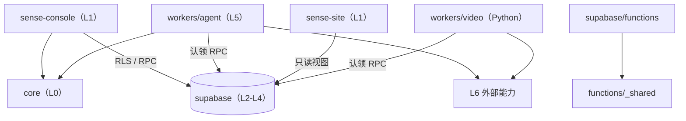
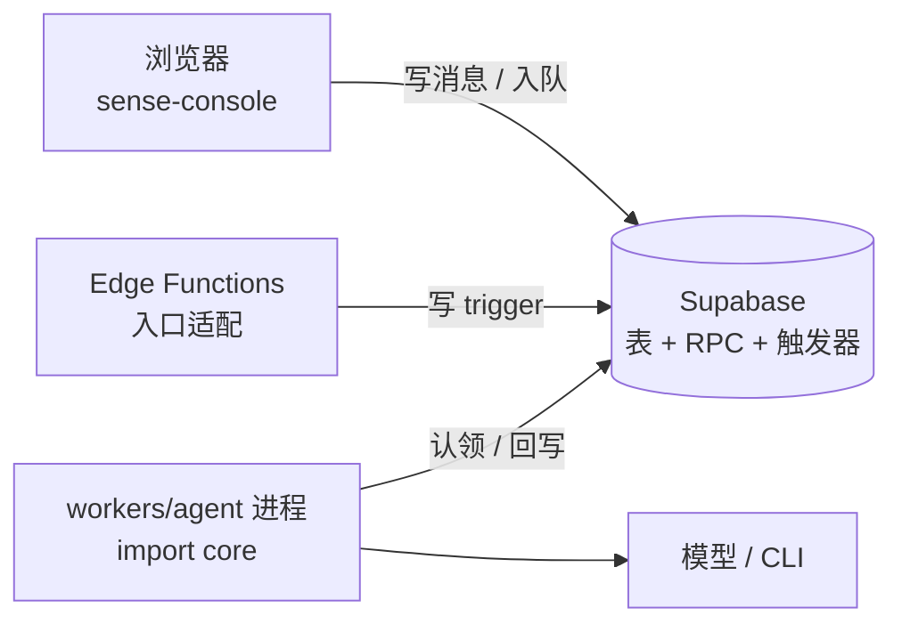

# Signal to Story 架构规划（0.5.0）

> 2026-11-17 · 分支 `0.5.0`（从 `codex/0.3` 切出）· 状态：**规划稿，在本分支上迭代**。
>
> 这是 0.5.0 起的**唯一架构入口**。旧文档已精简并入 `docs/`（见 [README](README.md)）。0.4 的数据库设计稿 `sense-console/supabase/design/00～13` 只作为参考，不作为基准，而且只存在于 `codex/0.4` 分支（提交 `348e41c`），不在本分支。
>
> 第 1～5 节是 2026-11-17 的梳理结论，已经确认。第 3、4、5 节的路径已按第 6 节确认的「根目录按职责拆分」方案更新。

## 目录

1. 现状的主要问题
2. 目标分层
3. 目标目录图
4. 业务模块与调用关系
5. 调整顺序
6. 已确认的决定与分析
7. 下一步

---

## 1. 现状的主要问题

| # | 问题 | 依据 |
|---|---|---|
| 1 | `sense-console` 名不副实：里面同时放了前端、数据库、两个 worker、视频引擎和 IM 适配器 | 看目录结构就能看出来 |
| 2 | 共享代码靠 `../../src/...` 相对路径引用；worker 的 demo 甚至依赖测试代码 | `workers/agent` 有 40 多处 `../../src/harness`、`../../src/test/db/pglite-harness` |
| 3 | IM 适配器有两份完全相同的拷贝；`adapters/im` 还反过来引用 `workers` | `sense-console/adapters/im/` 和 `sense-console/supabase/functions/im-webhook/adapters/` 用 diff 比对完全一致 |
| 4 | **调用 CLI 的桥接代码有两套**：Chat 走 Vite 开发服务器里的 `spawn`，生产环境里根本没有；任务走 worker 的 `cli-driver` | `sense-console/dev/local-bridge-plugin.ts` 和 `sense-console/workers/agent/drivers/cli-driver.ts` |
| 5 | 视频代码分在两处：`video-factory/` 放引擎（另有约 98M 本地 demo 产物，未提交到仓库），`workers/video/` 靠修改 `sys.path` 去导入引擎 | `sense-console/workers/video/video_worker/engines.py:24` |
| 6 | 前端按技术类型平铺：37 个页面、21 个 service。其中 6 个页面还在用 mock 数据（角色、场景、画布、脚本、仪表盘），Chat 页有 856 行（0.4 版本） | `src/pages`、`src/data/mock-data.ts` |
| 7 | 文档分散在四处：`docs-site/{spec,design,plan,research}`、`sense-console/docs`、`supabase/design` 下的 14 篇（现只在 `codex/0.4`）、两份 HTML 评审 | — |
| 8 | 仓库根目录有一个空的 `supabase/.temp`，是之前运行 CLI 留下的 | — |

## 2. 目标分层

```text
L1 界面          sense-console（控制台，只是 Web）    sense-site（读者站）
                    │ 只经 RLS / RPC                       │ 只读 public 视图
L2 入口适配       supabase/functions（intake-gateway / im-webhook / content-draft）
                    │ 都写成 trigger
L3+L4 状态与门禁   supabase/migrations（表、RLS、RPC、Mandate 触发器）+ 对象存储
                    ▲ 认领 RPC（出站拉取）
L5 执行面        workers/agent（本机节点：harness / CLI 会话 / Chat / 投递）
                 workers/video（Python：TTS / 渲染 / 合成）
                    │ 只经过 4 个适配接口
L6 外部能力      云端模型 · Codex/Claude CLI · TTS/视频模型 · 飞书/企微 · 存储

L0 共享内核      core/（纯 TS：契约 + Agent 循环 + harness 纯函数），L1 和 L5 共用，自身不依赖任何人
```

**L0 与 L5 的分工**：L0 定义「循环怎么跑」（状态机、轮次、预算、停止条件、接口），L5 负责「真正去跑」（起进程、调模型、写数据库）。浏览器只引用 L0 的契约和用于界面提示的判断，从不执行循环。

## 3. 目标目录图

```text
signal-to-story/
├── README.md · CLAUDE.md · AGENTS.md
├── docs/                          【R0 已完成】合并四处文档，精简后只保留一个入口
│   ├── README.md                  文档索引与维护规则
│   ├── architecture.md            唯一架构入口：分层、模块、调用规则（本文件）
│   ├── product.md                 ← PRD + 内容方法论 SPEC（精简）
│   ├── status.md                  ← V2 计划、验收清单中的现状与断层（精简）
│   ├── research.md                ← research/（只留结论）
│   ├── modules/                   每个模块一页：data-model / harness / intake / content / video / site
│   └── conventions/frontend.md    ← frontend-conventions + shadcn-foundation
│   （旧文档不归档、直接删除，原文在 codex/0.3 的 git 历史中）
├── knowledge-base/                保留：知识库默认种子
│
├── core/                          【新】L0 ← sense-console/src/contracts + src/harness；禁止使用 DOM/Node API
│   ├── contracts/                 表行类型、任务类型、VideoPlan schema
│   ├── agent/                     【新】统一的 Agent 循环：会话/回合模型、消息结构、循环控制器、
│   │                              接口 LlmClient / SessionDriver / JobStore / ChannelSender
│   └── harness/                   生成↔预检↔评估、Context Pack、注入检测、Mandate UX 判断
│
├── supabase/                      L2–L4 ← sense-console/supabase【R1 已完成】
│   ├── migrations/ seeds/
│   ├── tests/                     SQL 验收脚本；tests/db/ 为 vitest + PGlite 测试（← sense-console/src/test/db）
│   └── functions/
│       ├── _shared/im/            ← adapters/im，唯一一份（Supabase 官方约定的共享目录），协议测试在旁边
│       └── intake-gateway/ im-webhook/ content-draft/ admin-create-account/ *-upload-token/
│
├── workers/                       L5，独立进程 ← sense-console/workers【R1 已完成】
│   ├── agent/                     本机节点，所有 CLI 调用只在这里
│   │   ├── runner.ts main.ts      认领 / 心跳 / 分派
│   │   ├── handlers/              content-draft、video-storyboard、fetch-source、chat-turn（新）
│   │   ├── drivers/               LlmClient（cloud / cli）、SessionDriver（新）
│   │   ├── backends/              JobStore 实现
│   │   ├── delivery/              ← notify/，改成 outbox 投递器 + ChannelSender（R3）
│   │   ├── demo/                  ← 根目录散放的 demo-*、*-scenario【R1 已完成】
│   │   └── Dockerfile             构建上下文为仓库根目录
│   └── video/
│       ├── video_worker/          队列消费
│       ├── engine/                ← video-factory（Python 包 `engine`，去掉 sys.path 注入）【R1 已完成】
│       └── Dockerfile             构建上下文为仓库根目录
│
├── sense-console/                 L1 控制台前端，只在浏览器运行
│   └── src/
│       ├── app/                   路由、Provider、布局壳 ← App.tsx、components/layout、features/*
│       ├── modules/               【新】按一级菜单分域，每个域自带 pages/components/services
│       │   ├── board/             任务看板（新建，替代 tasks / topics / projects 的入口）
│       │   ├── chat/              Chat 界面：会话列表、消息渲染、输入；不含循环逻辑
│       │   ├── content/           稿件、审核、发布与复盘
│       │   ├── intake/            速记、信源分类、外部接入配置
│       │   ├── video/             视频工坊；角色/场景/画布/脚本这些 mock 页标为演示或下线
│       │   ├── library/           知识库、决定记忆、资产、提示词示例
│       │   └── system/            账号、角色、模型、CLI、存储
│       ├── components/ui/         只放 shadcn
│       ├── components/shared/     跨域复用（category-select 等）
│       └── lib/                   supabase client、safe-markdown、query-client
│   （dev/ 只留开发期自检，CLI 调用逻辑改为引用 workers/agent/drivers；e2e/ scripts/ 保留；
│     e2e/support/intake-send.mjs ← adapters/intake/send.mjs，只剩 e2e 在用）
│
├── sense-site/                    保留：L1 读者站，与 console 零共享代码
├── testing/                       ← sense-console/src/test/db/{pglite-harness, supabase-shim.sql, video-studio-seed}【R1 已完成】
│                                  workers 与 supabase 测试共用
└── package.json · tsconfig.json · vitest.config.ts · eslint.config.js
                                   运行时一侧（workers、testing、supabase 测试）的依赖与门禁；不是 npm workspace
（已删除：sense-console/adapters/、sense-console/video-factory/、im-webhook/adapters 拷贝、
  video-factory 的 3 个一次性脚本 download_wanx_shots.py / test_dashscope*.py）
```

## 4. 业务模块与调用关系

| 模块 | 所在层 | 代码位置 | 可以调用 | 主要的表（下一步细化） |
|---|---|---|---|---|
| 资讯收集 | L1/L2 | `sense-console/src/modules/intake`、`supabase/functions/intake-gateway`、`im-webhook` | RPC `record_intake_event` | intake_events、source_categories |
| 看板 / 事项 | L1 | `sense-console/src/modules/board` | 视图 + RPC | work_items、work_item_board |
| 内容生产 | L1 | `sense-console/src/modules/content` | RLS + RPC | content_documents / revisions / proposals |
| Chat | L1 → L0 → L5 | 界面 `modules/chat`；循环 `core/agent`；执行 `workers/agent/handlers/chat-turn` | 只写消息，由节点执行 | chat_sessions / messages |
| Agent 循环 | L0 | `core/agent` | 什么都不依赖 | — |
| CLI 桥接 | L5 | `workers/agent/drivers` | 只被 handler 调用 | agent_jobs、steps |
| Harness | L0 | `core/harness` | 只依赖 `core/agent`、`core/contracts` | — |
| 视频 | L1 + L5 | `modules/video`、`workers/video` | 与 agent 只通过 `agent_jobs` 交互 | video_plans / shots / cost |
| 知识与记忆 | L1/L0 | `modules/library`、`core/harness/context-pack` | RLS | knowledge_entries、decision_memories |
| 发布 / 读者站 | L1 | `modules/content`、`sense-site` | 发布 RPC；读者站只读视图 | content_results / versions |
| IM 通知 | L5 | `workers/agent/delivery` | ChannelSender | outbox |

**禁止的调用方向**（用 ESLint `no-restricted-imports` 和各自的 tsconfig 强制执行）：

- `sense-console` 不能引用 `workers`，也不能 `spawn` 子进程。
- `workers` 不能引用 `sense-console`。**过渡例外（R2 前）**：`workers/agent` 仍以相对路径引用 `sense-console/src/{harness,contracts}`；`supabase/tests/db` 引用 `sense-console/scripts/knowledge-seed`。
- `workers` 可以引用 `supabase/functions/_shared`（纯 TS、Deno 兼容）：IM 协议在 Edge Function 收消息和 worker 发通知两处都要用，只能放在 Deno 能打包的位置。
- `core` 不能引用任何其他目录。
- `supabase/functions` 只能引用 `supabase/functions/_shared`。
- `sense-site` 不能引用 `sense-console`，也不引用 `core`。
- `sense-console/src/modules` 之间不互相引用页面；需要共用的组件先提到 `components/shared`。



## 5. 调整顺序

1. **R0 文档**（2026-11-17 完成）：写 `docs/architecture.md`；旧文档按 0.5 方向精简后并入 `docs/`，不需要的直接删除，不保留 archive。纯文档改动，零风险。
2. **R1 搬家**（2026-11-17 完成）：
   - `sense-console/supabase` 移到根目录 `supabase/`，`sense-console/workers` 移到根目录 `workers/`；
   - IM 适配器只保留一份，放在 `supabase/functions/_shared/im`；
   - 删除根目录残留的 `supabase/.temp`；
   - `video-factory` 移到 `workers/video/engine`；
   - 抽出 `testing/`，把 worker 的 demo 归位；
   - 同步修改 CLAUDE.md、README 与 docker-compose 中的路径和边界说明；
   - 实际做法：根目录新增 `package.json`（运行时一侧），Docker 镜像按进程拆开（`sense-console/Dockerfile` 只剩 Web，`workers/*/Dockerfile` 以仓库根为构建上下文），数据库与 migration 未改动。
3. **R2 抽出 `core/`**：配好路径别名，再加上 import 规则检查。
4. **R3 桥接统一并让 Chat 能在生产使用**：新建 `core/agent` 循环，加 `chat-turn` handler，删掉 Vite 里的 `spawn`。
5. **R4 前端按模块重组**：和看板一起做，不单独大挪动。
6. **R5 按模块确认表的归属**：已提前完成规划，见 [database.md](database.md)；实施按其中 DB0～DB7，与 R2～R4 交错推进。

每一步都跑一遍 typecheck / lint / test / build 再进入下一步。

---

## 6. 已确认的决定与分析

### 6.1 顶层按职责拆到根目录（已确认，2026-11-17）

选「最对的改动」，不选最小改动：`core`、`supabase`、`workers`、`sense-console`、`sense-site`、`testing` 在根目录平级。Console 只是 Web 控制台。

需要同步修订 CLAUDE.md 中的两条约束（在 R1 时改）：

| 现条款 | 修订为 |
| --- | --- |
| All current application code belongs under `sense-console/` | 应用代码按职责分布在根目录的 `sense-console/`、`sense-site/`、`core/`、`workers/`、`supabase/` 下 |
| Monorepo and shared packages remain forbidden | 不建 npm workspace / 发布包；`core/` 是纯源码目录，通过 tsconfig 路径别名引用，没有自己的 `package.json` |

### 6.2 core 目录：应该从 Console 中分出（分析）

`core` 的使用方是 Console（浏览器）和 `workers/agent`（Node），它不属于其中任何一方。放在 Console 下，就会出现 worker 反向引用 Web 工程的问题（第 1 节 #2）。所以放到根目录。

规则：

1. **纯 TS**：不使用 DOM 和 Node API，不发网络请求，不 new Supabase client。外部依赖只允许 `zod` 这一类纯函数库。
2. **只有接口没有实现**：`LlmClient`、`SessionDriver`、`JobStore`、`ChannelSender` 的接口定义在 core；真实实现在 workers，测试用的假实现放在 `testing/`。
3. **引用方式**：Console 和 workers 都用 `@core/*` 路径别名。不建 package，也不做 workspace。
4. **不覆盖的地方**：Edge Functions（Deno）不引用 core。它们之间要共享的少量契约，用脚本生成到 `supabase/functions/_shared`，再用测试校验两边一致（沿用 `kb:seed`、`video:contract` 的做法）。`sense-site` 也不引用 core。

### 6.2.1 core 怎么运行、怎么测试

**core 是被引用的代码库，不是独立运行的进程。** 它没有启动命令，不监听端口，也不需要在终端里单独起一个服务。

| 问题 | 回答 |
| --- | --- |
| 谁使用 core | Console 在构建时把 core 打进浏览器包（只用到契约和界面提示用的判断）；`workers/agent` 进程启动时把 core 加载进同一个进程，真正执行循环 |
| 各部分之间怎么通信 | **都通过数据库，不调用 core**。浏览器写 Supabase，worker 从 Supabase 认领任务，Edge Function 写 Supabase，门禁是 Postgres 里的触发器和 RPC。core 只是 worker 进程内部的函数调用 |
| 为什么不把 core 做成服务 | 做成服务就等于建一个传统后端 API，违背「普通读写直连 Supabase、长任务交给出站 worker」的原则；而且会多一个需要部署、鉴权和监控的东西 |
| 怎么测试 | `vitest` 直接跑 core 的单元测试，用 `testing/` 里的假实现（假模型、内存 JobStore）。不需要网络、数据库或密钥 |

部署时真正运行的进程只有这些：

| 进程 | 启动方式 | 是否包含 core | 对外端口 |
| --- | --- | --- | --- |
| Supabase（Postgres、Auth、Data API、Edge Functions、门禁） | 托管服务 | 否 | 是（Supabase 提供） |
| `sense-console` | 静态文件（nginx） | 是（只用契约部分） | 是 |
| `sense-site` | 静态文件（nginx） | 否 | 是 |
| `workers/agent` | `npm run worker:agent`（本机终端或容器） | **是，循环在这里执行** | 否，只出站 |
| `workers/video` | `python worker.py` | 否（通过生成的 JSON Schema 共享契约） | 否，只出站 |



所以本地开发时，需要在终端里单独启动的是 **worker**（`npm run worker:agent`），而不是 core。Console 的开发服务器、Supabase（本地用 `supabase start` 或连云端）、worker 三者各自运行，彼此只通过数据库交互。

### 6.3 Chat：界面在 Console，循环在 core，执行在 workers（分析）

你的判断对了一半：**循环逻辑**应该下沉到 core 共用，但**执行**不能放在 core，也不能放在浏览器。拆成三层：

| 层 | 位置 | 负责什么 |
| --- | --- | --- |
| 界面 | `sense-console/src/modules/chat` | 会话列表、消息渲染、输入框、显示运行状态；只写 `chat_messages`，再读回复 |
| 循环 | `core/agent` | 会话和回合的数据结构、上下文组装、循环控制器（轮次、预算、取消、停止条件），以及需要调用的接口 |
| 执行 | `workers/agent/handlers/chat-turn` + `drivers/` | 认领 Chat 回合任务 → 用 core 的循环 → 驱动调用 CLI 或模型 → 回写消息和用量 |

这样，Chat、harness 出稿、`agent_session` 改稿共用同一套 Agent 循环：harness 就是「生成 → 预检 → 评估」这种固定形状的循环，Chat 是「用户一轮 → Agent 一轮」的循环，两者的停止条件、预算和取消机制是同一份代码。

生产链路：浏览器写消息 → 本机节点按队列认领 → 执行 → 回写。初期用轮询，之后换成 Supabase Realtime 推送流式片段。Console 不依赖本机开端口。

### 6.4 文档

0.4 的成果已提交到 `codex/0.4`（`348e41c`，未推送）。0.5.0 从 `codex/0.3` 切出，不带这些文件。之后要用到 0.4 的设计稿或 Chat 代码时，按需取回，不整体合并。

## 7. 下一步

1. ~~R0 文档~~（已完成）。
2. ~~R1 搬家~~（已完成）。
3. ~~规划数据库设计~~（方案见 [database.md](database.md)，审计见第 9 节，决定见第 10 节）。
4. 之后 R2 抽出 `core/`：消除上面的过渡例外，并只保留一份 zod（目前根目录精确锁定 4.4.3 与 console 对齐，否则跨工程传递 schema 会类型不兼容）。
