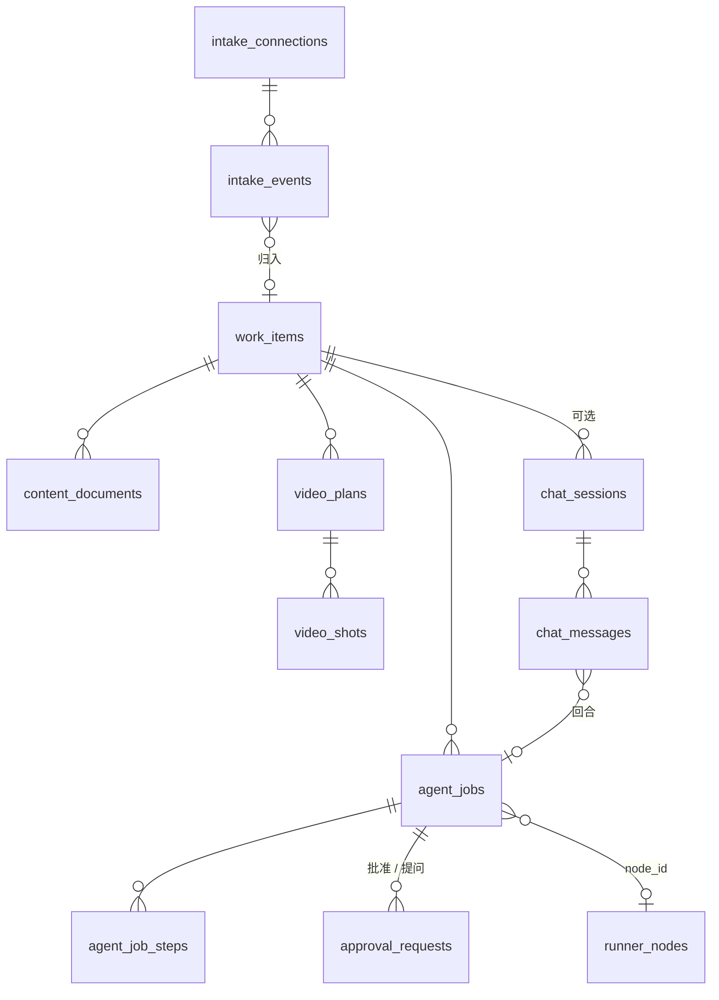

# 数据库设计规划（0.5）

> 2026-11-17 起草，2026-11-18 按第 1 轮字段评审改为 **MVP 精简版**（第 2～7 节，答复见 9.1）· 状态：**2026-11-18 第 2 轮字段评审通过，定版（DB-D11～D13）**。本文只出方案，不改线上、不写迁移。确认后的结论写入第 10 节，再按第 8 节分步实施。
>
> 输入：本分支 `supabase/migrations`（25 个文件）；`codex/0.4` 中的线上只读快照（`design/06`，2026-11-16）、0.4 用户方向（`design/05` Q-01～Q-08）和独立评审（`design/10`）。线上结构已于 2026-11-17 完成 DB0 对账（见 1.2）；1.1 的行数仍是 2026-11-16 的数字，上线脚本执行时会在前置断言里重新核对。

## 1. 现状事实

### 1.1 线上 35 张表（2026-11-16 快照，17 张有数据）

| 分组 | 表（行数） |
| --- | --- |
| 组织与权限 | `organizations`(1) `profiles`(2) `organization_members`(2) `organization_roles`(4) `audit_events`(2) |
| 资产与配置 | `assets`(2) `storage_provider_configs`(2) `prompt_examples`(5) |
| 收集 | `source_categories`(10) `signals`(33) `selections`(4) |
| 内容 | `content_projects`(1) `content_documents`(3) `content_revisions`(6) `content_review_events`(9) `content_ai_proposals`(0) `content_project_assets`(0) |
| 外部发布 | `publishing_channels`(0) `content_publications`(0) `publication_metrics`(0) |
| 外部接入 | `intake_connections`(1，已过期) `intake_receipts`(2) `intake_oauth_requests/grants/tokens`(各 0) |
| 读者站（旧结构） | `site_settings` `site_categories` `site_entries` `site_entry_bodies` `site_release_sources` `site_release_events` `site_topics` `site_topic_items` `site_resources` `site_bookmarks`（全部 0） |

### 1.2 仓库迁移与线上的关系

**DB0 对账结论（2026-11-17，线上只读导出 schema 和迁移历史，与仓库前 13 个迁移在 PGlite 上的结果逐对象比对）**：

| 迁移 | 线上 |
| --- | --- |
| 仓库前 13 个（`20260822…` ～ `20261006144529`，已按线上版本号改名） | **结构完全一致**：表、列、约束、索引、函数体、触发器、策略、授权、存储桶逐项比对，差异为零 |
| 其中 6 个版本号不同 | 同名迁移，线上记录的版本号是：`create_content_intake` 20260827081939、`add_content_intake_audit_indexes` 20260827082145、`create_prompt_examples` 20260827095153、`add_prompt_example_image_storage` 20260827101059、`create_storage_provider_configs` 20260827154257、`intake_remote_oauth` 20261006144529 |
| 线上多出的 3 个（仓库任何分支都没有） | `20261030021827 create_site_publishing`、`20261030021834 intake_harvest_signals`、`20261030023526 site_entries_publish_guard` |
| 仓库 `20261115100000` ～ `20261122100000`（12 个） | **都没有应用到线上** |
| `20261123100000_chat_sessions` | 只在 `codex/0.4` 分支，且有已知问题（可伪造 assistant 消息、可改 `organization_id`） |

线上多出的 3 个迁移带来的对象（全部在退役范围内）：

- 旧 `site_*` 十张表（和本地 `20261116100000` 同名但结构不同，例如 `site_settings.site_id` 线上是 text，本地是 uuid；直接 `db push` 会冲突）；
- 函数 `public.ensure_site_settings`、`public.publish_site_entry`、`public.unpublish_site_entry`、`private.is_verified_reader`、`private.site_entries_guard_release_fields`，以及 `site_entries` 上的触发器；
- 函数 `public.ingest_harvested_signals(uuid, jsonb)`：security definer，授权给 authenticated，向 `signals` 写入。**仓库中没有任何调用方**，已确认没有外部调用，直接删除（DB-D10）。

比对工具会忽略环境差异：PGlite 把 NOT NULL 记为约束、平台自带的 storage 触发器、`extensions.` 前缀。

### 1.3 关键判断

- 12 个未上线迁移**从未在线上执行过**，所以它们可以按 0.5 目标模型**重写**，而不必在旧设计上再叠修补迁移。已上线的 13 个只能追加，不能改。
- 线上真正有业务数据的只有 V1 的收集和内容表（signals 33 行、内容 19 行左右）。数据量小，迁移和回填的风险可控。

## 2. 设计原则（MVP，2026-11-18 第 1 轮字段评审后改写）

1. **如无必要，勿增实体**。表只为三件事存在：**给人看**（看板、稿件、审批）、**存数据**（输入、资产）、**进度与 AI 交接**（任务、步骤、提问）。成本账本、发布复盘、知识库、读者站专题这类，等 MVP 跑通后再加。
2. **AI native 的数据流**：输入 → 事项 → 任务 → **AI 直接把草稿写进真表**（稿件、分镜）→ 人审批 → 发布。不再为 AI 单独建一张「提案表」：防覆盖靠 `revision`，防越权靠审批门禁。
3. **复用通用结构，不为每个业务建表**：
   - 一张 `approval_requests` 同时承载批准和提问；
   - 一张 `audit_events` 承载所有历史，包括审核记录；
   - 一张 `agent_jobs` 承载所有 AI 工作（出稿、分镜、Chat 回合、抓取），类型用 `kind` 区分；
   - 易变的细节放 jsonb（`brief`、`payload`、`usage`），稳定后再升成列。
4. **门禁仍在数据库**（不变）：审批绑定版本、发布只走 RPC、节点租约。
5. **已上线的迁移只追加；未上线的可以重写**。
6. **租户隔离**：每张表都有 `unique(organization_id, id)`，表间外键都带 `organization_id`（原 B2）。

## 3. MVP 表清单

标记：**保留** = 不动；**改造** = 保留并改字段；**新建**；**重写** = 未上线的迁移按新设计重写；**退役** = 线上已有，数据迁移后删除；**不做** = 从 0.5 迁移集中删掉，以后需要再加。

| 模块 | 表 | 处理 | 理由 |
| --- | --- | --- | --- |
| 基座 | `organizations` `profiles` `organization_members` `organization_roles` | 保留 | 已上线，有数据 |
| | `audit_events` | 保留，**复用** | 审核记录、发布记录、回答记录都写这里，不再单独建历史表 |
| 收集 | `intake_events` | **新建（精简）** | 所有入口的一条输入；11 个字段，其余放进 `payload` |
| | `intake_connections` | 保留 | 外部令牌；飞书、企微也是一种连接（`adapter`） |
| | `source_categories` | 保留 | 事项分类 |
| | `signals` `selections` `intake_receipts` `quick_captures` OAuth 三表 | 退役 / 不做 | 由 `intake_events` + `work_items` 取代 |
| | `im_channels` | **不做** | 平台信息在 `intake_connections.adapter`；回复地址在 `intake_events.payload.reply_to` |
| 看板 | `work_items` | **新建（精简）** | 一张卡；**状态直接存 `status` 列**，不建看板视图 |
| | ~~`work_item_board` 视图~~ | **不做** | 见第 1 轮评审答复 R1 |
| 内容 | `content_documents` | 改造 | 改挂 `work_item_id`；**发布信息并入本表**（`published_*` 列） |
| | `content_revisions` | **退役** | 不存历史版本；`revision` 只作为计数器，审批仍然绑定版本号 |
| | `content_review_events` | **退役 → `audit_events`** | 审核历史是通用审计 |
| | `content_ai_proposals` | **退役** | AI 直接写稿件草稿；生成过程留在 `agent_job_steps` |
| | `content_project_assets` `content_projects` | 退役 | 关联资产 MVP 不做（见 R3）；Brief 并入 `work_items.brief` |
| 发布 | `publishing_channels` `content_publications` `publication_metrics` | **退役** | 人工发布：发布链接回填到 `content_documents.published_url`；不做数据复盘 |
| | ~~`content_results` `content_result_versions` `public_results`~~ | **不做** | 读者站直接读 `content_documents` 的已发布列（见 R7） |
| | 本地 `site_*` 十二表、线上旧 `site_*` 十表 | 不做 / 退役 | 已确认整表移除 |
| 执行 | `agent_jobs` | 重写（**精简到约 20 列**） | 预算、轮次、模型等放 `payload` 和步骤里 |
| | `agent_job_steps` | 重写（**精简到 10 列**） | 评估、输入摘要、用量都放 jsonb |
| | `approval_requests` | 重写（DB1 已加提问） | 加 `notified_at`，替代 outbox |
| | `runner_nodes` | 新建 | 节点身份（DB-D8），不让 worker 持有 `service_role` |
| | ~~`outbox`~~ | **不做** | 通知由节点扫描 `notified_at is null` 的待办发送（见 R4） |
| Chat | `chat_sessions` `chat_messages` | 新建 | 会话可以挂在某张事项卡上（`work_item_id`），复用同一套任务 |
| 知识 | `knowledge_entries` `decision_memories` | **不做** | MVP 由 worker 直接读仓库 `knowledge-base/` 里的 Markdown 文件 |
| | `prompt_examples` | 保留，不再投入 | 已上线、有 5 行数据、V1 有页面；删了会丢数据 |
| 视频 | `video_plans` `video_shots` | 重写（精简） | AI 直接写草稿分镜；`video_shots.render_status` 就是渲染进度 |
| | `video_storyboard_proposals` `video_cost_entries` 视图 `video_plan_cost_summary` | **不做** | 见 R5、R6 |
| 资产与配置 | `assets` `storage_provider_configs` | 保留 | |

**数量**：0.5 上线后 public schema 共 **21 张表、0 个视图**（上一版约 36 张 + 2 个视图）。

- **沿用已上线的 11 张**：基座 5 张，加 `intake_connections`、`source_categories`、`content_documents`、`assets`、`storage_provider_configs`、`prompt_examples`。
- **新建或首次上线 10 张**：`intake_events`、`work_items`、`agent_jobs`、`agent_job_steps`、`approval_requests`、`runner_nodes`、`chat_sessions`、`chat_messages`、`video_plans`、`video_shots`。
- **线上退役 24 张**：signals、selections、content_projects、intake_receipts、OAuth 3 张、旧 site 10 张、content_revisions、content_review_events、content_ai_proposals、content_project_assets 和外部发布 3 张。

## 4. 字段草案（MVP）

### 4.1 `intake_events`：一条输入，不可变

| 字段 | 说明 |
| --- | --- |
| `id` `organization_id` | — |
| `source` | `web` / `im` / `api` / `chat` |
| `connection_id` | → `intake_connections`；Web 和 Chat 为空 |
| `external_id` | 来源内的事件 id；Web 用客户端生成的幂等键，所以**不为空**。`unique(organization_id, source, connection_id, external_id) nulls not distinct`（原 B3） |
| `text` `url` | 原始内容 |
| `payload jsonb` | 其余全部放这里：附件引用、发送者、`reply_to`、`intent`、回填来源 `legacy` |
| `work_item_id` | 归到哪个事项；为空表示还在收件箱 |
| `ignored_at` | 人忽略这条输入的时间 |
| `created_by` `created_at` | — |

只有 `work_item_id` 和 `ignored_at` 可以修改，其他列禁止 UPDATE。上一版的 `strength`、`intent`、`disposition`、`decided_*`、`legacy_ref`、`actor_ref` 都并入 `payload`，或者由 `work_item_id` 与 `ignored_at` 推出。

### 4.2 `work_items`：看板上的一张卡

| 字段 | 说明 |
| --- | --- |
| `id` `organization_id` | — |
| `kind` | `article` / `video` |
| `title` | 选题标题 |
| `brief jsonb` | 角度、平台、`content_kind`、`target_seconds`、`aspect_ratio`、旧 Brief 文本、回填来源都放这里（原 B9） |
| `category_id` | → `source_categories` |
| `status` | `todo` / `doing` / `waiting` / `review` / `done` / `dropped`，**直接决定看板列** |
| `created_by` `created_at` `updated_at` | — |

`status` 由两方写：人拖卡；少数 RPC 在任务变化时同步写（入队 → `doing`，提问或请求批准 → `waiting`，AI 写完草稿 → `review`）。上一版的 `parent_id`、`angle`、`platforms`、`origin_trigger_id`、`mandate`、`priority`、`assignee_id`、`exec_session`、`closed_*` 先不做：单人使用不需要负责人；来源可以从 `intake_events.work_item_id` 反查；会话信息放 `chat_sessions`。

### 4.3 `content_documents`：稿件，也是发布记录

改动：

- `project_id` → `work_item_id`，唯一键改为 `(work_item_id, platform)`（原 A3）；
- `revision` 保留为计数器，**不再写 `content_revisions`**；审批仍然绑定 `(content_document, id, revision)`；
- 新增发布列：`published_revision` `published_title` `published_body` `published_at` `published_url` `slug`；
- AI 写草稿走 RPC `write_document_draft(document_id, base_revision, title, body)`：如果 `base_revision` 不等于当前值（人改过了），就拒绝写入，不覆盖人的修改；
- 审核历史写 `audit_events`（`content.submitted` / `content.approved` / `content.changes_requested`）。

**读者站**：发布 RPC 把当前版本复制到 `published_*` 列。`anon` 只被授予这几列的 SELECT 权限，RLS 只放行 `published_at is not null` 的行。这样改稿不会影响线上内容，也不用另建成果表或视图。

### 4.4 执行

**`agent_jobs`**（约 20 列）：

> **DB2c-1 已实施**（迁移 `20261123100000_agent_jobs_mvp`，上线脚本 `supabase/release/0.5.0-step2.sql`）。

- 身份与归属：`id` `organization_id` `work_item_id`（可空）`kind`（取代 `job_type`）`idempotency_key`；
- 状态与数据：`status` `payload`（输入，以及预算、轮次上限、目标对象）`result` `error_code` `error`；
- 排队与租约：`attempts` `max_attempts` `run_after` `node_id` `locked_until` `lease_epoch` `cancel_requested_at`；
- 通知与时间：`notified_at` `created_by` `created_at` `updated_at`。

删掉的列：`priority`、`target_*`、`budget_cents`、`cost_cents`、`token_budget`、`tokens_used`、`hops_used`、`max_hops`、`rounds`、`max_rounds`、`driver`、`model`、`approval_request_id`、`locked_by`、`last_heartbeat_at`、`started_at`、`finished_at`。它们的去向：

- 目标放 `payload.target = {type, id, revision?}`，形状由 CHECK 约束；和身份、输入一样不可修改；
- 门禁批准放 `payload.approval_request_id`，Mandate 触发器照旧校验（已批准、未过期、同组织 / 动作 / 对象、批准版本等于对象当前版本）；`approval_requests.requested_by_job` 保留为反向关系；
- 上限放 `payload.limits = {max_rounds 1–5（默认 3）, max_hops 2–32（默认 8）, budget_cents 0–1000000（默认 100）, token_budget?}`，CHECK 约束取值；只有 `resume_agent_job` 能调高；
- 用量（tokens、费用、轮次、跳数、模型、驱动、耗时、开始 / 结束时间）按步骤推出；控制台用 `summarizeJobUsage`；
- `locked_by` → `lease_epoch`：每次认领 +1 并返回，心跳、步骤、完成、失败、提问都必须带当前值，否则拒绝；`node_id` 由 `node_claim` 写入，外键 → `runner_nodes`（DB2c-2 已加，节点删除时置空）；
- `priority` → 按 `run_after, created_at` 先进先出；
- 已有行原地搬迁，旧的进度列保存在 `result.legacy_columns`。

任务状态变化同步卡片（触发器）：`queued / running → doing`，`pending_review → review`，`blocked_needs_human / failed → waiting`，`succeeded / cancelled` 不动；`done / dropped` 的卡和 Chat 回合不动。`work_item_id` 由入队方传入，或从稿件的 `work_item_id` 推出，两者不一致时拒绝（B7）。

节点不能直接 INSERT / UPDATE 这两张表，只能走 RPC。DB2c-2 起 agent worker 用节点令牌调 `node_*` RPC（见下面 `runner_nodes`）；带 `service_role` 的旧节点 RPC 只留给视频 worker，DB5 一起切换。

**风险（已接受）**：轮次、跳数、预算、Token 上限从数据库列检查改为节点内检查——worker 的循环控制器从 `payload.limits` 读上限、从已落库的步骤累加用量（恢复时也一样）。一个有缺陷或被篡改的节点可能超支 LLM 预算；数据库仍然保证：上限本身只能由人调高，所有写入带有效租约，**付费渲染和发布由审批门禁拦在数据库层**，强度不变。

**`agent_job_steps`**（10 列）：`id` `organization_id` `job_id` `seq` `kind`（context / fetch / generate / check / persist；check 的 `output.stage` 为 precheck / evaluate）`status` `output jsonb`（含 round、评估、输入摘要）`usage jsonb`（input/output tokens、cost_cents、模型、驱动、耗时）`error` `created_at`。只追加，只能经 `record_agent_job_step` 写入，`seq` 在任务行锁下分配。

**`approval_requests`**：保留 DB1 的结构，新增 `notified_at`（DB2c-1 已加）；`estimated_cost_cents` 并入 `payload` 留到 DB5（视频门禁还在用它算批准额度）。

**`runner_nodes`**（DB2c-2 已建）：`id` `organization_id` `name` `token_hash` `revoked_at` `last_seen_at` `created_at`。上一版的 `allowed_job_types` 先不做。

- 创建 / 吊销：`create_runner_node`（返回明文令牌 `stn_…`，只显示一次，库里只存 sha256）、`revoke_runner_node`，需要 `organization.manage`；控制台入口在「本地 Agent」页的「执行节点」。未吊销的节点组织内不重名。
- 节点调用（DB-D16）：worker 只持有**公开 key + 节点令牌**，以 anon 身份调用 12 个 `node_*` RPC（认领、心跳、完成、失败、写步骤、读步骤、出稿上下文、分镜知识、写提案、写分镜提案、待发通知、标记已通知），每次都在库内校验令牌哈希。
- 规则：吊销的令牌一律拒绝；`node_claim` 只认领本组织的任务并写 `node_id`；其余调用要求任务属于本组织、`node_id` 是本节点且仍在 `running`，再叠加 `lease_epoch`；通知只看本组织。
- 在线：`last_seen_at` 每次调用更新（30 秒节流），两分钟内算在线。

**通知**（取代 outbox，DB2c-1 已实施）：节点主循环调用 `list_pending_notices`，取两类记录：`approval_requests` 中 `status='pending' and notified_at is null` 的（批准和提问），以及 `agent_jobs` 中 `pending_review / blocked_needs_human / failed` 且 `notified_at is null` 的。发送地址取任务来源输入或事项最早 IM 输入的 `payload.reply_to`，发完 `mark_notice_sent` 回写 `notified_at`；失败不回写，下一轮自动重试；没有 IM 地址的直接标记。任务状态一变 `notified_at` 自动清空；提问时任务本身记为已通知，由提问那条负责通知。上线前已有的记录记为已通知。

### 4.5 Chat

- **`chat_sessions`**：`id` `organization_id` `owner_id` `work_item_id`（可空，在某张卡上聊）`title` `exec_session jsonb` `archived_at` `created_at` `updated_at`。
- **`chat_messages`**：`id` `organization_id` `session_id` `seq` `role` `content` `agent_job_id` `created_at`。只能通过 `send_chat_message` RPC 写入（原 B8）；`assistant` 消息只能由节点写。

### 4.6 视频

- **`video_plans`**：`project_id` → `work_item_id`；去掉 `source_proposal_id`。AI 直接写 `status='draft'` 的计划和镜头，人编辑后申请付费渲染（审批绑定计划的 `revision`，保持不变）。
- **`video_shots`**：去掉 `estimated_cost_cents` `actual_cost_cents`；`render_status` 就是进度。付费渲染的预估费用写在审批的 `payload` 里给人看。

## 5. 关系图

## 6. 数据库强制的不变量

1. `intake_events` 去重键唯一；除 `work_item_id` 和 `ignored_at` 外不可更新。
2. 同一个 `work_item` 同时最多一个 `running` 的非 Chat 任务（部分唯一索引，`kind <> 'chat_turn'`，原 B6）；可以有多个 `queued`（自动出稿每个平台一条），认领时跳过已有运行任务的事项。
3. 节点写入时 `lease_epoch` 必须等于当前值（心跳、步骤、完成、失败、提问）。
4. 发布、付费渲染必须带有效批准，且批准的版本等于对象当前的 `revision`（已有逻辑，保留）。
5. `decide_approval_request` / `answer_question` 只允许登录的人调用（DB1 已实现）。
6. `published_*` 列只能由发布 RPC 写入；`anon` 只能读这几列。
7. AI 写稿必须带 `base_revision`，与当前版本不一致就拒绝。
8. `chat_messages` 的 `assistant` 消息只能由节点写；`seq` 和时间由服务端生成。

## 7. 现有数据怎么迁

| 旧数据（线上行数） | 去向 | 规则 |
| --- | --- | --- |
| `intake_receipts`(2) | `intake_events` | `source=api`，原去重键写入 `external_id` |
| `signals`(33) | `intake_events`；已整理的再生成 `work_items` | 原 id 记在 `payload.legacy` |
| `selections`(4) | `work_items` | `core_thesis`、`angle_type`、`outline_template` 等并入 `brief` |
| `content_projects`(1) | 合并进对应的 `work_items` | Brief 合并；回填 `content_documents.work_item_id` |
| `content_review_events`(9) | `audit_events` | `action = content.<status>`，原 note 写入 metadata |
| `content_revisions`(6) | 不迁 | 只是历史快照；上线前的备份里保留 |
| `content_documents`(3) | 原地保留 | 加 `work_item_id` 和发布列 |
| 外部发布三表（全部 0 行） | 直接删除 | — |
| `prompt_examples`(5) | 原地保留 | — |

验收：每条旧记录都能通过 `payload.legacy` 或 `brief.legacy` 找到新记录，行数守恒。旧表在同一个上线脚本里删除（DB-D6），上线前先备份。

## 8. 实施步骤

| 步骤 | 内容 | 验收 | 是否碰线上 |
| --- | --- | --- | --- |
| **DB0 对账**（2026-11-17 完成） | 只读导出线上 schema 和迁移历史（不含数据），与仓库前 13 个迁移逐对象比对 | 结论见 1.2 | 只读 |
| **DB1 基线整理**（2026-11-17 完成） | 迁移历史对齐线上（A4）；在未上线迁移里原地修正 B1、B5。`quick_captures`、本地 `site_*` 这类要被替换的部分，等 DB2/DB4 的替代物就位后再删，保证每一步门禁都是绿的 | 根目录全部测试 + 三个 demo 通过 | 否 |
| **DB2a 核心表**（2026-11-18 完成） | 迁移 `20261115090000_mvp_core`：`work_items`、`intake_events` + `record_intake_event`、`content_documents.work_item_id`、回填函数 `private.backfill_v1()`（V1 → 0.5，可重复执行）；旧表暂不删 | `mvp-core-db.test.ts`：幂等、权限、原始输入不可改、回填可追溯且第二次执行为 0 | 否 |
| **DB2b 入口与调用方**（2026-11-18 完成） | 速记、外部收录、IM 共用 `private.capture_core`：只收录 → 收件箱；自动出稿 → 同一事务建事项 + 稿件 + 任务；`accept_intake` 保留 V1 输入契约；`im_channels` 删除，回复地址进 `payload.reply_to`；`promote_intake_event` 一步把输入转成事项；稿件 `project_id` 改可空、新稿件只挂 `work_item_id`；worker、Edge Function、控制台（收件箱 + 事项页）全部改用新表。AI 写草稿 RPC 并入 DB2c | 全部门禁 | 否 |
| **DB2c-1 执行精简**（2026-11-18 完成，上线脚本第 2 批） | `agent_jobs` / `agent_job_steps` 按 4.4 精简；`lease_epoch`；串行与卡片状态同步；`notified_at` 通知；worker、视频 worker、控制台同步改 | `agent-jobs-mvp-db.test.ts`（串行、状态同步、payload 形状、门禁、迁移搬运）、`release-step2.test.ts`、全部门禁 | 第 2 批由 Codex 执行 |
| **DB2c-2 节点身份**（2026-11-19 完成，上线脚本第 3 批） | `runner_nodes` + `agent_jobs.node_id` 外键；节点令牌由数据库 `node_*` RPC 校验（DB-D16），agent worker 不再持有 `service_role`；控制台「执行节点」；视频 worker 留到 DB5 | `runner-nodes-db.test.ts`（吊销、跨组织、只写自己持有的任务、通知范围）、`node-backend.test.ts`、`release-step3.test.ts`、全部门禁 | 第 3 批由 Codex 执行 |
| **DB2c-3 AI 直接写草稿** | `write_document_draft(base_revision)`；退役 `content_ai_proposals`，审核走稿件本身 | 人改过就拒绝写入 | 否 |
| **退役迁移**（DB2 收尾，代码不再引用旧表后） | 调用 `private.backfill_v1()`，校验行数守恒，删除旧表；`content_documents.work_item_id` 改必填、删 `project_id` | 行数守恒断言 | 否 |
| **DB3 Chat** | `chat_sessions` `chat_messages` + chat 回合 | 浏览器无法伪造 assistant 消息 | 否 |
| **DB4 发布与读者站** | 发布 RPC 写 `published_*`；`anon` 列授权；sense-site 改读 `content_documents`；删除本地 `site_*` 迁移和外部发布三表的代码 | 未批准读不到；下线后读不到；改稿不影响已发布内容 | 否 |
| **DB5 视频精简** | `video_plans` 改挂 `work_item_id`；删除分镜提案和成本账本；AI 直接写草稿分镜 | 现有视频测试改写后通过 | 否 |
| **DB6 生成上线脚本** | 把 0.5 迁移集、回填、删除 17 张旧表和 `intake_oauth` RPC 拼成一个脚本（见 8.1）；在导入了线上结构的隔离库上完整演练 | 演练通过；所有代码不再引用旧表 | 否 |
| **DB7 上线** | 先部署 0.5 控制台和 Edge Function → 备份 → Codex 执行上线脚本 | 脚本内置的对账断言全部通过 | **是，执行前由你批准** |

**DB0 怎么做**（本机没有 Supabase CLI、psql 和 docker，也不应把数据库密码或访问令牌交给 Agent，所以由人在控制台执行一次只读查询）：

1. 在 Supabase Dashboard 的 SQL Editor 中运行 `supabase/snippets/schema_snapshot.sql`（只有 SELECT，只读结构，不读业务数据），把唯一的结果单元格保存为 JSON 文件。
2. 同一文件末尾注释里的第二条查询会导出迁移历史，也保存下来。
3. 运行 `npx tsx testing/db/db0-diff.ts <文件> > db0-report.md`：用同一条查询读取「仓库前 13 个迁移在 PGlite 上的结果」，按表、列、约束、索引、函数（含函数体 md5）、触发器、策略、授权、存储桶逐项比对。

仓库这一侧已验证：前 13 个迁移得到 25 张 public 表；按 2026-11-16 的快照，线上应多出旧 `site_*` 十张。

DB1～DB5 都只在仓库和 PGlite 上进行，可以和 R2（并入 workers/agent）、R3（Chat）交错推进。建议顺序：DB1 → DB2 → R2 → DB3 + R3 → R4 看板（依赖 DB2 的视图）→ DB4 → DB5。

## 8.1 上线脚本形态（为「一把执行」准备）

> 2026-11-18 起按 DB-D14 分批执行：第 1 批（DB2a + DB2b）是 `supabase/release/0.5.0-step1.sql`。每批的形态都按本节，旧表的删除和行数守恒断言放在最后的退役批次。

目标：定版后生成**一个**上线脚本，交给 Codex 在线上执行一次。约束如下：

1. **来源是迁移文件，不是手写脚本**。0.5 迁移集在 PGlite 上测试通过后，用生成器拼成 `supabase/release/0.5.0-golive.sql`，测的和跑的是同一份 SQL。
2. **单事务**（`begin … commit`），任何一步失败全部回滚。
3. **开头做前置断言**：线上的迁移历史、关键表行数、旧 `site_*` 是否为空，必须与 DB0 报告一致，否则直接 `raise exception` 中止，不在漂移的库上执行。
4. **结尾写迁移历史**：插入 `supabase_migrations.schema_migrations`，以后 `db push` 不会重放。
5. **结尾做对账断言**：行数守恒、`legacy_ref` 全覆盖，失败回滚。
6. 脚本只含结构和数据，**不含密钥、项目 ID**。

## 9. 结构审计（2026-11-17）

对照本文第 3～7 节和仓库 25 个迁移逐项检查。**A 类阻断上线**，B 类是结构错误，必须在 DB1 修正；C 类需要你决定。每项附建议。

### A. 阻断：不改就不能一把执行

| # | 问题 | 依据 | 建议 |
| --- | --- | --- | --- |
| A1 | 同一个脚本里「建新表 + 删旧表」，执行完那一刻，线上 V1 控制台立即失效 | 控制台读写 `signals`(6 处)、`selections`(5)、`content_projects`(3)、`intake_receipts`；workers 和 `content-draft` 函数也读 `content_projects` | 二选一，见 C1 |
| A2 | 外部收录入口 `accept_intake` 写 `signals` + `selections` + `intake_receipts`。删掉这三张表后，`intake-gateway` 会直接报错 | `20261006131202` | 同一个脚本里重写 `accept_intake`，改为写 `intake_events`，返回值保持兼容（`topic_path` 改指向事项），同时部署新的 Edge Function |
| A3 | `content_documents.project_id` 是 NOT NULL，带外键，且有 `unique(project_id, platform)`；`guard_cloud_content` 触发器里还写死了 `new.project_id<>old.project_id` | `20261006111044` | 迁移顺序：加 `work_item_id` → 回填 → 设为 NOT NULL → 新唯一键 `(work_item_id, platform)` → 改写守卫函数 → 删 `project_id`；之后才能删 `content_projects` |
| A4 | 6 个迁移的版本号与线上历史不同，另有 3 个线上独有的迁移（DB0 已确认，见 1.2） | §1.2 | 前置断言按**对象是否存在和结构**判断，不按版本号；上线前把仓库 6 个文件改名为线上版本号，并为线上 3 个迁移补占位文件，使 `db push` 历史对齐 |
| A5 | 线上函数 `ingest_harvested_signals` 写 `signals`，仓库里没有调用方 | DB0 | **已确认没有外部调用（DB-D10）**，上线脚本直接删除 |

### B. 结构错误：DB1 重写时修正

| # | 问题 | 依据 | 建议 |
| --- | --- | --- | --- |
| B1 | 视频表的资产外键是单列 `references assets(id)`，数据库本身不阻止引用其他组织的资产（守卫触发器 `video_asset_in_org` 已在拦，所以不是现存漏洞，属于纵深防御） | `video_plans.composed_video_asset_id`、`video_shots` 的 3 个资产列 | **DB1 已改**为 `(organization_id, xxx_asset_id)` 复合外键，触发器保留，用于给出可读的报错 |
| B2 | §4 的字段草案没写租户隔离规则 | — | 所有新表都要 `unique(organization_id, id)`，表间外键一律带 `organization_id`；写进 §2 原则 |
| B3 | `intake_events` 的去重键里，`source_event_id` 可为空，Postgres 默认把 NULL 视为互不相等，Web 速记会重复插入 | §4.1 | 去重键改用 `nulls not distinct`（PG15+），或者无事件 id 的入口不去重并写明 |
| B4 | `work_item_board` 视图默认以所有者身份执行，**会绕过 RLS**，跨组织泄露 | Postgres 视图语义 | 声明 `with (security_invoker = true)`（`video_plan_cost_summary` 已这样做）。`public_results` 例外：它以所有者身份执行，但只暴露公开字段，并且只授权给 anon |
| B5 | `approval_requests.action` 和 `target_*` 都是 NOT NULL，`action` 的取值里也没有「提问」，`kind=question` 放不进去 | `20261115100200` | **DB1 已改**：加 `kind`、`question`、`answer` 和状态 `answered`，按 kind 做表级 check；新增 `ask_question`（只限节点）和 `answer_question`（只限登录的人，回答后把任务重新排队） |
| B6 | 串行约束「同一事项同时最多一个 queued/running 任务」会挡住 Chat：用户在事项里追问时，出稿任务正在跑 | §6 第 2 条 | 部分唯一索引加上 `mode <> 'chat'`；`video` 渲染另起一类，或也排除 |
| B7 | `agent_jobs` 同时有 `target_type/target_id`（文本多态）和新增的 `work_item_id`，归属有两套 | `20261115100000` | 保留 target 指向「被改的对象」（稿件 / 分镜），`work_item_id` 指向「属于哪张卡」；写明两者含义，并在入队 RPC 中校验它们属于同一事项 |
| B8 | `chat_messages` 的「插入用户消息，同一事务入队任务」，如果靠浏览器直接 INSERT 加触发器实现，`seq` 并发递增会冲突 | §4.5 | 浏览器不直接写表，只调用 `send_chat_message` RPC：先锁会话行再分配 `seq`，然后入队 |
| B9 | `content_projects` 上的 `content_kind`、`target_seconds`、`aspect_ratio` 在 `work_items` 里没有对应位置；`brief` 原来是 text，新设计是 jsonb | `20261006111044`、§4.2 | `kind` 只区分产出形态；`content_kind` 等写进 `brief`（给出 jsonb 结构和 check）；旧 text 迁到 `brief.text` |
| B10 | `decision_memories.platform` 允许 `site`，`content_documents.platform` 不允许，两边枚举不一致 | `20261115100100` | **复核后不改**：`site` 是读者站这个发布平台，记忆可以针对它；稿件始终以 `master` 稿发布到读者站，不需要 `site` 稿。DB4 成果层的 `platform` 取值再与这里对齐 |
| B11 | 表名 `triggers` 与 Postgres 的 TRIGGER 概念、`information_schema.triggers` 同名，代码和排障时容易混淆 | — | **已改名 `intake_events`**（DB-D9），本文已全部替换 |

### C. 需要决定的事项（已全部决定）

| # | 问题 | 选项 |
| --- | --- | --- |
| C1 | 一把执行与旧控制台的关系 | **已决定 DB-D6**：一个脚本建、迁、删全做 |
| C2 | 首轮范围与「定版」 | **已决定 DB-D7**：本地做完 DB1～DB5 再上线一次 |
| C3 | 节点身份 `runner_nodes` 怎么落地 | **已决定 DB-D8，实现方式改为 DB-D16**：令牌由数据库 `node_*` RPC 直接校验 |
| C4 | 读者站 | `sense-site` 现在读的是本地设计的 `site_*`（含 `site_readers`、收藏），线上是另一套。按 DB-D7，读者站在 DB4 中改读 `public_results`，和上线脚本同时切换 |

### 9.1 第 1 轮字段评审答复（2026-11-18）

逐条回应审计台导出的意见。**采纳**的已写进第 2～7 节；**补充**是我按同样的原则顺带提出的，你没有标记，请在第 2 轮确认。

| # | 你的意见 | 答复 |
| --- | --- | --- |
| R1 | `work_item_board` 是为了显示列，还是为了关联多个任务？只为显示列的话，在 `work_items` 加字段 | 只为显示列：视图从任务和审批状态推导列，好处是状态不会不一致。**采纳**：改成 `work_items.status`，由人拖卡和少数 RPC 写入，视图不做 |
| R2 | `content_revisions` 不需要快照，版本暂不存历史 | **采纳**，表退役。`revision` 保留为计数器：审批绑定版本、AI 写稿防覆盖都要用。代价是看不到改稿前后的对比，需要时再加回 |
| R3 | `content_project_assets`：关联的资产应该放在……（备注没写完） | MVP 先不做关联表（线上 0 行）：稿件正文直接引用资产地址，视频资产挂在镜头上。**想放到哪里请第 2 轮补充** |
| R4 | `outbox` 能否去掉，直接用已有的结果表 | **采纳**，去掉。结果表也删了，没有现成的表可以复用，所以改为在 `approval_requests`、`agent_jobs` 上加 `notified_at`，节点扫描未通知的记录后发送，失败自动重试（4.4） |
| R5 | `video_storyboard_proposals` 能否直接用分镜表 | **采纳**：AI 直接写 `draft` 状态的 `video_plans` / `video_shots`，人在原表上修改；付费渲染仍然需要批准 |
| R6 | 先不记成本账本；成本汇总视图能否移除，进度复用 `video_shots` | **采纳**：账本和汇总视图都不做，镜头表去掉成本列；进度看 `render_status`；预估费用写在付费渲染审批的 `payload` 里给人看 |
| R7 | 人工发布不需要 `content_publications`；不能自动抓数据的话 `publication_metrics`、成果层用处不大；`public_results` 直接读原始内容即可，不要重叠建模 | **采纳**：外部平台的发布链接回填到 `content_documents.published_url`；读者站直接读 `content_documents` 的已发布列。`published_*` 是发布那一刻的快照列，不是另一张表，不重叠，也不需要迁移数据。**`publishing_channels` 你标了「可以」**，但没有发布记录后它就没用了（线上 0 行），建议一起退役，请确认 |
| R8 | 知识库、决定记忆、提示词示例能否先不做 | 知识库和决定记忆**采纳**：不做，worker 直接读仓库 `knowledge-base/` 里的文件。`prompt_examples` 已上线，有 5 行数据和 V1 页面，**建议保留不动、不再投入**；删除就要删数据，请确认 |
| R9 | `agent_jobs` 主表尽量简化，内容放进度里；跟看板是否真的需要关联 | **采纳精简**：36 列减到 21 列，上限放 `payload`，用量和时间放步骤（4.4）。看板关联**需要**，而且只要一个 `work_item_id`：卡片要显示「AI 在做 / 在等你」，同一事项不并发跑两个任务也靠它 |
| R10 | `agent_job_steps` 字段精简 | **采纳**：17 列减到 10 列 |
| R11 | `intake_events` 字段精简，MVP 先跑起来 | **采纳**：18 列减到 11 列，其余放 `payload` |
| 补充 1 | — | `content_review_events` 退役，审核历史写 `audit_events`（线上 9 行迁过去） |
| 补充 2 | — | `content_ai_proposals` 退役：AI 直接写稿件草稿，用 `base_revision` 防止覆盖人的修改 |
| 补充 3 | — | `im_channels` 不做：平台信息看连接的 `adapter`，回复地址在输入的 `payload.reply_to` |
| 补充 4 | — | `work_items` 只留 9 列；`runner_nodes` 去掉 `allowed_job_types` |

因此失效的旧审计项：B4（看板视图不做了）、B7（`target_*` 删除，归属只看 `work_item_id`）。B3、B6、B8、B9 已并入第 4、6 节。

### 9.2 第 2 轮字段评审结果（2026-11-18）

导出文件共 354 条：347 条「可以」，0 条「要改」。4 件待确认事项全部同意（publishing_channels 退役；prompt_examples 保留不投入；资产关联暂不做；补充 1～4 同意）。漏标的两处已当面确认：`content_documents` 的 6 个发布列可以；`im_channels` 移除。导出里另有 5 条「有疑问」（`work_item_board`、`outbox`、`content_results`、`content_result_versions`、`public_results`），都是第 1 轮留下的旧标记，这些表在第 2 轮已经去掉，不需要处理。**结论：定版**，下一步按第 8 节 DB2 实施。

## 10. 决定记录

| 编号 | 日期 | 决定 |
| --- | --- | --- |
| DB-D1 | 2026-11-17 | **重写**12 个未上线迁移，不在旧设计上叠修补迁移（DB1） |
| DB-D2 | 2026-11-17 | ~~首轮实施范围 DB1～DB3~~，已被 DB-D7 取代 |
| DB-D3 | 2026-11-17 | 第 3 节 17 张线上表**全部确认**为退役目标；删除写在上线脚本里（DB-D6），脚本执行前由你批准 |
| DB-D4 | 2026-11-17 | 外部发布三表（`publishing_channels` 等）**保留不动**（默认，未单独提问） |
| DB-D5 | 2026-11-17 | **授权 DB0**：只读导出一次线上 schema 和迁移历史，不含业务数据，不做写入；当天完成 |
| DB-D6 | 2026-11-17 | 上线**一个脚本全做**：建表、迁数据、删 17 张旧表在同一事务；执行前先部署 0.5 控制台和 Edge Function，V1 当场下线 |
| DB-D7 | 2026-11-17 | 本地做完 **DB1～DB5** 后**只上线一次**；读者站同时切换（~~切到 `public_results`~~，按 DB-D11 改为读 `content_documents` 已发布列） |
| DB-D8 | 2026-11-17 | 节点身份：~~令牌 + Edge Function 代理~~（实现方式由 DB-D16 取代），worker 不再持有 `service_role` |
| DB-D9 | 2026-11-17 | 输入表 `triggers` **改名 `intake_events`**，RPC 改为 `record_intake_event` |
| DB-D10 | 2026-11-17 | 线上函数 `ingest_harvested_signals` 没有外部调用，上线脚本直接删除 |
| DB-D11 | 2026-11-18 | **MVP 精简定版**：第 2～7 节为准，0.5 共 21 张表、0 个视图；读者站读 `content_documents` 的 `published_*` 列（6 列已确认） |
| DB-D12 | 2026-11-18 | 第 2 轮确认：`publishing_channels` 一起退役；`prompt_examples` 保留，不再投入；资产关联暂不做；补充 1～4 全部同意；`im_channels` 移除 |
| DB-D13 | 2026-11-18 | 字段级：`agent_jobs`、`agent_job_steps`、`video_shots`、`approval_requests` 中标「MVP 删除」的列全部删除，标「计划新增」的列按第 4 节加入 |
| DB-D14 | 2026-11-18 | **线上库就是唯一环境**（开发、测试、正式共用，目前只有你在用）。迁移改为**分批推送**：每批由 `testing/db/release.ts` 从迁移生成一个单事务脚本，先在模拟线上状态的 PGlite 上演练，再由 Codex 执行（手册见 `supabase/release/README.md`）。推上线的迁移从此只能追加；取代 DB-D6、DB-D7 里「只上线一次」的部分，第 8.1 节的脚本形态不变 |
| DB-D15 | 2026-11-18 | DB2c 拆成三步：**DB2c-1** 任务表精简（本批，`lease_epoch`、串行、卡片状态同步、`notified_at` 通知）、**DB2c-2** `runner_nodes` + 节点网关、**DB2c-3** AI 直接写草稿并退役 `content_ai_proposals`。上限检查移到节点内的风险已接受（4.4） |
| DB-D16 | 2026-11-19 | 节点令牌**由数据库直接校验**：worker 用公开 key 调 `node_*` RPC，令牌作参数，RPC 内比对 sha256；不建 Edge Function 代理（少一跳、规则全在库内、PGlite 可测）。这些 RPC 对 anon 开放，没有有效令牌什么也做不了。视频 worker 要读写对象存储，留到 DB5 再切 |
