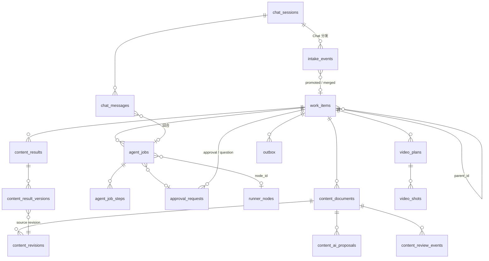

# 数据库设计规划（0.5）

> 2026-11-17 · 状态：**规划稿，待确认**。本文只出方案，不改线上、不写迁移。确认后的结论写入第 10 节，再按第 8 节分步实施。
>
> 输入：本分支 `supabase/migrations`（25 个文件）；`codex/0.4` 中的线上只读快照（`design/06`，2026-11-16）、0.4 用户方向（`design/05` Q-01～Q-08）和独立评审（`design/10`）。线上结构已于 2026-11-17 完成 DB0 对账（见 1.2）；1.1 的行数仍是 2026-11-16 的数字，上线脚本执行时会在前置断言里重新核对。

## 1. 现状事实

### 1.1 线上 35 张表（2026-11-16 快照，17 张有数据）

| 分组 | 表（行数） |
| --- | --- |
| 组织与权限 | `organizations`(1) `profiles`(2) `organization_members`(2) `organization_roles`(4) `audit_events`(2) |
| 资产与配置 | `assets`(2) `storage_provider_configs`(2) `prompt_examples`(5) |
| 收集 | `source_categories`(10) `signals`(33) `selections`(4) |
| 内容 | `content_projects`(1) `content_documents`(3) `content_revisions`(6) `content_review_events`(9) `content_ai_proposals`(0) `content_project_assets`(0) |
| 外部发布 | `publishing_channels`(0) `content_publications`(0) `publication_metrics`(0) |
| 外部接入 | `intake_connections`(1，已过期) `intake_receipts`(2) `intake_oauth_requests/grants/tokens`(各 0) |
| 读者站（旧结构） | `site_settings` `site_categories` `site_entries` `site_entry_bodies` `site_release_sources` `site_release_events` `site_topics` `site_topic_items` `site_resources` `site_bookmarks`（全部 0） |

### 1.2 仓库迁移与线上的关系

**DB0 对账结论（2026-11-17，线上只读导出 schema 和迁移历史，与仓库前 13 个迁移在 PGlite 上的结果逐对象比对）**：

| 迁移 | 线上 |
| --- | --- |
| 仓库前 13 个（`20260822…` ～ `20261006141445`） | **结构完全一致**：表、列、约束、索引、函数体、触发器、策略、授权、存储桶逐项比对，差异为零 |
| 其中 6 个版本号不同 | 同名迁移，线上记录的版本号是：`create_content_intake` 20260827081939、`add_content_intake_audit_indexes` 20260827082145、`create_prompt_examples` 20260827095153、`add_prompt_example_image_storage` 20260827101059、`create_storage_provider_configs` 20260827154257、`intake_remote_oauth` 20261006144529 |
| 线上多出的 3 个（仓库任何分支都没有） | `20261030021827 create_site_publishing`、`20261030021834 intake_harvest_signals`、`20261030023526 site_entries_publish_guard` |
| 仓库 `20261115100000` ～ `20261122100000`（12 个） | **都没有应用到线上** |
| `20261123100000_chat_sessions` | 只在 `codex/0.4` 分支，且有已知问题（可伪造 assistant 消息、可改 `organization_id`） |

线上多出的 3 个迁移带来的对象（全部在退役范围内）：

- 旧 `site_*` 十张表（和本地 `20261116100000` 同名但结构不同，例如 `site_settings.site_id` 线上是 text，本地是 uuid；直接 `db push` 会冲突）；
- 函数 `public.ensure_site_settings`、`public.publish_site_entry`、`public.unpublish_site_entry`、`private.is_verified_reader`、`private.site_entries_guard_release_fields`，以及 `site_entries` 上的触发器；
- 函数 `public.ingest_harvested_signals(uuid, jsonb)`：security definer，授权给 authenticated，向 `signals` 写入。**仓库中没有任何调用方**，已确认没有外部调用，直接删除（DB-D10）。

比对工具会忽略环境差异：PGlite 把 NOT NULL 记为约束、平台自带的 storage 触发器、`extensions.` 前缀。

### 1.3 关键判断

- 12 个未上线迁移**从未在线上执行过**，所以它们可以按 0.5 目标模型**重写**，而不必在旧设计上再叠修补迁移。已上线的 13 个只能追加，不能改。
- 线上真正有业务数据的只有 V1 的收集和内容表（signals 33 行、内容 19 行左右）。数据量小，迁移和回填的风险可控。

## 2. 设计原则

1. **每张表只有一个拥有模块**。拥有模块负责写入；其他模块通过视图或 RPC 读取。
2. **只存事实，不存可推导的状态**。看板的列由视图推导，不在 `work_items` 上存 `stage/status`。
3. **门禁在数据库**。审批、版本失效、事项串行、租约都由触发器和 RPC 强制执行。
4. **不可变的东西禁止 UPDATE**：原始输入、稿件版本、执行步骤、成果版本。
5. **表的数量服从职责**。不为减少表数而合并，例如稿件必须保留版本表（反例见 0.4 评审 §2.1）。
6. **已上线的迁移只追加；未上线的可以重写**。

## 3. 模块与表的归属（目标）

标记：**保留** = 不动；**改造** = 保留并改字段或外键；**新建**；**重写** = 本地未上线的迁移按新设计重写；**退役** = 数据迁移后删除。

| 模块（见 architecture 第 4 节） | 拥有的表 | 处理 |
| --- | --- | --- |
| 基座：组织、权限、审计 | `organizations` `profiles` `organization_members` `organization_roles` `audit_events` | 保留 |
| 资讯收集 | `intake_events` | **新建**：所有入口统一写入，不可变 |
| | `intake_connections` | 保留：外部令牌连接 |
| | `im_channels` | 重写：改为连接 ↔ IM 会话登记，回复地址写进 `intake_events.reply_to` |
| | `source_categories` | 保留：作为事项的分类 |
| | `signals` `selections` `intake_receipts` | **退役**：数据回填到 `intake_events` / `work_items` |
| | `quick_captures` | 不上线（由 `intake_events` 取代） |
| | `intake_oauth_*` 三表 + `intake_oauth` RPC | **退役**（0.4 Q-05 已确认不用自建 OAuth） |
| 看板 / 事项 | `work_items`、视图 `work_item_board` | **新建** |
| 内容生产 | `content_documents` | 改造：`project_id` → `work_item_id` |
| | `content_revisions` `content_review_events` `content_ai_proposals` | 保留 |
| | `content_project_assets` | 改造：改挂 `work_item_id`（重命名为 `work_item_assets`） |
| | `content_projects` | **退役**：Brief 并入 `work_items.brief` |
| 发布与复盘 | `publishing_channels` `content_publications` `publication_metrics` | 保留：外部平台人工发布与复盘（V1 已上线） |
| | `content_results` `content_result_versions`、视图 `public_results` | **新建**：以本地站点模型为蓝本改名、去掉站点专属字段 |
| | 线上旧 `site_*` 十表，及其 5 个函数和 1 个触发器 | **退役** |
| | 线上函数 `ingest_harvested_signals` | **退役**（仓库外创建，见 1.2） |
| | 本地 `site_*` 十二表 | 不上线（设计并入成果层；专题、收藏、资源首版不做） |
| Agent 执行 | `agent_jobs` `agent_job_steps` | 重写：加 `work_item_id` `mode` `lease_epoch` `node_id` |
| | `approval_requests` | 重写：加 `kind`（approval / question）、`question` `answer` |
| | `runner_nodes` | **新建**：受限、可吊销的节点身份，替代 `service_role` |
| 投递 | `outbox` | **新建**：待发消息，事务内写入、提交后投递 |
| Chat | `chat_sessions` `chat_messages` | **新建**（以 0.4 草稿为参考重写）；每次回合是一条 `agent_jobs(mode=chat)` |
| 知识与记忆 | `knowledge_entries` `decision_memories` | 重写：基本沿用本地设计 |
| | `prompt_examples` | 保留；以后再评估是否并入知识库 |
| 视频 | `video_plans` `video_shots` `video_storyboard_proposals` `video_cost_entries` | 重写：`video_plans` 挂 `work_item_id`，其余沿用本地设计 |
| | `assets` | 保留 |
| 系统配置 | `storage_provider_configs` | 保留 |

**数量变化（public schema）**：线上 35 张 → 退役 17 张（signals、selections、content_projects、intake_receipts、OAuth 3 张、旧 site 10 张）→ 保留 18 张；加上 0.5 新建或首次上线的 18 张（新建 6 张：intake_events、work_items、content_results、content_result_versions、runner_nodes、outbox；首次上线 12 张：chat 2、agent 2、approval 1、knowledge 2、im_channels 1、video 4；`work_item_assets` 由改名得到，不重复计），**目标约 36 张表 + 2 个视图**。表数增加主要来自从未上线的执行、知识、视频三块。

## 4. 新表与关键改动（字段草案）

### 4.1 `intake_events`：每条输入一行，不可变

| 字段 | 说明 |
| --- | --- |
| `id uuid` `organization_id` | — |
| `source_kind` | `web_capture / external_intake / im / chat / schedule` |
| `source_ref` `source_event_id` | 来源与来源内事件 id；`unique(organization_id, source_kind, source_ref, source_event_id)` 去重 |
| `actor_ref` | 发起者在来源内的身份（不映射后台账号） |
| `strength` | `explicit` 明确请求 / `inferred` 推断（影子模式） |
| `body_text` `url` `attachments jsonb` | 原始内容；附件只存对象存储引用 |
| `intent` | `capture_only / auto_draft / append` |
| `reply_to jsonb` | 回复地址（IM 会话 / chat 会话 / 无） |
| `disposition` `work_item_id` `decided_at` `decided_by` | 去向：`pending / promoted / merged / ignored`，只能由 RPC 写一次 |
| `legacy_ref jsonb` | 回填来源（旧 signal / receipt id） |

### 4.2 `work_items`：看板上的一张卡，只存事实

| 字段 | 说明 |
| --- | --- |
| `id uuid` `organization_id` `parent_id` | 一个线索拆出多个选题时用 `parent_id` |
| `kind` | `article / video / research`，决定默认执行模式 |
| `title` `angle` `brief jsonb` `platforms text[]` | 选题与 Brief（Brief 字段见 product.md 第 6 节） |
| `category_id` | → `source_categories` |
| `origin_trigger_id` `mandate jsonb` | 第一条输入；起点授权依据（来源、规则、强度） |
| `priority` `assignee_id` | 排序与负责人 |
| `exec_session jsonb` | agent_session 的会话信息（驱动、节点、原生会话 id、能否续接） |
| `closed_at` `close_reason` | 唯一的终态记录：完成 / 放弃 / 合并 |
| `legacy_ref jsonb` | 回填来源（旧 selection / project id） |

不存 `stage` / `status`：`work_item_board` 视图按「关闭 → 待答复 → 待审核 → 受阻 → 运行中 → 排队 → 待办」的顺序推导（architecture 第 8 节同款规则，见 `codex/0.4` design/12 §8.2）。

### 4.3 成果层

- **`content_results`**（可变，只能经 RPC 修改）：`work_item_id` `result_kind`（article / video）`platform` `slug` `visibility`（public / registered）`status`（online / offline）`current_version_id` `published_at` `offline_at`。
- **`content_result_versions`**（不可变，只能由发布 RPC 插入）：`result_id` `source_document_id` `source_revision` `title` `summary` `body_markdown` `media_asset_id` `content_hash` `approval_request_id` `approved_by` `approved_at`。
- **`public_results`**（视图，`security_barrier`）：只暴露上线成果当前版本的安全字段；读者角色对两张基础表都没有 SELECT 权限。

### 4.4 执行与投递

- **`agent_jobs` 新增**：`work_item_id`、`mode`（`harness / agent_session / chat / video`）、`lease_epoch bigint`（认领时递增，迟到写入被拒）、`node_id`。
- **`approval_requests` 新增**：`kind`（`approval / question`）、`question jsonb`（标题、选项、推荐项）、`answer jsonb`。
- **`runner_nodes`**：`name` `allowed_job_types` `token_hash` `revoked_at` `last_seen_at`。节点用令牌经 Edge Function 换取受限身份，只能调用节点 RPC。
- **`outbox`**：`work_item_id` `trigger_id` `channel` `kind`（receipt / needs_review / needs_answer / blocked / result）`payload` `dedupe_key` `status` `attempts` `next_attempt_at` `last_error`。只有进入「等我处理」时由触发器写入。

### 4.5 Chat

- **`chat_sessions`**：`owner_id` `title` `driver` `exec_session jsonb` `archived_at`。`organization_id` 和 `owner_id` 不可修改。
- **`chat_messages`**：`session_id` `seq`（服务端递增）`role`（user / assistant / system）`content` `agent_job_id` `created_at`（服务端时间）。浏览器只能插入 `role=user` 的消息；`assistant` 消息只能由节点 RPC 写入。
- **一次回合**：用户消息写入 → 同一事务内入队 `agent_jobs(mode=chat)` → 节点执行 → 回写 assistant 消息。用户在 Chat 里说「帮我做这个」，就写一条 `intake_events(source_kind=chat)`。

## 5. 关系图

## 6. 数据库强制的不变量

1. `intake_events` 去重键唯一；原始内容列不可更新；`disposition` 只能由 RPC 改一次。
2. 同一个 `work_item` 同时最多一个 `queued/running` 的任务（部分唯一索引）。
3. 节点写入时 `lease_epoch` 必须等于当前值。
4. 发布、付费渲染类任务必须带有效批准，且批准的版本等于对象当前版本（已有逻辑，保留）。
5. `decide_approval_request` / `answer_question` 只允许登录的人类调用，节点身份和 `service_role` 都没有执行权限。
6. `content_result_versions` 只能由发布 RPC 插入，禁止 UPDATE 和 DELETE。
7. 读者角色只能读 `public_results`。
8. `chat_messages` 的 `assistant` 角色只能由节点写入；`seq` 和时间由服务端生成。

## 7. 现有数据怎么迁

| 旧数据 | 去向 | 规则 |
| --- | --- | --- |
| `intake_receipts`（2） | `intake_events` | `source_kind=external_intake`，保留原去重键 |
| `signals`（33） | `intake_events` + 已整理的进 `work_items` | 每条 signal 生成一条 intake_event（`legacy_ref`）；`is_organized` 或已有选题的，生成或关联 work_item |
| `selections`（4） | `work_items` | `parent` 指向其 signal 对应的事项；`priority`、`outline_template` 并入 `brief` |
| `content_projects`（1） | 合入对应 `work_items` | Brief 合并；`content_documents.work_item_id` 回填 |
| `content_*` 稿件、版本、审核 | 原地保留 | 只加外键列 |
| 已批准的稿件版本 | 不自动生成成果 | 成果只能经发布 RPC 产生，迁移不伪造批准 |

验收：每类旧记录都能通过 `legacy_ref` 找到新记录；行数守恒。旧表在同一个上线脚本里删除（DB-D6），上线前务必先备份。

## 8. 实施步骤

| 步骤 | 内容 | 验收 | 是否碰线上 |
| --- | --- | --- | --- |
| **DB0 对账**（2026-11-17 完成） | 只读导出线上 schema 和迁移历史（不含数据），与仓库前 13 个迁移逐对象比对 | 结论见 1.2 | 只读 |
| **DB1 重写未上线迁移** | 删除 12 个未上线迁移，按本文写新的 0.5 迁移集（大量 SQL 沿用原文件）；同步更新 PGlite 测试和 demo | 根目录全部测试 + 三个 demo 通过 | 否 |
| **DB2 核心** | `intake_events` `work_items` `work_item_board`，内容改挂，执行改造（epoch、mode、node、串行），`runner_nodes` | 状态机、串行、epoch 测试；回填脚本在 PGlite 上行数守恒 | 否 |
| **DB3 Chat** | `chat_sessions` `chat_messages` + chat 回合 | 浏览器无法伪造 assistant 消息 | 否 |
| **DB4 成果层** | `content_results` + versions + `public_results`；读者站改读视图 | 未批准读不到；下线后读不到；改稿不影响已上线版本 | 否 |
| **DB5 视频与投递** | 视频改挂 `work_item_id`；`outbox` | 现有视频测试通过；投递失败会重试 | 否 |
| **DB6 生成上线脚本** | 把 0.5 迁移集、回填、删除 17 张旧表和 `intake_oauth` RPC 拼成一个脚本（见 8.1）；在导入了线上结构的隔离库上完整演练 | 演练通过；所有代码不再引用旧表 | 否 |
| **DB7 上线** | 先部署 0.5 控制台和 Edge Function → 备份 → Codex 执行上线脚本 | 脚本内置的对账断言全部通过 | **是，执行前由你批准** |

**DB0 怎么做**（本机没有 Supabase CLI、psql 和 docker，也不应把数据库密码或访问令牌交给 Agent，所以由人在控制台执行一次只读查询）：

1. 在 Supabase Dashboard 的 SQL Editor 中运行 `supabase/snippets/schema_snapshot.sql`（只有 SELECT，只读结构，不读业务数据），把唯一的结果单元格保存为 JSON 文件。
2. 同一文件末尾注释里的第二条查询会导出迁移历史，也保存下来。
3. 运行 `npx tsx testing/db/db0-diff.ts <文件> > db0-report.md`：用同一条查询读取「仓库前 13 个迁移在 PGlite 上的结果」，按表、列、约束、索引、函数（含函数体 md5）、触发器、策略、授权、存储桶逐项比对。

仓库这一侧已验证：前 13 个迁移得到 25 张 public 表；按 2026-11-16 的快照，线上应多出旧 `site_*` 十张。

DB1～DB5 都只在仓库和 PGlite 上进行，可以和 R2（抽出 core）、R3（Chat）交错推进。建议顺序：DB1 → DB2 → R2 → DB3 + R3 → R4 看板（依赖 DB2 的视图）→ DB4 → DB5。

## 8.1 上线脚本形态（为「一把执行」准备）

目标：定版后生成**一个**上线脚本，交给 Codex 在线上执行一次。约束如下：

1. **来源是迁移文件，不是手写脚本**。0.5 迁移集在 PGlite 上测试通过后，用生成器拼成 `supabase/release/0.5.0-golive.sql`，测的和跑的是同一份 SQL。
2. **单事务**（`begin … commit`），任何一步失败全部回滚。
3. **开头做前置断言**：线上的迁移历史、关键表行数、旧 `site_*` 是否为空，必须与 DB0 报告一致，否则直接 `raise exception` 中止，不在漂移的库上执行。
4. **结尾写迁移历史**：插入 `supabase_migrations.schema_migrations`，以后 `db push` 不会重放。
5. **结尾做对账断言**：行数守恒、`legacy_ref` 全覆盖，失败回滚。
6. 脚本只含结构和数据，**不含密钥、项目 ID**。

## 9. 结构审计（2026-11-17）

对照本文第 3～7 节和仓库 25 个迁移逐项检查。**A 类阻断上线**，B 类是结构错误，必须在 DB1 修正；C 类需要你决定。每项附建议。

### A. 阻断：不改就不能一把执行

| # | 问题 | 依据 | 建议 |
| --- | --- | --- | --- |
| A1 | 同一个脚本里「建新表 + 删旧表」，执行完那一刻，线上 V1 控制台立即失效 | 控制台读写 `signals`(6 处)、`selections`(5)、`content_projects`(3)、`intake_receipts`；workers 和 `content-draft` 函数也读 `content_projects` | 二选一，见 C1 |
| A2 | 外部收录入口 `accept_intake` 写 `signals` + `selections` + `intake_receipts`。删掉这三张表后，`intake-gateway` 会直接报错 | `20261006131202` | 同一个脚本里重写 `accept_intake`，改为写 `intake_events`，返回值保持兼容（`topic_path` 改指向事项），同时部署新的 Edge Function |
| A3 | `content_documents.project_id` 是 NOT NULL，带外键，且有 `unique(project_id, platform)`；`guard_cloud_content` 触发器里还写死了 `new.project_id<>old.project_id` | `20261006111044` | 迁移顺序：加 `work_item_id` → 回填 → 设为 NOT NULL → 新唯一键 `(work_item_id, platform)` → 改写守卫函数 → 删 `project_id`；之后才能删 `content_projects` |
| A4 | 6 个迁移的版本号与线上历史不同，另有 3 个线上独有的迁移（DB0 已确认，见 1.2） | §1.2 | 前置断言按**对象是否存在和结构**判断，不按版本号；上线前把仓库 6 个文件改名为线上版本号，并为线上 3 个迁移补占位文件，使 `db push` 历史对齐 |
| A5 | 线上函数 `ingest_harvested_signals` 写 `signals`，仓库里没有调用方 | DB0 | **已确认没有外部调用（DB-D10）**，上线脚本直接删除 |

### B. 结构错误：DB1 重写时修正

| # | 问题 | 依据 | 建议 |
| --- | --- | --- | --- |
| B1 | 视频表的资产外键是单列 `references assets(id)`，可以引用其他组织的资产 | `video_plans.composed_video_asset_id`、`video_shots` 的 3 个资产列 | 统一改成 `(organization_id, xxx_asset_id)` 复合外键（项目在 `content_project_assets` 里已经这样做） |
| B2 | §4 的字段草案没写租户隔离规则 | — | 所有新表都要 `unique(organization_id, id)`，表间外键一律带 `organization_id`；写进 §2 原则 |
| B3 | `intake_events` 的去重键里，`source_event_id` 可为空，Postgres 默认把 NULL 视为互不相等，Web 速记会重复插入 | §4.1 | 去重键改用 `nulls not distinct`（PG15+），或者无事件 id 的入口不去重并写明 |
| B4 | `work_item_board` 视图默认以所有者身份执行，**会绕过 RLS**，跨组织泄露 | Postgres 视图语义 | 声明 `with (security_invoker = true)`（`video_plan_cost_summary` 已这样做）。`public_results` 例外：它以所有者身份执行，但只暴露公开字段，并且只授权给 anon |
| B5 | `approval_requests.action` 和 `target_*` 都是 NOT NULL，`action` 的取值里也没有「提问」，`kind=question` 放不进去 | `20261115100200` | 拆成 `kind` + 按 kind 的 check：`approval` 必须有 action 和 target，`question` 必须有 `question` 字段且 action 为空 |
| B6 | 串行约束「同一事项同时最多一个 queued/running 任务」会挡住 Chat：用户在事项里追问时，出稿任务正在跑 | §6 第 2 条 | 部分唯一索引加上 `mode <> 'chat'`；`video` 渲染另起一类，或也排除 |
| B7 | `agent_jobs` 同时有 `target_type/target_id`（文本多态）和新增的 `work_item_id`，归属有两套 | `20261115100000` | 保留 target 指向「被改的对象」（稿件 / 分镜），`work_item_id` 指向「属于哪张卡」；写明两者含义，并在入队 RPC 中校验它们属于同一事项 |
| B8 | `chat_messages` 的「插入用户消息，同一事务入队任务」，如果靠浏览器直接 INSERT 加触发器实现，`seq` 并发递增会冲突 | §4.5 | 浏览器不直接写表，只调用 `send_chat_message` RPC：先锁会话行再分配 `seq`，然后入队 |
| B9 | `content_projects` 上的 `content_kind`、`target_seconds`、`aspect_ratio` 在 `work_items` 里没有对应位置；`brief` 原来是 text，新设计是 jsonb | `20261006111044`、§4.2 | `kind` 只区分产出形态；`content_kind` 等写进 `brief`（给出 jsonb 结构和 check）；旧 text 迁到 `brief.text` |
| B10 | `decision_memories.platform` 允许 `site`，`content_documents.platform` 不允许，两边枚举不一致 | `20261115100100` | 抽出 `private.platforms()` 或统一的 check 定义，成果层也用同一份 |
| B11 | 表名 `triggers` 与 Postgres 的 TRIGGER 概念、`information_schema.triggers` 同名，代码和排障时容易混淆 | — | **已改名 `intake_events`**（DB-D9），本文已全部替换 |

### C. 需要决定的事项（已全部决定）

| # | 问题 | 选项 |
| --- | --- | --- |
| C1 | 一把执行与旧控制台的关系 | **已决定 DB-D6**：一个脚本建、迁、删全做 |
| C2 | 首轮范围与「定版」 | **已决定 DB-D7**：本地做完 DB1～DB5 再上线一次 |
| C3 | 节点身份 `runner_nodes` 怎么落地 | **已决定 DB-D8**：令牌 + Edge Function 代理 |
| C4 | 读者站 | `sense-site` 现在读的是本地设计的 `site_*`（含 `site_readers`、收藏），线上是另一套。按 DB-D7，读者站在 DB4 中改读 `public_results`，和上线脚本同时切换 |

## 10. 决定记录

| 编号 | 日期 | 决定 |
| --- | --- | --- |
| DB-D1 | 2026-11-17 | **重写**12 个未上线迁移，不在旧设计上叠修补迁移（DB1） |
| DB-D2 | 2026-11-17 | ~~首轮实施范围 DB1～DB3~~，已被 DB-D7 取代 |
| DB-D3 | 2026-11-17 | 第 3 节 17 张线上表**全部确认**为退役目标；删除写在上线脚本里（DB-D6），脚本执行前由你批准 |
| DB-D4 | 2026-11-17 | 外部发布三表（`publishing_channels` 等）**保留不动**（默认，未单独提问） |
| DB-D5 | 2026-11-17 | **授权 DB0**：只读导出一次线上 schema 和迁移历史，不含业务数据，不做写入；当天完成 |
| DB-D6 | 2026-11-17 | 上线**一个脚本全做**：建表、迁数据、删 17 张旧表在同一事务；执行前先部署 0.5 控制台和 Edge Function，V1 当场下线 |
| DB-D7 | 2026-11-17 | 本地做完 **DB1～DB5** 后**只上线一次**；读者站同时切到 `public_results` |
| DB-D8 | 2026-11-17 | 节点身份：**令牌 + Edge Function 代理**，函数校验令牌哈希后调用节点 RPC，worker 不再持有 `service_role` |
| DB-D9 | 2026-11-17 | 输入表 `triggers` **改名 `intake_events`**，RPC 改为 `record_intake_event` |
| DB-D10 | 2026-11-17 | 线上函数 `ingest_harvested_signals` 没有外部调用，上线脚本直接删除 |
