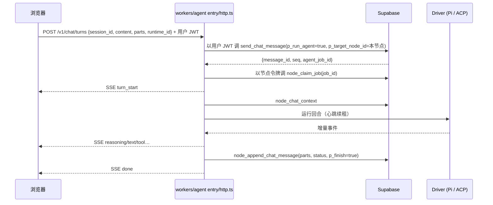
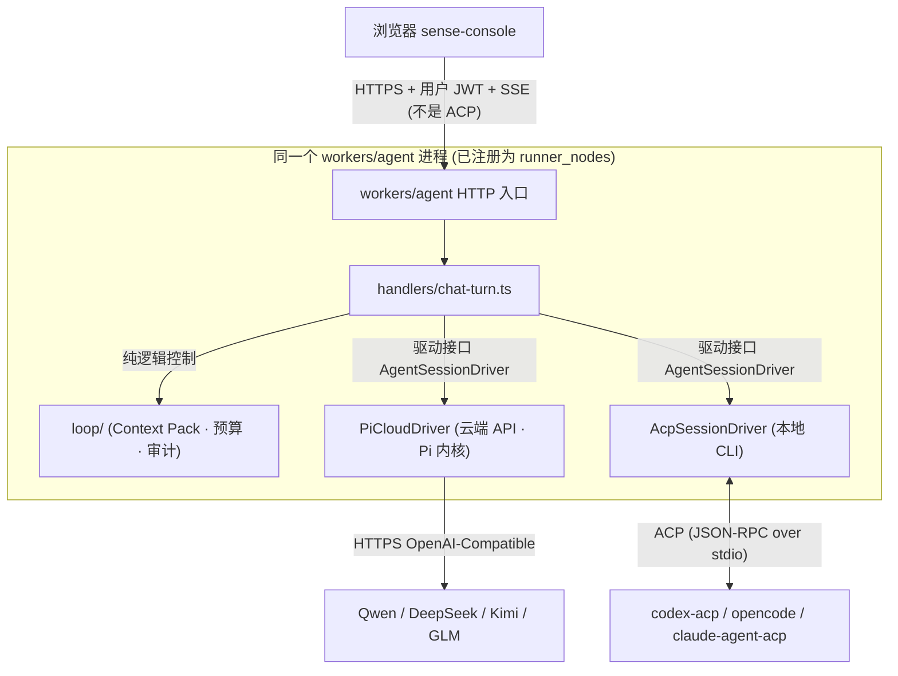

# 标准 Chat Agent 入口设计（`modules/chat`）

> 2026-11-24 · 状态：**设计已确认（决定见第 5 节），待实施**；第 4.2 节涉及的 Pi / ACP 具体 API 待 R3.0 spike 与 R3-B 真机验证。涵盖「工作台 → 智能对话与速记」（`/chat` 与 `/h5/chat`）的产品定位、交互协议、Runtime & Model Catalog 机制，以及 Pi 精简 MVP 内核与部署边界探讨。

## 1. 现状事实与目标定位

### 1.1 现状事实

1. **前端现状**：`sense-console/src/pages/chat-assistant-page.tsx` 当前是 0.4 遗留形态——消息全部保存在组件 `useState` 内存中，刷新即丢；顶部硬分为「对话测试 / 极简速记 / 自循环出稿」三选一模式；`harness_draft` 在浏览器内运行简化版循环，违背 [../architecture.md](../architecture.md)「Console 不运行 Agent 循环」的边界。
2. **执行桥现状**：对话接口直连 Vite 开发插件 `sense-console/dev/local-bridge-plugin.ts`（`apply: "serve"`，生产静态包中不存在），`stream: false` 非流式、无多轮历史上下文。
3. **数据库现状**：DB3 基础表与 RPC（`chat_sessions`、`chat_messages`、`send_chat_message`、`node_append_chat_message`）已在 `supabase/migrations/20261126100200_chat.sql` 编写完成，随 `0.5.0-step5.sql` 待执行（见 [../status.md](../status.md)）。但目前表结构只有纯文本 `content`，缺少结构化消息块 `parts`、会话运行时配置 `runtime_config` 及节点能力目录（待通过 DB3b 增补，见 [../tasks/db3b-chat-runtime-catalog.md](../tasks/db3b-chat-runtime-catalog.md)）。
4. **DB3 的回合正确性缺口（评审补充）**：没有「同一会话单活跃回合」约束；`chat_turn` 沿用默认 `max_attempts = 2` 且助手消息写入不幂等（崩溃重试会写重复回复）；助手消息与用户消息只靠 `seq` 相邻配对（并发或重新生成时会错位）；`max_rounds = 1`。均在 DB3b「需求 0」中修补。

### 1.2 目标定位（已确认）

将 `/chat`（含独立移动入口 `/h5/chat`）从“开发期测试台”升级为 **Signal to Story 平台的标准通用 Agent 入口**：

- **标准 Chat 体验**：持久会话管理、多轮上下文、SSE 流式输出、中断生成、错误重试、重新生成（Regenerate）。
- **统一底层执行面**：所有云端 API 与本地 CLI 引擎统一收口到 `workers/agent` 执行节点（`runner_nodes`），前端只读写 Supabase 与订阅 SSE，不接触任何私钥。
- **业务能力无缝触发**：默认即通用对话，通过 **Slash 命令 / 快捷工具芯片 / `@` 上下文引用** 触发速记收录、事项上下文挂载、后台出稿/分镜派发与 Mandate 审批确认。

---

## 2. 交互与能力详细设计（已确认）

> UI 组件规范、Base UI 避坑与 AI Elements 分阶段选型见 [../conventions/frontend.md](../conventions/frontend.md) 第 5 节，本文聚焦交互流与前后端协议。

### 2.1 会话管理（基于 Supabase `chat_sessions` / `chat_messages`）

- **会话列表与组织隔离**：左栏展示当前成员名下的会话（按 `updated_at desc` 排序），支持新建会话、搜索标题、重命名、归档（`archived_at`）、删除。
- **事项绑定（`work_item_id`）**：支持创建「通用全局会话」（`work_item_id = null`），也支持在某张事项卡内发起或关联到特定 `work_items`，侧栏提供「全部 / 仅看当前事项」过滤。
- **自动命名**：新会话在首轮回复完成后，由后台轻量规则或异步摘要回写 `title`（用户手动改过标题则不再覆盖）。
- **多端响应式**：桌面端为可折叠左栏 + 主对话区；`/h5/chat` 复用同一套组件，通过 `Sheet` / `Drawer` 抽屉展示会话列表。

### 2.2 Slash 命令、快捷工具芯片与 `@` 上下文引用

取消原有顶部「三选一测试模式」开关，改为 **Prompt Input 内置的标准化能力入口**：

| 交互入口 | 触发方式 | 平台语义与执行动作 | UI 呈现（AI Elements） |
| --- | --- | --- | --- |
| **Slash 命令 `/capture`** | 输入 `/capture <文本或URL>` 或点击芯片 | **前端直接调**现有速记 RPC 写入 `intake_events`（进入收件箱），不经过模型 | 本地插入一条结果卡（带跳转 `/intake` 链接） |
| **Slash 命令 `/draft`** | 输入 `/draft [要求]` | 已绑定事项或 `@doc` 时，**前端直接调** `enqueue_agent_job` 入队后台 `content_draft`（与事项页按钮同一入口） | `Task` 进度卡（显示队列 Job 状态与跳转详情） |
| **Slash 命令 `/storyboard`** | 输入 `/storyboard` | 同上，前端直接为当前绑定事项派发 `video_storyboard` | `Task` 状态卡 |
| **Slash 命令 `/work`** | 输入 `/work` | 弹出事项选择器，前端直接更新 `chat_sessions.work_item_id` | 顶部上下文芯片更新 |
| **Slash 命令 `/clear`** | 输入 `/clear` | **新建一个会话**（继承当前 `work_item_id` 与 `runtime_config`），旧会话保留在列表中。`chat_messages` 只追加，不做「同会话内重置上下文」，避免引入上下文截断标记 | 跳转到新会话 |
| **`@` 上下文引用** | 输入 `@` 呼出 `Command` 弹层 | 选择 `@work-item`（注入事项 Brief、目标、状态）或 `@doc`（注入稿件当前正文只读摘要） | 输入框上方显示已挂载芯片（`Attachment` 样式），可移除 |
| **URL 粘贴识别** | 粘贴外部链接 | 自动识别并在输入框上方提示「收录到收件箱 / 本轮抓取阅读作为参考」快捷芯片 | 芯片开关，默认不盲抓 |
| **快捷工具芯片** | 输入框上方轻量 Chip 栏（空对话时展示推荐提示词） | 覆盖高频场景（如「整理一条灵感速记」「基于当前事项讨论选题角度」「帮我拆解这篇文章结构」） | 可点击填充或直接发送 |

**评审建议：确定性动作不走模型。** `/capture` `/draft` `/storyboard` `/work` `/clear` 的参数都是明确的，直接由前端调已有 RPC（RLS / 权限照常生效）即可：零 token 成本、零幻觉、不依赖 worker 在线。模型侧的同名工具（4.2 的 MVP 工具集）只用于「用户用自然语言表达了同样意图」的场景，两者落到同一个 RPC。Slash 命令的结果作为本地 UI 卡片展示，**不写入 `chat_messages`**（`chat_messages` 的 user 行只能经 `send_chat_message` 写入，且会触发模型回合）；如需在会话里留痕，以后再加 `role = 'system'` 的事件消息。

**安全护栏（不变量）**：Chat 内的任何业务工具严格遵守 [../architecture.md](../architecture.md) 与 [harness.md](harness.md)——Agent **不能**在对话中直接发布稿件、触发付费视频渲染或篡改权限；所有需要人拍板的动作只生成草稿或弹出确认卡（`Questionnaire` / 审批链接），由人在真实登录态下走数据库 RPC 放行。

### 2.3 流式输出、中断、错误重试与重新生成

#### 1) 标准化 SSE 事件协议（`ChatStreamEvent`）

`workers/agent/entry/http.ts` 对外提供统一 SSE 事件流，同时在服务端将完整结构化片段落库到 `chat_messages.parts`（`jsonb` 数组）：

| SSE Event | `data` 核心字段 | 对应落库 `parts[]` 元素 | 前端交互行为 |
| --- | --- | --- | --- |
| `turn_start` | `jobId`, `userMessageId`, `seq`, `nodeId`, `runtime`, `contextTruncated?` | — | 锁定当前发送状态，输入框切换为「停止」按钮 |
| `reasoning_delta` | `delta` | `{ type: "reasoning", text }` | 流式追加到 `Reasoning` 块，正文开始后自动折叠 |
| `text_delta` | `delta` | `{ type: "text", text }` | 流式追加到 `Message` / `Bubble`，走安全 Markdown 渲染 |
| `plan_update` | `steps: [{ id, title, status }]` | `{ type: "plan", steps }` | 更新 `Plan` 卡片状态 |
| `tool_start` | `callId`, `name`, `inputSummary` | `{ type: "tool_call", callId, name, state: "running", ... }` | 插入或更新 `Task` 卡片为运行中 |
| `tool_end` | `callId`, `status`, `outputSummary`, `error?`, `stackTrace?` | 更新对应 `tool_call` 项（含 `stackTrace?`） | `Task` 卡片完成；若失败可折叠查看 `Stack Trace` |
| `permission_request` | `requestId`, `action`, `summary`, `options` | `{ type: "permission", ... }` | 渲染 `Questionnaire` / 确认按钮供用户选择放行或拒绝 |
| `usage` | `inputTokens`, `outputTokens`, `costCents`, `durationMs`, `model` | 写入 `agent_job_steps.usage` | 显示在消息页脚元数据 |
| `error` | `code`, `message`, `retryable`, `stack?` | `{ type: "error", code, message, stack? }` + `status = "error"` | 显示错误提示、`Stack Trace` 与「重试」按钮 |
| `done` | `assistantMessageId`, `seq`, `status` | — | 刷新 TanStack Query 缓存并恢复输入态 |

**字段取值（2026-11-24 补充冻结，合并 Chat UI 第一波时发现原表未写死）**：

- `plan` 步骤 `status`：`"pending" | "in_progress" | "completed" | "failed"`（与 ACP `plan` 条目取值一致，多一个 `failed`）。
- `permission_request.options`：`[{ id, label, kind: "allow" | "deny" }]`（ACP 的 `allow_once` 等映射为 `allow`，`reject_*` 映射为 `deny`；MVP 不展示「总是允许」）。前端可以只渲染固定的允许 / 拒绝两个按钮，回答时只回 `decision`。
- `permission` part 的 `decision`：`"allow" | "deny" | "timeout"`（`timeout` 只由 worker 写入，按拒绝处理，见 2.5）。
- `tool_start.inputSummary`、`tool_end.outputSummary`、`error.retryable` 由 worker 必填；前端按可选字段容错解析。
- 运行时 `kind`（`capabilities.runtimes[].kind`）：`"api" | "acp" | "exec"`，与 DB3b 的 `id` 格式校验一致，不再另设 `cli`。
- 运行时 `id`：云端为 `api:<provider>:<model>`（小写，非法字符换成 `-`），本机 CLI 为 `acp:<cliKey>`（如 `acp:opencode`）。
- `error.code` 除 `loop/chat/events.ts` 的 `TURN_ERROR_CODES`（`budget_exceeded`、`max_rounds`、`driver_failed`、`persist_failed`、`tool_not_allowed`、`permission_denied` 等）外，还有驱动层的 `rate_limited` / `provider_unavailable` / `provider_error`（Pi）与 `acp_*`（如 `acp_process_exited`、`acp_capacity`、`acp_auth_required`）；前端按通用错误展示，只对 `budget_exceeded` 用专门文案。

#### 2) 停止生成、错误重试与重新生成（Regenerate）

- **停止生成**：用户点击「停止」时，浏览器调用 `cancel_agent_job`（写 `cancel_requested_at`），**然后**再断开 SSE。worker 两路感知取消：SSE 连接关闭（同一节点内立即触发 `AbortSignal` / ACP `session/cancel`）与心跳返回 `cancel_requested`（兜底）。已产出部分以 `status = "cancelled"` 落库，不丢失半截回复。
  - **注意**：「SSE 断开」本身**不等于**取消——刷新、切后台、移动网络抖动都会断开。worker 收到断开时应继续把本轮跑完并落库（见下一条），只有 `cancel_requested_at` 才是真正的停止信号。否则 H5 端切个 App 回复就没了。
- **断线恢复**：若用户刷新页面，通过 `chat_messages` 与 `agent_jobs` 状态读取已落库的完整消息或错误状态。MVP 中生成过程的增量**不落库**，刷新后对 `running` 的回合只显示「生成中」占位，通过 Supabase Realtime 订阅 `chat_messages` 插入（或轮询 `agent_jobs.status`）等待最终结果；SSE 续传（按事件 id 重放）留到后续。
- **错误重试 / 重新生成**：针对失败的回合或任意一条助手消息点击「重新生成」，调用 `regenerate_chat_turn`——**不重复创建 `user` 消息**，直接针对原 `user_message_id` 新建一条 `chat_turn` 任务，并允许用户在重试前切换 `Model Selector`（例如 Qwen 超时后切 DeepSeek 重跑）。新回复以 `reply_to_message_id` 指向原 user 消息，前端把同一 user 消息下的多条助手回复折叠为「版本 1/2/…」（已确认，见第 5 节 C6）。
- **单活跃回合**：同一会话上一轮未结束时，发送按钮禁用（数据库同时拒绝），避免两轮回复交错。

### 2.4 回合时序：HTTP 主路径（评审新增）

原稿只说明了「HTTP/SSE 入口」与「`agent_jobs` 记录」都要有，但没有定义二者谁先谁后、谁来认领，存在「浏览器发了消息、任务被别的节点的队列轮询抢走、HTTP 请求那边却没有租约」的竞争。建议固定为下面的时序：



要点：

1. **由 worker 代用户写 user 消息**（持用户 JWT 调 RPC，RLS 与 `agent.dispatch` 校验照常），写消息、入队、认领在一次 HTTP 请求里完成，不存在「消息写了但没人执行」的窗口；重新生成同理（`POST /v1/chat/turns/regenerate`）。
2. **队列轮询不认领 `chat_turn`**：`entry/queue.ts` 的 `p_job_types` 不含 `chat_turn`；`chat_turn` 只能由收到 HTTP 请求的节点经 `node_claim_job` 认领。路由因此天然成立——**浏览器请求哪个节点的 HTTP 地址，就是哪个节点执行**，`target_node_id` 只是写进 payload 的记录与兜底校验。
3. **节点离线**：浏览器根本连不上 HTTP 地址，直接提示「节点离线」，不产生任何数据库写入。
4. **SSE 客户端**：原生 `EventSource` 只支持 GET 且不能带 `Authorization` 头，前端统一用 `fetch` + `ReadableStream` 解析 SSE（如 `@microsoft/fetch-event-source` 或手写约 50 行解析器）；服务端每 15 秒发一次 `: ping` 注释行防代理超时。
5. **HTTP 入口安全**：CORS 只放行控制台域名与 `localhost`；JWT 用 Supabase `getUser` / JWKS 验签；按用户与组织做并发与速率限制（例如每用户同时 2 个回合）。

#### HTTP 接口约定（v1，2026-11-24 冻结；前端与 worker 并行开发以此为准，改动须先改本节）

基地址取自所选节点的 `runner_nodes.capabilities.http_endpoint_hint`。所有请求带 `Authorization: Bearer <Supabase access token>` 与 `Content-Type: application/json`。

| 方法与路径 | 请求体 | 成功响应 | 说明 |
| --- | --- | --- | --- |
| `POST /v1/chat/turns` | `{ session_id, content, parts?, runtime_id, thinking_effort? }` | `200 text/event-stream` | 发送一轮并流式返回；`parts` 为 user 消息的 `@` 引用芯片 |
| `POST /v1/chat/turns/regenerate` | `{ session_id, user_message_id, runtime_id, thinking_effort? }` | `200 text/event-stream` | 重新生成，事件同上 |
| `POST /v1/chat/turns/{job_id}/permissions/{request_id}` | `{ decision: "allow" \| "deny" }` | `204` | 回答 `permission_request` |
| `GET /v1/health` | — | `200 { protocol_version: 1, node_id }` | 前端判断节点是否可达，无需鉴权 |

- `thinking_effort` 取值 `"off" | "low" | "medium" | "high"`，运行时不支持时忽略。
- **SSE 线格式**：每个事件为 `event: <类型>\ndata: <单行 JSON>\n\n`，类型与字段见 2.3 表；保活为 `: ping\n\n`；**结束规则（2026-11-24 评审后修订）**：worker 先落库再宣布结果——回合出错时依次发 `error`、`done(status: "error")`；正常或中断时只发 `done`。因此 **`done` 是唯一的正常终止事件**，收到 `done` 时消息已在库里；只有落库本身失败时，流以 `error`（`code: "persist_failed"`）结束且没有 `done`。前端收到 `error` 后应继续读到 `done` 或流结束为止（第一波实现收到 `error` 即停止读取，因 worker 已先落库所以结果正确，第二波 B 统一改为以 `done` 为准）。`data` 中字段名用 camelCase。
- **流开始前的错误**用普通 HTTP 状态码 + `{ code, message }` JSON 返回：`401 unauthorized`、`403 forbidden`（无 `agent.dispatch` 等）、`409 turn_in_progress`（会话已有活跃回合）、`409 claim_failed`、`422 invalid_request`（含未知 `runtime_id`）、`429 rate_limited`、`503 runtime_unavailable`。流开始后的错误一律走 `error` 事件。
- **实现补充（T3b，2026-11-25）**：另有 `404 not_found`（未知路径、权限请求不存在）、`405 method_not_allowed`、`500 internal_error`（不回显 SQL 细节）；流开始后读取上下文失败用 `error.code = "context_failed"`，同样先落库再发 `error`、`done`。浏览器断开时挂起中的权限请求记为 `deny`。节点需配置 `SENSE_NODE_ID`（数据库暂无返回节点 id 的 RPC；配错时每轮 `409 claim_failed`，worker 会立即以用户身份取消该回合释放会话）。HTTP 仅在设置 `SENSE_HTTP_PORT` 时开启，默认只监听 `127.0.0.1`；全部变量见 `workers/agent/README.md`。
- `parts` 元素形状与 2.3 表「落库 `parts[]` 元素」列一致；user 消息的引用芯片为 `{ type: "context_ref", kind: "work_item" | "document", id, label }`。

### 2.5 工具身份与权限确认回传（评审新增）

1. **工具以谁的身份执行**：HTTP 路径下 worker 手里有用户 JWT，但**模型永远拿不到它**。工具是 `handlers/chat-turn` 里写死的函数白名单（4.2 的 3 个工具），每个工具内部调用固定的一个 RPC；不提供「通用 RPC / SQL / HTTP 调用」类工具。原因：用户 JWT 拥有批准、发布等权限，若模型能任意调用 RPC，数据库门禁就形同虚设（门禁只验证「是不是这个人」，不验证「是不是这个人亲手点的」）。批准 / 发布类 RPC 必须在工具层显式禁止，并加一条单测枚举工具清单。
2. **`permission_request` 的回传通道**：SSE 是单向的，原稿未定义用户点了「允许 / 拒绝」后如何送回。建议：`POST /v1/chat/turns/{job_id}/permissions/{request_id} {decision}`（同一节点、同一用户 JWT、校验 `job.node_id` 为本节点）；worker 在内存里挂起等待，**超时（如 5 分钟）或连接丢失按拒绝处理**，结果写入该 `permission` part 的 `decision` 字段落库。挂起期间继续心跳续租。

### 2.6 费用与上下文预算（评审新增）

1. **单轮费用上限**：每个 `chat_turn` 带 `budget_cents`（默认 50，数据库夹紧在 1～500，见 [../tasks/db3b-chat-runtime-catalog.md](../tasks/db3b-chat-runtime-catalog.md) 需求 0 第 5 点）。`handlers/chat-turn` 在**每次模型调用前**累计本任务已记录的 `usage.costCents`，超出即停，已产出部分以 `error / budget_exceeded` 落库。与 `max_rounds`（默认 8）一起，防止工具循环失控。各厂商单价由节点配置提供（不进数据库）；没有单价的模型按 0 计，只受 `max_rounds` 约束，目录里标注「未计价」。
2. **按 token 截断上下文**：`node_chat_context` 只按条数（≤ 100）取历史，消息长度不受控（单条最多 20 万字）。`loop/` 中的上下文组装按以下规则在 token 维度截断：
   - **预算**：`输入上限 = 运行时 context_window − 预留输出（max_output_tokens，默认 4096）− 工具定义开销`；`context_window` 由节点在能力目录中按运行时上报（见 3.4），未知时取保守值 32K。
   - **估算**：MVP 不引入分词库，按字符估算（中日韩字符 ≈ 1 token/字、其余 ≈ 1 token/4 字符，再乘 1.1 安全系数）；模型返回真实 `inputTokens` 后，若估算偏差大于 20% 写一条 warn 日志，后续再调系数。
   - **优先级（从高到低，永不丢弃前三项）**：系统指令与安全护栏 → 本轮 user 消息 → `@` 引用与绑定事项的上下文 → 历史消息（**从最新往旧**逐条加入，放不下就停）。
   - **超长单条**：本轮 user 消息或 `@doc` 正文本身超出预算时，保留开头与结尾各一半、中间用「…（已截断 N 字）…」替代，并在 `turn_start` 事件中带 `contextTruncated: true` 让前端提示。
   - 被截掉的历史不做摘要压缩（MVP）；需要长期记忆时再引入会话摘要，届时摘要写入 `exec_session`。
   - ACP 运行时若成功 `session/load`，CLI 自己管理上下文，worker 只发本轮消息，不走上述截断。

---

## 3. 专题分析：节点注册、ACP 与 Runtime & Model Catalog

> 回应核心问题：**「底层走 `runner_nodes` 注册节点、用 ACP 模式统一调用 worker 里的 Agent，目前的理解哪里有偏差，现有代码有哪些偏离？」**

### 3.1 与总体规划完全对齐的部分

1. **所有密钥与模型/CLI 执行权留在 `workers/agent`**：前端绝不直连模型供应商，也不保留开发期 Vite `spawn`；所有执行单元必须持有可吊销节点令牌（`runner_nodes`），按组织隔离，审计与预算全记进 `agent_jobs`。
2. **统一控制面抽象**：无论底层是云端 API 还是本地 CLI，对前端 Chat 页面暴露的都是同一套会话表、同一条 HTTP/SSE 协议和同一套 UI 组件。

### 3.2 需要厘清的两处技术理解边界



1. **边界一：`runner_nodes` 当前只管“身份与心跳”，不管“能力清单与路由”**
   - 现状（`supabase/migrations/20261124100000_runner_nodes.sql`）：`runner_nodes` 只有 `id / organization_id / name / token_hash / revoked_at / last_seen_at / created_at`。控制台只知道某个节点“是否在线”，不知道它配了哪些 API Profile、本机装了哪些 CLI、有没有开启 HTTP SSE 入口。
2. **边界二：ACP 是 `worker ↔ 本地 CLI 子进程` 的协议，不是“云端 API 也必须包一层 ACP 子进程”**
   - 云端大模型 API（Qwen、DeepSeek、Kimi 等）本来就是 HTTP 接口，由 `workers/agent` 内置的 **Pi 精简内核** 直接调用即可，再把事件流转换成统一的 `ChatStreamEvent`；如果硬给云端 API 外面再包一层本地 ACP 子进程，只会增加无谓的进程开销与延迟。
   - **真正的统一层在 `workers/agent/drivers/` 的 `AgentSessionDriver` 接口**：向上对 `chat-turn` 输出同一套流式事件（`text_delta` / `reasoning_delta` / `tool_call` / `plan_update` / `permission_request`），向下分别对接 **Pi 云端内核** 与 **ACP 本地 CLI 客户端**。

### 3.3 对照现状代码的 3 处明显偏离（必须修补的断层）

| # | 现状偏离点 | 代码位置（事实） | 导致的断层 |
| --- | --- | --- | --- |
| 1 | **模型配置两张皮，且 worker 只支持单模型** | `sense-console/src/pages/models-integration-page.tsx` 写入 `sense-console/.env.local`；而 `workers/agent/config.ts` 明确不读该文件，且只读单一 `SENSE_LLM_*` 与 `SENSE_EVAL_LLM_*` | 用户在控制台配置的多厂商模型（Qwen/Kimi/DeepSeek/GLM）完全进不到 `workers/agent`，前端 `Model Selector` 无法在生产环境动态切模型 |
| 2 | **前端不知道节点有哪些模型和 CLI** | `runner_nodes` 无能力字段；`sense-console/src/services/local-bridge-service.ts` 只向 Vite `/__sense_bridge/status` 探测本机状态 | 离开 Vite 开发服务器后，生产页面看不到任何可用模型或在线 CLI |
| 3 | **两套 CLI 调用代码并存，且均为一次性 `exec`** | `sense-console/dev/local-bridge-plugin.ts` 与 `workers/agent/drivers/cli-driver.ts` | 无流式、无多轮上下文（`exec_session` 未启用）、无 `request_permission` |

### 3.4 补齐方案：Runtime & Model Catalog（节点能力目录）

为真正实现「自由选择已配置的 API 模型或本地 CLI 模型」，在 `runner_nodes` 与 `workers/agent` 间建立一套 **零密钥脱敏能力目录**：

1. **节点配置多 Profile（仅在 worker 环境）**：允许一个 `workers/agent` 节点同时配置多个云端 API Profile（如 `qwen`、`deepseek`、`kimi`）并探测本机已启用的 ACP CLI 列表。密钥继续只留在 worker 环境变量或宿主密钥管理中，**绝不落库明文、绝不返回前端**。
2. **启动与心跳上报目录（`node_report_capabilities`）**：节点启动和定期刷新时，向 `runner_nodes.capabilities` 写入脱敏清单：
   ```json
   {
     "protocol_version": 1,
     "supports_http_sse": true,
     "http_endpoint_hint": "http://localhost:4310",
     "runtimes": [
       {
         "id": "api:qwen:qwen3.7-max",
         "kind": "api",
         "provider": "qwen",
         "model": "qwen3.7-max",
         "label": "通义千问 Qwen 3.7 Max",
         "capabilities": { "streaming": true, "reasoning": true, "tools": true },
         "context_window": 131072,
         "max_output_tokens": 8192,
         "priced": true,
         "status": "ready"
       },
       {
         "id": "acp:opencode",
         "kind": "acp",
         "provider": "opencode",
         "model": "local-default",
         "label": "OpenCode CLI (本机 ACP)",
         "capabilities": { "streaming": true, "reasoning": true, "tools": true, "sessions": true },
         "status": "ready"
       }
     ]
   }
   ```
3. **前端 `Model Selector` 渲染与精准路由**：
   - 前端读取在线（`last_seen_at` 2 分钟内、未吊销）节点列表与各自的 `capabilities.runtimes`；
   - 选择器按节点分组（例如「☁️ 云端节点 · API 模型」「💻 本机节点 · CLI (ACP)」），若某节点离线则置灰提示，不再出现“点选后报错找不到本地桥”；
   - 发送消息时携带 `{ runtime_id, thinking_effort }` 直接 POST 到所选节点的 HTTP 地址，该节点即执行者（见 2.4）；浏览器不传 `target_node_id`，由节点以自己的 id 填入 payload 作记录与兜底校验，保证“点本地 CLI 只会由对应的本地节点执行”。
4. **节点 HTTP 地址的可达性（评审补充）**：
   - `http_endpoint_hint` 对同组织成员可见，云端节点填公网 HTTPS 地址即可。
   - 线上控制台（`https://story.susense.cn`）访问本机节点 `http://localhost:<port>`：Chrome 对公网页面访问本地地址有 Private/Local Network Access 限制（需要预检响应 `Access-Control-Allow-Private-Network: true`，新版本还会弹出本地网络权限提示），Safari 会按混合内容拦截。**MVP 约定：本机 CLI 节点只配合本地启动的控制台使用**；需要从线上台用本机 CLI 时走隧道（得到 HTTPS 地址），不在 MVP 里解决浏览器直连 localhost 的兼容问题。
5. **ACP 会话的节点亲和性（评审补充）**：ACP 的 `acp_session_id` 与 CLI 本地会话文件只存在于那台机器上。会话一旦在某节点的 ACP 运行时上跑过，`runtime_config.node_id` 即被锁定；用户切换到其他节点或从 CLI 切到 API 模型时，前端提示「将以纯文本历史开启新上下文」，worker 清空 `exec_session` 并用 `node_chat_context` 的文本历史重建上下文（API 模型本来就每轮回灌历史，没有这个问题）。

---

## 4. 专题方案与探讨：Pi 精简 MVP 内核与部署归属

### 4.1 为什么用 Pi 开源框架替换手写 `fetch` Loop？

- **现状痛点**：当前 `workers/agent/drivers/cloud-llm.ts` 直接手写 `fetch('/chat/completions')`，写死 `stream: false`，既无 `tools` / `tool_calls` 多步工具循环，也不解析思考流（`reasoning_content`），多厂商兼容（如 DashScope Qwen、DeepSeek Reasoner、Kimi、GLM）全靠手工补丁。
- **Pi 核心栈（MIT 协议）**：
  - `@mariozechner/pi-ai`：轻量化统一模型协议层，原生支持 `Model<'openai-completions'>`（几乎零成本对接国内所有 OpenAI 兼容模型与自建网关），统一流式文本、thinking 与 TypeBox/JSON Schema 工具定义；
  - `@mariozechner/pi-agent-core`：轻量事件驱动 Agent Loop（`agentLoop`），在工具调用、流式 delta、中止信号（`AbortSignal`）之间做极简状态机编排，没有重型编排框架的黑盒绑定，方便后续扩展树形会话、Skill 加载或自定义工具。

### 4.2 Pi 精简 MVP 改造分层（如何与现有 `loop/` 共存）

**核心原则：用 Pi 替换“底层模型调用与工具回环（执行引擎）”，保留并复用平台自研的“安全上下文、预算熔断与审计门禁（治理层）”。**

| 层级 | 模块 | 职责划分 |
| --- | --- | --- |
| **治理层（平台自研，保留）** | `workers/agent/loop/` | `SafeContextPack` 指令数据隔离、预算/跳数上限计算、Mandate 门禁校验、`agent_jobs` / `agent_job_steps` 审计落库、确定性预检与独立评估（`runHarnessJob`） |
| **驱动层（Pi 精简嵌入）** | `workers/agent/drivers/pi-cloud.ts` | 基于 `@earendil-works/pi-ai@1.5.2` + `@earendil-works/pi-agent-core@1.5.2`（已实现，2026-11-25）：实现流式 `AgentSessionDriver`；出稿用的 `LlmClient` 暂不迁移（见下方评审修订）。运行时目录的环境变量约定见 `workers/agent/README.md`「运行时目录」 |

**评审修订：R3-A 只把 Pi 用在 Chat，不同时替换出稿的 `LlmClient`。** 原稿让 `pi-cloud.ts` 同时实现 `LlmClient`（`content_draft` / `video_storyboard`）与 `AgentSessionDriver`。出稿链路 2026-11-23 刚真实跑通，同时换底层会让两条链路的回归问题搅在一起。建议：R3-A 中 `PiCloudDriver` 只实现 `AgentSessionDriver`；`cloud-llm.ts` 保持不动；等 Chat 稳定后再单独一步把 `LlmClient` 切到 `pi-ai` 并对比出稿结果。

**评审补充：Pi 依赖风险与 spike。** `pi-ai` / `pi-agent-core` 是单人维护、迭代很快的库：① 锁定精确版本（不用 `^`），升级单独提交；② `pi-*` 类型只允许出现在 `drivers/pi-cloud.ts` 内，`loop/` 只认自己的 `ChatStreamEvent`，以便将来替换；③ 动工前先做半天 spike，用真实 Key 逐个验证 Qwen（DashScope 兼容模式）、DeepSeek Reasoner、Kimi、GLM 的流式文本、思考字段（如 `reasoning_content`）与工具调用是否被正确解析，不兼容的厂商先不进目录。

**Spike 结论（2026-11-24，详见 [../tasks/pi-spike-result.md](../tasks/pi-spike-result.md)）**：

- 实测包为 `@mariozechner/pi-*@0.73.1`，该包名已废弃（2026-05 起停更），后续在 **`@earendil-works/pi-ai` / `@earendil-works/pi-agent-core`** 继续发布（当前 1.x）。**决定**：R3-A 引入新包名并锁定 **`@earendil-works/pi-ai@1.5.2` / `@earendil-works/pi-agent-core@1.5.2`**。API 已复核，与 0.73.1 有 6 处差异（`streamFn` 必填、系统提示改为消息、不再导出 `Type`、新增 `beforeToolCall` / `finishTurn` 钩子等），见 spike 报告第 5 节；预算闸门接 `finishTurn`。**平台工具的权限确认由 worker 的回合编排在执行工具前统一处理**（白名单 + `enqueue_content_draft` 等高成本工具先发 `permission_request`），驱动不使用 `beforeToolCall` 做这件事；`requestPermission` 只给 ACP CLI 自身的敏感动作用。2026-11-24 交叉评审后 `AgentSessionDriver` 增加了 `sessionId` 与本轮原始输入 `turn`（见 `workers/agent/loop/chat/driver.ts` 规则 1～6）。
- 首批目录：Qwen `qwen3.8-flash`、DeepSeek `deepseek-chat` / `deepseek-reasoner`（5 项全通过）。Kimi、GLM 与 `qwen3.7-max` 未实测，不进首批。
- 驱动必须处理的坑：① DashScope 端点必须显式传完整 `compat`（否则 `system` 被改写为 `developer` 报 400）；② 思考型模型 `model.reasoning` 恒为 `true`，用户选「关闭思考」时只把本轮 `reasoning` 传 `undefined`；③ 中止不抛异常，以 `stopReason = "aborted"` 结束，驱动据此返回 `cancelled`；④ 自定义模型 `cost` 默认为 0，单价由节点配置注入，否则只受 `max_rounds` 约束（目录标 `priced: false`）。

**MVP 最小工具集（首批只挂 3 个只读/提案级工具，保持极简可控）**：
1. `capture_intake`：将对话中的链接或灵感结构化写入 `intake_events`（进收件箱，不越权发外链）；
2. `read_work_item`：按 ID 读取关联 `work_items`、关联信源与当前稿件摘要；
3. `enqueue_content_draft`：为用户选定的稿件触发后台 `content_draft` 队列任务（必须满足权限且不自动绕过人工审核）。

> 工具 1、3 是写操作且需要用户身份（`record_intake_event` / `enqueue_agent_job` 都要求 `auth.uid()`），只在 HTTP 路径（持有用户 JWT）可用；节点令牌没有对应 `node_*` RPC。`enqueue_content_draft` 会花模型费用，建议默认走 `permission_request` 让用户确认后再执行。

### 4.3 架构探讨：内核放在 `workers/agent` 还是集成进 `sense-console`？

| 方案对比维度 | 方案 A：放回 `sense-console`（如 BFF / 全栈化） | 方案 B（推荐）：放进独立 `workers/agent` 进程，Web 只做最简单调用 |
| --- | --- | --- |
| **架构原则契合度** | ❌ 违反 [../architecture.md](../architecture.md)「Console 只是纯静态前端、无传统后端 API、长任务走 worker」 | ✅ **完全契合**：Web 保持纯静态（`nginx` 部署），只需调用 Supabase RLS/RPC 与 Worker HTTP/SSE |
| **本地 CLI / ACP 能力** | ❌ 云端 Web 服务端根本无法拉起用户本机安装的 `codex` / `opencode` / `agy` | ✅ 同一份 `workers/agent` 代码跑在本机即可注册为本地节点，天然拥有本地 CLI 与 ACP 能力 |
| **与队列出稿/IM 共享** | ❌ 容易分裂成两套密钥配置与两套 Loop（与现状 Vite 桥重蹈覆辙） | ✅ 队列入口（`entry/queue.ts`）与 HTTP 流式入口（`entry/http.ts`）共用同一份 `loop/`、`drivers/` 与 `RuntimeRegistry` |
| **公网部署与线上可用性** | ✅ 单体部署，无需配置 Worker 公网域名 | ⚠️ **唯一代价**：云端部署的 `sense-console`（`story.susense.cn`）若要使用流式 Chat，至少需要跑一个云端 `workers/agent` 容器（或个人机开隧道）并配 HTTPS 域名 |

**推荐落地拓扑（一源码、双节点形态）**：
1. **Web 前端（`sense-console`）极简化**：只保留纯静态 UI + Supabase Client + SSE Client，彻底删除 `dev/local-bridge-plugin.ts` 的业务桥接逻辑。
2. **云端常驻节点（`runner_nodes` 类型 A）**：在云端小规格容器部署一份 `workers/agent`（配置 Qwen / DeepSeek / Kimi 等云端 API Key，关闭本地 CLI，暴露 HTTPS SSE 入口），保障 `story.susense.cn` 与手机端 `/h5/chat` **7×24 开箱即用**云端大模型、自动出稿与 IM 通知。
3. **本机 CLI 节点（`runner_nodes` 类型 B，按需开启）**：在个人开发机启动同一份 `workers/agent`（不重复部署第二套逻辑），用控制台签发的另一枚 `stn_` 令牌注册为本机节点；本地调试直连 `http://localhost:<port>`（或通过隧道接入线上台），在 `Model Selector` 中专用于调度本机 ACP CLI。

---

## 5. 已确认的决定（2026-11-24）

| # | 决定项 | 结论 |
| --- | --- | --- |
| C1 | 交互定位 | 取消顶部「三选一测试模式」，统一为「通用多轮对话 + Slash 命令（`/capture` `/draft` `/storyboard` `/work` `/clear`）+ `@` 引用 + 快捷芯片」 |
| C2 | DB3b 范围 | 按评审修订版执行：需求 0（回合串行、幂等、`reply_to_message_id`）与 `node_claim_job` 先做，作为 R3-A 前置；`parts` / `runtime_config` / `regenerate_chat_turn` / `node_chat_context` / `capabilities` 同批或紧随其后 |
| C3 | DB3b 批次 | 作为 `0.5.0-step5.sql` 之后的独立批次（`0.5.0-step6.sql`），不重新生成 step5 |
| C4 | 部署拓扑 | 双节点形态：Web 纯静态 + 云端常驻 `workers/agent` 节点（Pi 云端模型）+ 本机按需节点（ACP CLI），同一份代码 |
| C5 | 首批 ACP CLI | R3-B 先跑通 `opencode`（原生 ACP）+ `codex-acp`，保留 `codex exec` 兜底；`claude-agent-acp`、`agy` 第二批 |
| C6 | 重新生成 | 保留全部版本，以 `reply_to_message_id` 归组，前端折叠为「版本 1/2/…」；模型上下文只取最新 `completed` 版本；不加 `superseded` 状态（见 2.3） |
| C7 | 回合时序 | HTTP 主路径：浏览器直接 POST 到所选节点，节点代用户写消息并 `node_claim_job` 立即认领；队列轮询不认领 `chat_turn`（见 2.4） |
| C8 | MVP 约定 | Slash 命令由前端直调 RPC、不经过模型（2.2）；`/clear` 即新建会话；本机 CLI 节点只配合本地控制台，线上台要用时走隧道（3.4 第 4 点） |
