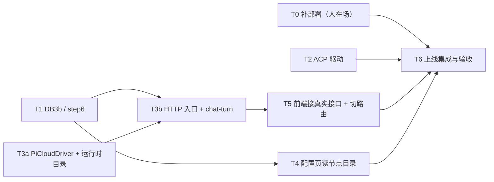

# 下一阶段剩余工作（R3 收尾：Chat 上线）

> 2026-11-24 · 2026-11-25 更新 · 状态：**T0～T5 与 step6 已完成，`0.5.0` 已合并进 `main`；T6 部分完成**。调度方式见 [orchestration.md](orchestration.md)。设计依据：[../modules/chat.md](../modules/chat.md)（第 5 节为已确认决定）、[db3b-chat-runtime-catalog.md](db3b-chat-runtime-catalog.md)、[../ACP-info.md](../ACP-info.md)。全部完成后结论并入模块文档，本文删除。

## 1. 已完成（截至 `0.5.0` 提交 `14c16e1`）

| 项 | 结果 |
| --- | --- |
| step5 线上数据库 | 已执行，README 9 项核对全部通过（Claude 只读核对） |
| R2 | `sense-console/src/harness` → `workers/agent/loop`，ESLint 边界规则两侧生效 |
| R3 回合内核 | `workers/agent/loop/chat`：`AgentSessionDriver`（已冻结）、事件与 parts、上下文与预算、`runChatTurn`；Gemini 交叉评审 9 项已修 |
| Chat UI | `sense-console/src/modules/chat`，Phase 1 + 2，已接真实节点传输（T5），`/chat`、`/h5/chat` 已切到新页面 |
| Pi 选型 | `@earendil-works/pi-*@1.5.2`，API 已复核（[pi-spike-result.md](pi-spike-result.md) 第 5 节） |
| T1 DB3b | 已合并（`61e4572`）：迁移、17 个 PGlite 用例、`0.5.0-step6.sql`（未上线） |
| T2 ACP 驱动 | 已合并（`162bccf`）：`@agentclientprotocol/sdk@2.6.0`，假 ACP Agent 29 个用例；真机未验证（本机有 `opencode` 2.4.1，无 `codex-acp`） |
| T5 前端切换 | 已合并（`fdea61f`）：真实传输 + 健康检查、以 `done` 为终止、错误码映射、按目录选节点、`runtime_config` 恢复；删除旧 Chat 页与 Vite `spawn` 桥（`dev/` 已删除）；Playwright 端到端（假 Supabase + 假节点）：`npx playwright test -c e2e/chat.playwright.config.ts` |
| T3b HTTP 入口 | 已合并（`9f915af`）：4 个端点、JWT 用 `getUser` 校验、用户身份 RPC、`node_claim_job`、SSE、CORS 白名单、限流；`chat-turn` 处理器与 3 个 MVP 工具；队列入口不认领 `chat_turn`；能力目录每 5 分钟上报。只用假驱动验证过 |
| T4 配置页 | 已合并（`9258edb`）：模型页、CLI 页只读展示节点上报的目录，与 Chat 的 Model Selector 共用 `listRuntimeCatalog`；`/__sense_bridge/env` 已删。控制台单元测试已与本机 `.env.local` 隔离（`894e53a`） |
| T3a Pi 驱动 | 已合并（`bc7bf72`）：`PiCloudDriver` + 运行时目录（`SENSE_API_RUNTIMES` / `SENSE_RUNTIME_<PROFILE>_*`）；未用真实 Key |

**线上现状（2026-11-25）**：0.5 控制台已部署到 `story.susense.cn`；step6 已执行（`20261127100000`，`node_*` = 15）；本机节点开启 HTTP 入口并上报 `api:qwen:qwen3.8-flash` 后，线上 Chat 已跑通两轮并落库（浏览器与节点在同一台机器，走 `http://localhost`）。读者站按用户决定暂不上线。库内快照未建立。

## 2. 依赖关系

第一波可同时开工：**T0、T1、T2、T3a、T4**（T4 按任务书的列定义先写，T1 合并后再接真实类型）。第二波：T1 与 T3a 合并后做 **T3b**；T3b 合并后做 **T5**；最后 **T6**。

## 3. 任务清单

每个任务都在自己的分支 / worktree 完成，交付时附 [parallel-plan.md](parallel-plan.md) 第 5 节格式的交付报告；门禁一律按 CLAUDE.md（涉及哪个项目就跑哪个项目的 typecheck / lint / test / build）。

### T0 · 补齐 step5 的部署（线上，需要人在场）

- **内容**：[brief-codex-wave2.md](brief-codex-wave2.md) 阶段 A：回答三个事实问题（备份是否做成、agent worker 运行的提交、视频 worker 在哪）；从 `0.5.0` 构建并部署控制台与读者站（自检：主 JS 含 `/work-items`、`/h5/chat`，不含 `content_projects`，自检失败即回滚）；用新代码重启两个 worker。
- **需要人**：部署凭据 / 方式；确认读者站域名。
- **完成标准**：线上控制台可登录并打开「事项」页；读者站首页 200；`runner_nodes.last_seen_at` 2 分钟内。
- **之后由人完成**：README「执行后验收」5 项（会真实发布文章，Agent 不代做），见 [../../supabase/release/README.md](../../supabase/release/README.md) 第 5 批。

### T1 · DB3b 迁移与 step6（仓库 + PGlite，不上线）

- **内容**：[db3b-chat-runtime-catalog.md](db3b-chat-runtime-catalog.md) 需求 0～6 全部；[brief-codex.md](brief-codex.md) 任务 B 的实现要点与测试清单；生成 `0.5.0-step6.sql`，step1～5 逐字节不变。
- **目录**：`supabase/migrations/`、`supabase/tests/db/`、`supabase/release/`、`testing/db/`。
- **完成标准**：任务书第 4 节 1～5 条全部有测试且通过；根目录门禁通过。

### T2 · ACP 驱动（R3.4）

- **内容**：[brief-codex-wave2.md](brief-codex-wave2.md) 阶段 C：`drivers/acp-driver.ts` + `drivers/acp-registry.ts`，严格按 `workers/agent/loop/chat/driver.ts` 规则 1～6 与 [../ACP-info.md](../ACP-info.md) 第 7 节；仓库内假 ACP Agent 覆盖全部协议路径；本机真机验证 `opencode`、`codex-acp`（未安装如实写未验证）。
- **目录**：`workers/agent/drivers/acp-*`、`workers/agent/drivers/testing/`；根 `package.json` 加 `@agentclientprotocol/sdk`（精确版本、发布满两周）。
- **不碰**：`workers/agent/loop/**`（接口问题写进报告）。

### T3a · `PiCloudDriver` 与运行时目录（不依赖 T1）

- **内容**：
  1. 根 `package.json` 加 `@earendil-works/pi-ai@1.5.2`、`@earendil-works/pi-agent-core@1.5.2`（精确版本）。
  2. `drivers/pi-cloud.ts` 实现 `AgentSessionDriver`：按 spike 第 5 节的 6 处 API 差异接线；`finishTurn` 做预算闸门（首个请求前先检查一次）；平台工具经 `host.executeTool`，**不用** `beforeToolCall` 做权限；Qwen 显式完整 `compat`；思考模型 `model.reasoning` 恒为 `true`；`stopReason = "aborted"` → `cancelled`；usage 换算 `costCents`（单价来自节点配置，无单价按 0 并标 `priced: false`）。
  3. 单测用**假 `streamFn`**（不需要真实 Key）覆盖：流式正文 / 思考、多轮工具、预算在第 2 轮截停且不重试、取消、上游报错。
  4. `workers/agent/runtime-registry.ts`：从环境变量读取多个 API Profile（命名约定写进 `workers/agent/README.md`），构造脱敏目录（chat.md 3.4 的 JSON 形状，含 `context_window` / `max_output_tokens` / `priced`），绝不含 Key；上报函数先写成接口 + 假实现，T1 合并后接 `node_report_capabilities`。
- **目录**：`workers/agent/drivers/pi-*`、`workers/agent/runtime-registry.ts`、`workers/agent/README.md`。

### T3b · HTTP 入口与 `chat-turn` 处理器（依赖 T1、T3a 合并）

- **内容**：按 chat.md 2.4「HTTP 接口约定 v1」与时序实现 `workers/agent/entry/http.ts`（4 个端点、JWT 验签、以用户身份调 `send_chat_message` / `regenerate_chat_turn`、`node_claim_job` 认领、SSE 线格式与 15 秒 ping、CORS 白名单、每用户并发 / 速率限制、权限回答端点）；`workers/agent/handlers/chat-turn.ts`（`node_chat_context` → `buildChatContext` → `runChatTurn`，端口接 `node_record_step` / `node_append_chat_message(p_finish)` / 心跳续租与 `cancel_requested_at`；3 个 MVP 工具以用户身份调用对应 RPC）；`runner.ts` 整理为 `entry/queue.ts`，`p_job_types` 不含 `chat_turn`；`main.ts` 同时启动两个入口；节点启动与定时上报 `node_report_capabilities`。
- **测试**：PGlite + 假驱动的 HTTP 集成测试（发送、重新生成、单活跃回合 409、断开不取消、停止、权限往返、`persist_failed`）。
- **T1～T3a 交付后定下的约定（必须遵守）**：
  - 数据库错误映射：`SQLSTATE 23505` 且 hint 为 `turn_in_progress` → `409 turn_in_progress`；`node_claim_job` 返回 `null` → `409 claim_failed`；`42501` → `403 forbidden`。
  - `node_chat_context` 返回 `{ turn, session, messages, work_item, documents }`；`node_append_chat_message`（9 参）返回 `{ message_id, seq, status, job_status, existing }`，`existing: true` 视为成功。
  - `budget_cents`、`max_rounds` 放在 `send_chat_message` / `regenerate_chat_turn` 的 `p_runtime` 里传，数据库会夹紧。
  - **重新生成走 ACP 时**：先让 `acp-registry` 关闭该会话的子进程，并以 `execSession: null` 运行，否则 CLI 会在保留了旧回复的上下文上继续（T2 报告）。
  - 驱动选择：`api:*` 经 `runtime-registry.createDriver`；`acp:*` 经 `drivers/acp-config.ts` + `acp-registry`。
  - 真正的 `CapabilityReporter` 调 `node_report_capabilities`，并填 `supports_http_sse: true` 与 `http_endpoint_hint`（来自 HTTP 入口的公开地址配置）；节点启动时上报一次，之后定时刷新。
- **目录**：`workers/agent/entry/`、`workers/agent/handlers/chat-turn*`、`workers/agent/main.ts`、`workers/agent/backends/`。

### T4 · 配置页改读节点目录（R3.5 前半）

- **内容**：[brief-codex-wave2.md](brief-codex-wave2.md) 阶段 D：模型页、CLI 页改读在线节点的 `capabilities.runtimes`，不再写 `.env.local`；只删 `/__sense_bridge/env`。复用 `sense-console/src/modules/chat/services/runtime-catalog-service.ts` 的读取逻辑，不另写一套。
- **目录**：两个页面、相关 service、`dev/local-bridge-plugin.ts`。

### T5 · 前端接真实接口并切换路由（依赖 T3b）

- **内容**：`http-transport` 接所选节点；Model Selector 读真实目录；按 chat.md 2.4 结束规则以 `done` 为终止事件；`/chat`、`/h5/chat` 切到新 `ChatPage`（在 `RequireAuth` 内），删除 `/chat-next` 与旧 `chat-assistant-page.tsx`、`local-bridge-service.ts`、`dev/local-bridge-plugin.ts` 的 `/__sense_bridge/chat`；Playwright 用本地假节点跑一条端到端（发送、停止、重新生成、刷新后历史仍在）。
- **目录**：`sense-console/src/modules/chat/**`、`App.tsx`、旧页面与 bridge 文件、`sense-console/e2e/`。

### T6 · 上线集成与验收（需要人）

1. ~~人确认后执行 `0.5.0-step6.sql`~~（2026-11-25 已执行并核对）。
2. 部署带 HTTP 端口的 `workers/agent`：本机节点走隧道或云端容器，配 HTTPS 与 CORS；`runner_nodes.capabilities` 能看到目录。
3. 用真实 Key 在 `@earendil-works/pi-*@1.5.2` 上重跑 spike 的 5 项（`deepseek-chat`、`deepseek-reasoner`、`qwen3.8-flash`），结果补进 [pi-spike-result.md](pi-spike-result.md) 第 5 节。
4. 部署新控制台，人在线上走一遍：发消息流式回复、停止、重新生成、`/capture`、`@` 引用、刷新后历史仍在、H5。
5. 收尾文档：结论并入 `docs/modules/chat.md` 与 `docs/status.md`，删除 `docs/tasks/` 下已完成的过程文档。

第 2 步目前只做到本机：节点监听 `127.0.0.1:8787`，只有同一台机器的浏览器能用；公网方式、生产 CORS、ACP 真机仍待定。第 4 步由用户在线上完整验收。

## 4. 需要人做的事（汇总）

| 时机 | 事项 |
| --- | --- |
| T0 | 部署凭据 / 方式、读者站域名；部署后走 README 5 项验收 |
| T2 | 本机是否安装 `opencode`、`codex-acp`（决定能否真机验证） |
| T6 | 批准执行 step6；HTTP 节点的公网方式（隧道或云端）；提供可用的模型 Key（当前百炼 Key 免费额度已用完，`.env.local` 旧 Key 已被封，建议删除） |

## 5. 再下一阶段：打磨优化（2026-11-25 用户确定）

0.5.0 合并进 `main` 后，下一阶段以打磨与优化为主，不再做大的结构调整。已确定的一项需求：

- **部署与启停用命令完成**：为 `workers/agent`（以及 `workers/video`）提供简单的命令来启动、停止、查看状态与日志，例如 `npm run node:start | node:stop | node:status | node:logs`；自动从 worker 的环境文件加载变量（不打印），记录 PID 与日志位置，重复启动时给出提示。控制台、读者站的构建与发布也收敛为一条命令。**暂不做常驻后台**（不配 launchd / 开机自启）。

