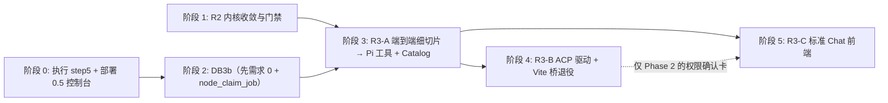

# R1 → R3 断层分析与可执行任务计划

> 2026-11-24 · 基于仓库代码实际审计（commit `7cfecfb` 及工作区现有迁移）整理。明确拆分已完成基线、当前 6 大断层、分阶段可执行任务与验证门禁。相关设计见 [../architecture.md](../architecture.md)、[../modules/chat.md](../modules/chat.md) 与 [db3b-chat-runtime-catalog.md](db3b-chat-runtime-catalog.md)。

## 1. 当前基线（事实）

- **已完成**：
  - **R0（文档整合）** 与 **R1（根目录按职责拆分）**：`supabase/`、`workers/`、`testing/` 已迁至根目录，IM 适配器只保留 `supabase/functions/_shared/im`。
  - **DB0 ～ DB2c-3**：已推线上至 `20261125100000_ai_direct_draft`，`runner_nodes` 与 12 个 `node_*` RPC 已运行。
  - **DB3/DB4/DB5/退役（代码已就绪）**：已合并为 `supabase/release/0.5.0-step5.sql`，待 Codex 推线上并同步部署新版静态控制台与读者站。
- **尚未开始**：**R2**（内核归位 `workers/agent/loop` 与 import 门禁）、**DB3b**（Chat 增强字段与能力目录增量迁移）、**R3**（Pi 精简 MVP 内核、ACP 驱动、HTTP/SSE 入口、标准 Chat UI）。

---

## 2. R1 → R3 六大断层全景（基于仓库代码实测）

| # | 断层名称 | 实测代码事实 | 影响与风险 |
| --- | --- | --- | --- |
| 1 | **worker 反向依赖前端目录（R2 未完成）** | `workers/agent/` 下 10+ 源码与测试文件（`backend.ts`、`config.ts`、`context.ts`、`runner.ts`、`job-handlers.ts`、`video-storyboard.ts`、`drivers/*`、`backends/*`、`demo/*`）以及 `workers/agent/Dockerfile`（`COPY sense-console/src/{harness,contracts}`）仍在跨边界引用 `sense-console` | 架构边界未闭环，无 ESLint 拦截，部署打包强耦合 |
| 2 | **`contracts/` 与 `harness/` 混合归属** | `sense-console/src/contracts/agent-job.ts`、`content.ts`、`work-item.ts`、`video-studio.ts` 被大量前端页面/服务用于展示；而 `sense-console/src/harness/*`（除浏览器端过渡 `agent-harness-service.ts` 与 `chat-assistant-page.tsx` 外）实质全属于 Agent 运行时内核；`workers/agent/video-storyboard.ts` 还直接引用了 `VideoPlanDraftSchema` 与 `checkStoryboardSop`，`demo-scenario.ts` 引用了 `mapAgentJobStep` / `summarizeJobUsage` | 若直接整目录暴力搬迁会打断前端编译，必须先做精确拆分 |
| 3 | **模型配置割裂且只支持单模型** | 控制台 `models-integration-page.tsx` 写 `sense-console/.env.local`；而 `workers/agent/config.ts` 只读进程环境中的单一 `SENSE_LLM_*` 与 `SENSE_EVAL_LLM_*`；`runner_nodes` 无 `capabilities` 字段 | 前端 `Model Selector` 无法获知节点可用 API 模型与本机 CLI，也无法按会话动态选模型 |
| 4 | **API 执行引擎为手写非流式单跳** | `workers/agent/drivers/cloud-llm.ts` 直接 `fetch('/chat/completions')` 且硬编码 `stream: false`，不支持 `tools` 循环与思考流；当前 `/chat` 甚至没有服务端循环 | 无法满足标准 Chat 的流式、Tool Calling 与多步 Agent 行为 |
| 5 | **两套割裂的一次性 CLI `spawn`** | `sense-console/dev/local-bridge-plugin.ts`（仅 Vite dev）与 `workers/agent/drivers/cli-driver.ts` 各自维护白名单和 `spawn`，均为无状态单次退出读取 | 生产不可用，无多轮会话、无流式进度、无 `request_permission` 权限交互 |
| 6 | **纯队列轮询 vs HTTP/SSE 入口** | `workers/agent` 当前只有 `runner.ts` 队列轮询；`/chat` 没有生产级 HTTP/SSE 入口，也无按 `target_node_id` 认领与立即认领机制 | 对话响应无法秒级流式首字输出 |

---

## 3. 分阶段可执行任务计划



> 注：阶段 1（R2，纯代码结构调整）与阶段 2（DB3b，数据库增量任务）**互不依赖、可并行推进**；阶段 3 起依赖两者的产物。
>
> **评审修订**：
> 1. **补上阶段 0**：DB3b 建在 DB3 的表上，而 DB3 还在未执行的 `0.5.0-step5.sql` 里；且 step5 会删 V1 旧表，必须紧接着部署 0.5 控制台（见 [../status.md](../status.md)）。这是整条线的真正第一步。
> 2. **R3-C 不必等 R3-B**：Chat 前端 Phase 1（会话、流式正文、Model Selector）只依赖 R3-A 的 SSE 协议；只有 Phase 2 的 ACP 权限确认卡需要 R3-B。原图的 `R3B --> R3C` 实线会让前端白等。
> 3. **R3-A 先做「端到端细切片」再加功能**：最大的未知是 HTTP 入口 + 用户 JWT + `node_claim_job` + 租约 + SSE + 落库这条链路本身，而不是 Pi 或工具。先用**单一模型、纯文本流式、无工具、无目录**打通「浏览器 → http.ts → 数据库 → 模型 → SSE → 落库 → 刷新可见」，再叠加工具循环、多模型目录与 ACP。

### 阶段 0：执行最终批次并部署 0.5（评审新增）

- 由 Codex 执行 `supabase/release/0.5.0-step5.sql`，紧接着部署 0.5 控制台与读者站（V1 控制台会在 step5 后失效）；
- 按 [../status.md](../status.md) 补做真实 IM、云端账号浏览器 E2E 验收。之后 DB3b 才有可以叠加的线上基线。

### 阶段 1：R2 — 内核迁入 `workers/agent/loop` 与边界门禁

- **Task R2.1：精确拆分契约与迁移纯逻辑内核**
  - 将 `sense-console/src/harness/`（`context-pack.ts`、`injection.ts`、`job-store.ts`、`llm.ts`、`llm-evaluator.ts`、`loop-controller.ts`、`mandate.ts`、`precheck.ts`、`providers.ts`、`index.ts`）迁入 `workers/agent/loop/`；
  - 从 `sense-console/src/contracts/agent-harness.ts` 拆分运行时类型（`SafeContextPack`、`DraftEvaluationReport`、`ExecutionDriverMode`、`CloudModelProviderKey`、`LocalAgentCliKey` 等）进 `workers/agent/loop/types.ts`（纯接口类型）；前端页面 `task-detail-page.tsx` 等改用轻量展示型契约或接口返回类型（保留 `sense-console/src/contracts/` 中的纯前端 UI 领域契约，如 `agent-job.ts`、`work-item.ts`、`content.ts` 等，或将 `VideoPlanDraftSchema`/`checkStoryboardSop` 这类双向契约同步抽离或放在单向边界内）；
  - 梳理 `sense-console/src/services/agent-harness-service.ts`、`chat-assistant-page.tsx` 与 `knowledge-base-service.ts` 对 `@/harness/*` 的调用：除前端展示所需常量（如模型/CLI 静态元数据或 Mandate UX 提示）外，消除浏览器对 Agent Loop 运行时代码的引用；
  - 梳理 `workers/agent/demo/demo-scenario.ts` 对 `agent-job.ts` 的引用（将步骤汇总逻辑独立至 `workers/agent/loop/` 或测试辅助，切断 `workers/` 对 `sense-console/` 的最后一条引用）。
- **Task R2.2：更新构建配置与 ESLint 强制门禁**
  - 更新 `workers/agent/` 全部 import 路径、`workers/agent/Dockerfile`、`tsconfig.json`；
  - 在根目录 `eslint.config.js` 增加 `no-restricted-imports`：禁止 `workers/**` 导入 `sense-console/**`，禁止 `workers/agent/loop/**` 导入 `../drivers/*`、`../entry/*` 或读取 `process.env`；
  - 在 `sense-console/eslint.config.js` 增加 `no-restricted-imports`：禁止 `sense-console/**` 导入 `workers/**` 或 Node 内置模块（`dev/` 与 `e2e/` 除外）。
- **Task R2.3：R2 门禁验收**
  - 运行仓库根全套门禁 + `sense-console` 全套门禁 + `sense-site` 全套门禁，全部通过后才算 R2 闭环。

### 阶段 2：DB3b — 数据库增量迁移（外部数据库任务执行）

- 作为独立批次 `0.5.0-step6.sql`（已确认，不重新生成 step5），按 [db3b-chat-runtime-catalog.md](db3b-chat-runtime-catalog.md) 评审并实施：
  - **需求 0：会话单活跃回合、`reply_to_message_id`、助手消息按任务幂等、`chat_turn` 的 `max_attempts = 1` 与 `max_rounds`**（评审新增，R3-A 细切片的硬前置）
  - **`node_claim_job` 按 id 原子认领 + 未认领 `chat_turn` 过期清理**（评审由「建议」改为必做）
  - `chat_messages.parts` & `status`
  - `chat_sessions.runtime_config`
  - `send_chat_message` 扩展 & `regenerate_chat_turn`
  - `node_chat_context` & `node_append_chat_message` 扩展
  - `runner_nodes.capabilities` & `node_report_capabilities` & `node_claim` 定向认领支持（以及建议的 `node_claim_job` 原子认领）

### 阶段 3：R3-A — Pi 精简 MVP 内核 + Runtime Catalog + HTTP/SSE 入口

- **Task R3.0（评审新增）：端到端细切片**
  - Pi spike：用真实 Key 验证各厂商流式文本 / 思考字段 / 工具调用的解析（见 [../modules/chat.md](../modules/chat.md) 4.2），只保留通过的厂商；
  - `entry/http.ts` 只实现 `POST /v1/chat/turns`：JWT 验签 → 以用户身份 `send_chat_message` → `node_claim_job` → `PiCloudDriver` 单模型纯文本流式 → `node_append_chat_message(p_finish)`，时序按 [../modules/chat.md](../modules/chat.md) 2.4；
  - 前端临时在现有 `/chat` 页接一个最简 fetch-SSE 消费，验证刷新后历史仍在、停止生成能落 `cancelled`、SSE 断开但未取消时回复仍完整落库；
  - 通过后再进入 R3.1～R3.3。
- **Task R3.1：引入 Pi 精简内核与多模型注册表（`workers/agent/drivers/`）**
  - 根目录 `package.json` 以**精确版本**引入 `@mariozechner/pi-ai` 与 `@mariozechner/pi-agent-core`；
  - 新建 `workers/agent/drivers/pi-cloud.ts`：基于 `pi-ai` 封装多厂商 OpenAI-compatible `Model<'openai-completions'>`，实现流式 `AgentSessionDriver`（基于 `pi-agent-core` `agentLoop` 输出流式文本、思考与工具调用事件）。**评审修订**：R3-A 不同时替换出稿用的 `LlmClient`（`cloud-llm.ts` 保持不动），待 Chat 稳定后单独一步迁移并对比出稿结果；
  - 新建 `workers/agent/runtime-registry.ts`：从环境变量（支持多厂商数组配置）与本机探测构建 `RuntimeCatalog`，并在节点启动及定时刷新时调用 `node_report_capabilities` 上报脱敏目录（绝不上报任何 Key）。
- **Task R3.2：统一 `chat-turn` 纯逻辑控制器与最小业务工具集（`workers/agent/loop/` & `handlers/`）**
  - 在 `workers/agent/loop/` 定义 `AgentSessionDriver` 接口与标准 `ChatStreamEvent`；
  - 新建 `workers/agent/handlers/chat-turn.ts`：加载 `node_chat_context`，拼接 `SafeContextPack` 与最近历史消息，执行预算/取消控制，挂载 MVP 3 个最小工具（`capture_intake`、`read_work_item`、`enqueue_content_draft`），结束时调用 `node_append_chat_message` 落库 `parts`、`content`、`exec_session` 并记录 `agent_job_steps` 用量；
  - 工具为写死的函数白名单，模型拿不到用户 JWT；加单测枚举工具清单，确保不存在批准 / 发布 / 通用 RPC 类工具（见 [../modules/chat.md](../modules/chat.md) 2.5）；
  - 取消只认 `cancel_requested_at`（心跳）与同节点内的显式停止请求，**SSE 断开不中止回合**；
  - 费用与上下文预算按 [../modules/chat.md](../modules/chat.md) 2.6：每次模型调用前核对 `budget_cents`，超出以 `budget_exceeded` 落库；上下文组装放在 `loop/`（纯逻辑、可用假模型单测），按 `context_window` 与字符估算做 token 截断，单测覆盖「超长单条首尾截断」「历史从新到旧填充」「系统指令与本轮消息永不丢弃」。
- **Task R3.3：拆分 `entry/queue.ts` 与新建 `entry/http.ts`**
  - 将 `workers/agent/runner.ts` 认领主循环整理为 `workers/agent/entry/queue.ts`（`p_job_types` 不含 `chat_turn`）；
  - 新建 `workers/agent/entry/http.ts`：校验浏览器 `Authorization: Bearer <Supabase JWT>`（通过 Supabase Auth 验签并确认当前用户权属），在一次请求内代用户写消息、`node_claim_job` 认领并以 `text/event-stream` 推送 SSE；另提供 `regenerate` 与 `permissions/{request_id}` 回传端点；CORS 白名单、每用户并发 / 速率限制、15 秒 `: ping` 保活；
  - 新增 `workers/agent/handlers/chat-turn.test.ts` 与 HTTP SSE 集成测试（假模型测试，不花真实费用）。

### 阶段 4：R3-B — 本地 CLI ACP 接入与 Vite 本地桥退役

- **Task R3.4：实现 `AcpSessionDriver`**
  - 根目录引入 `@agentclientprotocol/sdk`；
  - 新建 `workers/agent/drivers/acp-driver.ts`：实现 `initialize` → `session/new` / `session/load`（复用 `chat_sessions.exec_session`）→ `session/prompt` → `session/update` 事件映射 → `session/cancel`；
  - 严格执行 [../ACP-info.md](../ACP-info.md) 第 7 节安全约束（`CLI_ENV_ALLOWLIST`、隔离 `cwd` + CLI 自身最严沙箱档位、不声明宿主 `fs`/`terminal` 能力、`session/request_permission` 默认转前端确认卡、超时即拒绝、子进程生命周期与并发上限）；
  - 首批在真实本机环境中至少验证 1 个原生 ACP（推荐 `opencode`）或 `codex-acp`；现有 `CliLlmClient`（`codex exec`）保留作非 ACP 后台批处理兜底。
- **Task R3.5：下线 Vite 本地桥 `spawn` 与改造系统配置页**
  - 删除 `sense-console/dev/local-bridge-plugin.ts` 的 `/__sense_bridge/chat` 与 `/__sense_bridge/env` 桥接路由及 `local-bridge-service.ts` 对应的开发期 `spawn` 调用（若保留开发期环境自检仅保留只读状态提示）；
  - 更新 `models-integration-page.tsx` 与 `cli-agents-page.tsx`：改为实时展示在线 `runner_nodes` 上报的 `capabilities` 与运行节点部署配置引导，不再向 Vite 写 `.env.local`。

### 阶段 5：R3-C — 标准 Chat 前端入口（Base UI + AI Elements）

- **Task R3.6：建立 `sense-console/src/modules/chat/` 服务与状态层**
  - 会话 CRUD Service（直连 Supabase RLS + `cancel_agent_job`；发送与重新生成走所选节点的 HTTP 入口，不再由前端直接调 `send_chat_message`）；
  - Slash 命令 `/capture` `/draft` `/storyboard` `/work` `/clear` 由前端直接调对应 RPC，不经过模型（见 [../modules/chat.md](../modules/chat.md) 2.2）；
  - SSE 流式消费 Hook（`fetch` + `ReadableStream`，不用 `EventSource`；支持流式拼接 `parts`、客户端取消、对 `running` 回合的 Realtime / 轮询兜底、读取 `runner_nodes.capabilities` 构建 `Model Selector` 数据源）。
- **Task R3.7：落地 Phase 1 UI（`/chat` 与 `/h5/chat`）**
  - 按 [../conventions/frontend.md](../conventions/frontend.md) 第 5 节组装：会话管理侧栏（桌面侧栏 / H5 Drawer）+ `MessageScroller` + `Message`/`Bubble`（安全 Markdown）+ `Prompt Input`（Slash 命令、快捷芯片、`@` 上下文引用、停止按钮）+ `Model Selector`（节点分组、API/CLI、思考强度）。
- **Task R3.8：落地 Phase 2/3 UI 与测试验收**
  - 接入 `Reasoning`、`Plan`、`Task`、`Questionnaire`（权限确认 / Agent 反问）与 `Stack Trace`（报错折叠）；
  - 补齐组件单测（`vitest`）与 Playwright E2E（模拟 SSE 流、会话持久化、重新生成、模型切换）。

---

## 4. 阶段门禁与验证命令

每个阶段结束必须全量跑通（不跳过）：

```bash
# 仓库根（workers + 数据库 + testing）
npm run typecheck && npm run lint && npm test
npm run test:video-worker
npm run demo:harness && npm run demo:capture && npm run demo:video

# 控制台与读者站
npm --prefix sense-console run typecheck && npm --prefix sense-console run lint
npm --prefix sense-console run test && npm --prefix sense-console run build
npm --prefix sense-site run typecheck && npm --prefix sense-site run lint
npm --prefix sense-site run test && npm --prefix sense-site run build
```
